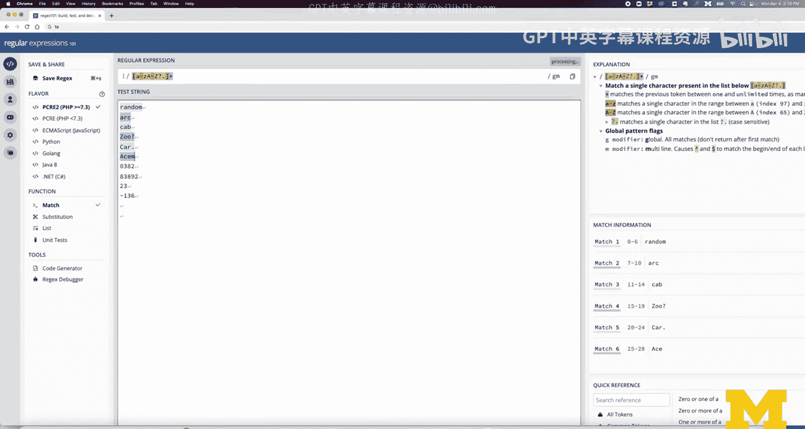

# 37：字符范围匹配

在本节课中，我们将学习正则表达式中一个非常实用的功能：字符范围匹配。通过使用方括号 `[]`，我们可以指定一组字符，让正则表达式匹配其中的任意一个。这极大地增强了模式匹配的灵活性。

## 匹配指定字符集合

上一节我们介绍了基础的模式匹配，本节中我们来看看如何使用方括号来定义一个字符集合。在方括号内列出字符，意味着匹配其中任意一个字符。

例如，模式 `[AC]+` 表示匹配一个或多个由字母 `A` 或 `C` 组成的序列。

以下是该模式的一些匹配示例：
*   `CA`
*   `AC`
*   `AAA`
*   `CCC`

该模式不会匹配包含 `A` 或 `C` 之外字符的字符串，例如 `ABC` 或 `CAT`。

## 匹配字符范围

除了列出每个字符，我们还可以使用连字符 `-` 在方括号内定义一个连续的字符范围。这可以简化对一系列字符的匹配。

例如，模式 `[A-C]+` 表示匹配一个或多个从 `A` 到 `C` 的字母（即 `A`、`B` 或 `C`）。因此，它会匹配 `cab`，因为 `c`、`a`、`b` 都在 `a` 到 `c` 的范围内。

我们也可以定义更常见的范围，例如：
*   `[a-z]+`：匹配一个或多个小写字母。
*   `[A-Z]+`：匹配一个或多个大写字母。

需要注意的是，`[a-z]` 只匹配小写字母，不会匹配大写字母 `A`。

## 组合多个字符范围

在一个方括号内，我们可以组合多个字符范围，从而匹配更广泛的字符集合。

例如，模式 `[A-Za-z]+` 表示匹配一个或多个大写或小写字母。这个模式可以匹配像 `Hello` 这样的单词。

## 方括号内的特殊字符

在方括号内部，大多数正则表达式的特殊字符（如 `.` 或 `?`）会失去其特殊含义，仅代表字符本身。

这意味着：
*   模式 `[.?]` 只会匹配字面的句点 `.` 或问号 `?`，而不会像外面的 `.` 那样匹配任意字符。
*   因此，`[.?]` 可以匹配字符串 `"whoop."` 中的最后一个句点，但不会匹配其中的 `o` 或 `p`。

## 使用量词

与之前学习的模式一样，我们可以在包含字符集合或范围的方括号后面加上量词，来指定需要匹配的次数。

例如：
*   `[AC]{3}`：精确匹配由 `A` 或 `C` 组成的 3 个字符序列，如 `"ACA"`。
*   `[0-9]*`：匹配零个或多个数字。
*   `[A-Za-z]?`：匹配零个或一个字母。

## 总结

本节课中我们一起学习了正则表达式中字符范围匹配的用法。关键点在于使用方括号 `[]` 来定义一个字符集合，匹配其中的任意一个字符。我们可以直接列出字符，也可以用连字符 `-` 定义范围，还可以组合多个范围。需要注意的是，在方括号内，特殊字符通常只表示其字面含义。最后，我们可以在方括号外使用量词来控制匹配的字符数量。掌握这个功能能让你更精确、更灵活地定义想要查找的文本模式。