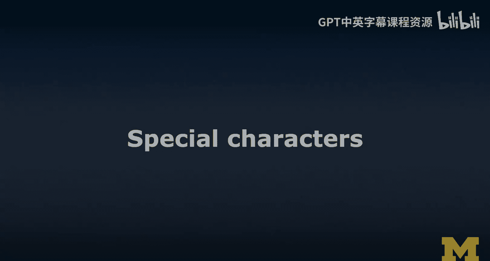
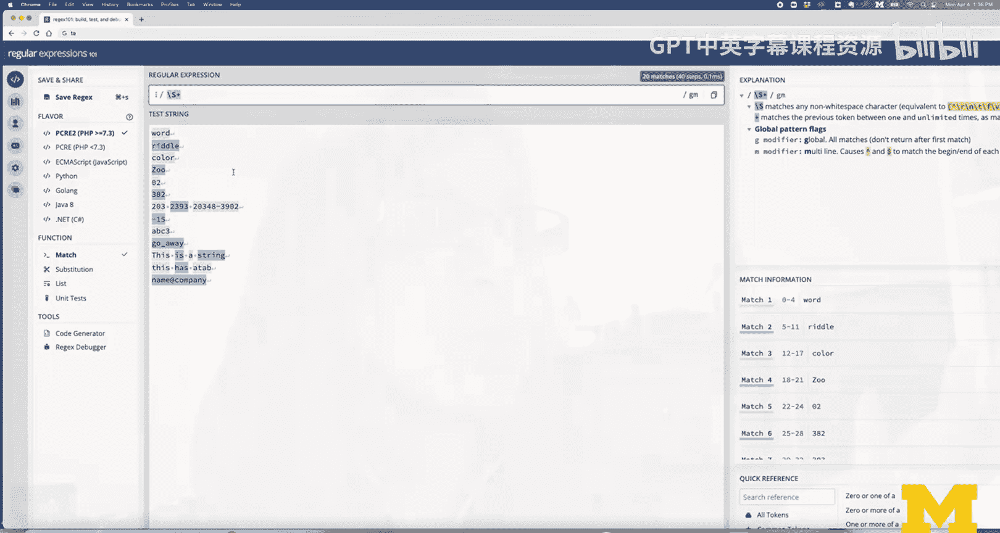
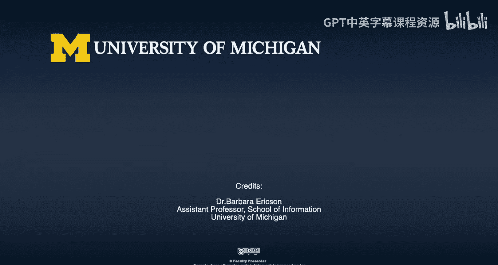

# 38：特殊字符处理 🧩

在本节课中，我们将学习正则表达式中的特殊字符。特殊字符拥有特定的匹配功能，例如匹配数字、字母或空白。理解这些字符是掌握正则表达式的关键。

上一节我们介绍了使用点号`.`作为通配符。本节中我们来看看其他以反斜杠`\`开头的特殊字符。

## 特殊字符 `\d`：匹配数字

`\d` 是一个特殊字符，它匹配任何数字，即从 0 到 9 的任意一个值。

**代码示例**：`\d`

请注意，它不匹配负数前的减号，也不匹配数字前的其他字符，但它会匹配所有数字。

## 特殊字符 `\w`：匹配字母数字字符

`\w` 是另一个特殊字符，它匹配字母数字字符。这意味着它匹配所有小写字母 a 到 z、大写字母 A 到 Z、数字 0 到 9 以及下划线 `_`。

**代码示例**：`\w`

例如，它会匹配大写字母 Z 和下划线，但不会匹配像 `&` 这样的符号。

## 特殊字符 `\s`：匹配空白字符

`\s` 用于匹配空白字符，例如空格、制表符等。

**代码示例**：`\s`

它会匹配字符串中单词之间的空格，但不会匹配其他字符。

## 对应的大写字符：取反匹配

此外，这些特殊字符还有对应的大写版本，它们的功能是相反的。

以下是这些大写版本字符的说明：

*   `\D`：匹配任何**非数字**字符。
*   `\W`：匹配任何**非字母数字**字符（即不属于 `\w` 范围的字符）。例如，它会匹配 `&` 符号。
*   `\S`：匹配任何**非空白**字符。

本节课中我们一起学习了正则表达式的几组核心特殊字符：用于匹配数字的 `\d`、匹配字母数字的 `\w`、匹配空白字符的 `\s`，以及它们对应的取反版本 `\D`、`\W` 和 `\S`。掌握这些字符能帮助你更精确地定义文本匹配模式。