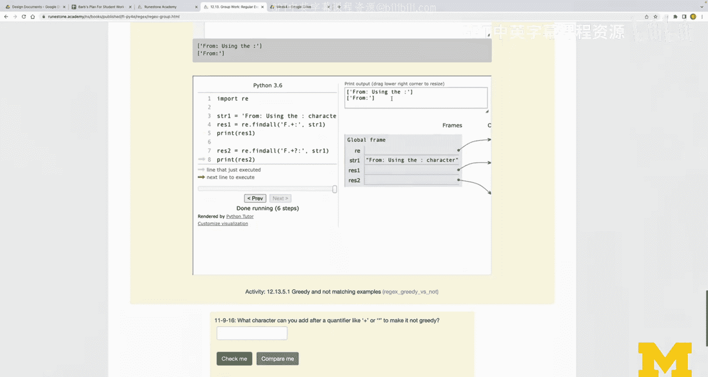

# 40：贪婪与非贪婪匹配 🧐

在本节课中，我们将要学习正则表达式中一个非常重要的概念：**贪婪匹配**与**非贪婪匹配**。理解这两种匹配模式的区别，能帮助我们更精确地从文本中提取所需内容。


---


## 默认行为：贪婪匹配

首先，我们需要了解正则表达式的默认匹配行为是**贪婪的**。这意味着，当使用像 `+` 或 `*` 这样的量词时，正则表达式引擎会尝试匹配**尽可能多**的字符。

让我们通过一个具体的代码示例来理解这一点。

```python
import re

# 示例字符串，其中包含两个冒号
text = "From: user@example.com: This is a sample text"
```

在上面的字符串中，我们有两个冒号。现在，我们使用正则表达式 `F.+:` 进行匹配。这个模式的意思是：寻找字母 `F`，然后匹配**一个或多个任意字符**（`.` 表示任意字符，`+` 表示一个或多个），最后匹配一个冒号 `:`。

由于默认是贪婪匹配，`.+` 会尽可能多地匹配字符，直到字符串的末尾，然后**回溯**以满足最后一个冒号 `:` 的条件。因此，它会匹配到第二个冒号为止。

```python
# 贪婪匹配示例
pattern_greedy = r'F.+:'
result_greedy = re.findall(pattern_greedy, text)
print(result_greedy)  # 输出: ['From: user@example.com:']
```

如你所见，匹配结果是从第一个 `F` 开始，一直到字符串中的**第二个冒号**结束。这就是贪婪匹配的效果。

---

## 如何实现非贪婪匹配

上一节我们介绍了贪婪匹配的默认行为，本节中我们来看看如何改变这种行为，实现**非贪婪匹配**（也称为“懒惰匹配”）。

非贪婪匹配的目的是让量词匹配**尽可能少**的字符。实现方法非常简单：只需在量词（如 `+`、`*`、`?`、`{m,n}`）后面加上一个**问号 `?`**。

以下是修改后的非贪婪匹配模式：

```python
# 非贪婪匹配示例
pattern_non_greedy = r'F.+?:'
result_non_greedy = re.findall(pattern_non_greedy, text)
print(result_non_greedy)  # 输出: ['From:']
```

在这个模式 `F.+?:` 中，`+?` 组合表示“匹配一个或多个任意字符，但尽可能少地匹配”。因此，引擎在找到第一个满足条件的冒号 `:` 后就会停止，最终只匹配到 `"From:"`。

---

## 核心要点总结

以下是贪婪与非贪婪匹配的核心区别和用法：

*   **贪婪匹配**是默认行为。量词会尝试匹配**尽可能长**的字符串。
    *   公式表示：`量词`（如 `+`, `*`）
*   **非贪婪匹配**需要显式指定。在量词后添加 `?` 使其匹配**尽可能短**的字符串。
    *   公式表示：`量词?`（如 `+?`, `*?`）
*   选择哪种模式取决于你的需求：如果你想获取一个大块文本中最后一个分隔符之前的所有内容，使用贪婪匹配；如果你想获取第一个分隔符之前的内容，则使用非贪婪匹配。



---


本节课中我们一起学习了正则表达式中贪婪与非贪婪匹配的关键区别。记住，**默认是贪婪的**，当你需要更精确、更小范围的匹配时，别忘了在量词后面加上 `?` 来启用非贪婪模式。通过灵活运用这两种模式，你可以更有效地控制和提取文本数据。