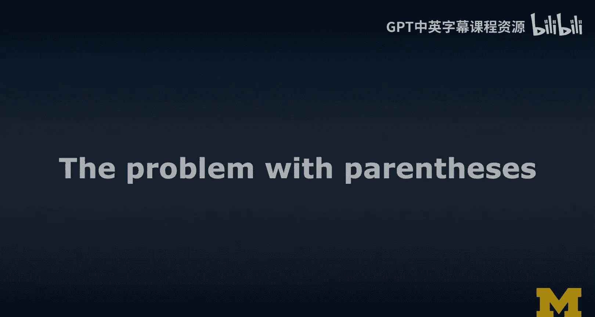
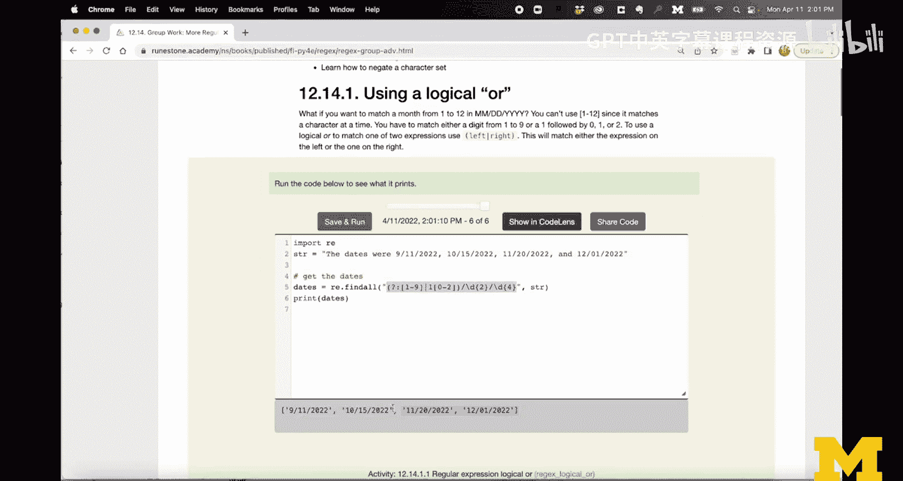

# 创造性编程：129：正则表达式中括号的使用问题 🧩




在本节课程中，我们将探讨在正则表达式中使用逻辑“或”运算符 `|` 时，括号 `()` 可能带来的一个常见问题。我们将学习为什么括号有时会改变匹配结果，以及如何通过两种不同的方法来解决这个问题。

---

上一节我们介绍了正则表达式的基本匹配。本节中我们来看看当我们在逻辑“或”运算中使用括号时会发生什么。

当我们使用逻辑“或” `|` 时，我们经常将左右两侧的条件用括号括起来。但这样做会发生什么？

观察以下正则表达式：它试图匹配“1-9”或者“10-12”，后面跟着一个斜杠 `/`，然后是两位数的日期 `\d\d`，再一个斜杠，最后是四位数的年份 `\d\d\d\d`。

```python
pattern = r‘(1[0-2]|[1-9])/\d\d/\d\d\d\d‘
```

如果我们运行这个模式，会发现返回的结果仅仅是括号内的内容，例如 `‘10‘` 或 `‘9‘`，而不是完整的日期。这是因为在正则表达式中，括号 `()` 默认表示一个**捕获组**。引擎看到括号，就认为你只想提取括号内的部分。

---

为了解决这个问题，我们有两种主要方法。

**方法一：将整个表达式包裹在括号中**
我们可以给整个表达式外加一层括号，使其成为一个大的捕获组。

```python
pattern = r‘((1[0-2]|[1-9])/\d\d/\d\d\d\d)‘
```

这样做会使整个日期成为一个匹配组。但此时，我们得到的结果会是一个元组列表。在每个元组中，第一个元素是整个匹配项，第二个元素是内层括号（原始括号）的匹配项。如果你有更多层括号，就会得到更多元素。

以下是处理这种结果的示例：
```python
import re
matches = re.findall(pattern, text)
for match in matches:
    full_date = match[0] # 提取整个日期
    print(full_date)
```

**方法二：使用非捕获组**
另一种更优雅的解决方法是告诉正则表达式引擎：这些括号仅用于分组逻辑，而不是为了捕获匹配内容。我们可以使用 `(?: ... )` 语法来创建**非捕获组**。

```python
pattern = r‘(?:1[0-2]|[1-9])/\d\d/\d\d\d\d‘
```

通过这种方式，我们得到了完整的日期匹配，而不会意外地只捕获月份部分。引擎会忽略 `(?: )` 内的内容作为一个独立的结果返回。



---


本节课中我们一起学习了正则表达式中括号的双重角色：逻辑分组和捕获组。我们看到了默认的捕获行为如何导致意外的匹配结果，并掌握了两种应对策略：一是接受嵌套捕获组并处理其结果结构，二是使用非捕获组 `(?: )` 来纯粹进行逻辑分组。理解这一区别对于编写准确、高效的正则表达式至关重要。