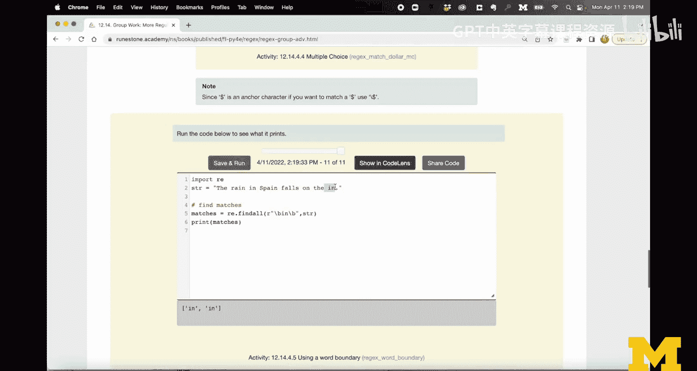

# 创造性编程：42：锚点应用解析 🔍


在本节课中，我们将学习正则表达式中的“锚点”或“边界”字符。这些特殊字符允许我们精确地指定匹配模式在字符串中出现的位置，例如只在开头、结尾，或者作为独立的单词出现。

上一节我们介绍了正则表达式的基本模式匹配，本节中我们来看看如何控制匹配发生的位置。

---

## 匹配字符串开头：`^` 符号

`^` 符号（脱字符）用于确保匹配只发生在字符串的开头。

观察以下字符串和模式：
- 模式：`r'^FROM: [A-Za-z0-9_]+'`
- 目标字符串包含多个“FROM:”，但只有位于字符串开头的那个会被匹配。

```python
import re
text = "FROM: Sender FROM: AnotherSender"
pattern = r'^FROM: [A-Za-z0-9_]+'
matches = re.findall(pattern, text)
print(matches)  # 输出: ['FROM: Sender']
```

如果去掉 `^`，模式 `r'FROM: [A-Za-z0-9_]+'` 则会匹配字符串中所有出现的“FROM:”。

因此，当你只想匹配出现在字符串开头的模式时，请使用 `^`。

---

## 匹配字符串结尾：`$` 符号

`$` 符号用于确保匹配只发生在字符串的结尾。

观察以下示例：
- 模式：`r'\d+\.\d{2}$'`
- 此模式匹配一个或多个数字，后跟一个点，再跟两位数字，并且整个序列必须位于字符串的末尾。

```python
text = "Price 12.99 and 45.50"
pattern = r'\d+\.\d{2}$'
matches = re.findall(pattern, text)
print(matches)  # 输出: ['45.50']
```

如果去掉 `$`，模式 `r'\d+\.\d{2}'` 则会匹配字符串中所有符合该格式的数字序列。

**注意**：由于 `$` 本身是特殊字符，如果你想匹配字面意义上的美元符号，需要使用反斜杠进行转义：`\$`。

---

## 匹配单词边界：`\b` 符号

有时我们需要匹配一个完整的单词，而不是它作为其他单词一部分的情况。使用空格来界定并不总是可靠，因为单词可能以标点结尾。

这时可以使用单词边界锚点 `\b`。它匹配单词字符（字母、数字、下划线）和非单词字符之间的位置。

观察以下示例：
- 模式：`r'\bin\b'`
- 此模式匹配独立的单词“in”，而不会匹配“inside”或“pin”中的“in”。

```python
text = "in the beginning. inside the box. pin it."
pattern = r'\bin\b'
matches = re.findall(pattern, text)
print(matches)  # 输出: ['in']
```

**注意**：由于 `\b` 在普通字符串中代表退格键，在定义正则表达式模式时，应使用原始字符串（`r'...'`）来避免转义问题。

以下是使用这些锚点字符的要点总结：

- **`^`**： 匹配字符串的开头。
- **`$`**： 匹配字符串的结尾。
- **`\b`**： 匹配单词的边界。



---


本节课中我们一起学习了正则表达式的三个核心锚点字符：`^`、`$` 和 `\b`。它们通过控制匹配发生的位置，极大地增强了模式匹配的精确性。掌握这些锚点，能帮助你更有效地进行文本搜索和数据提取。