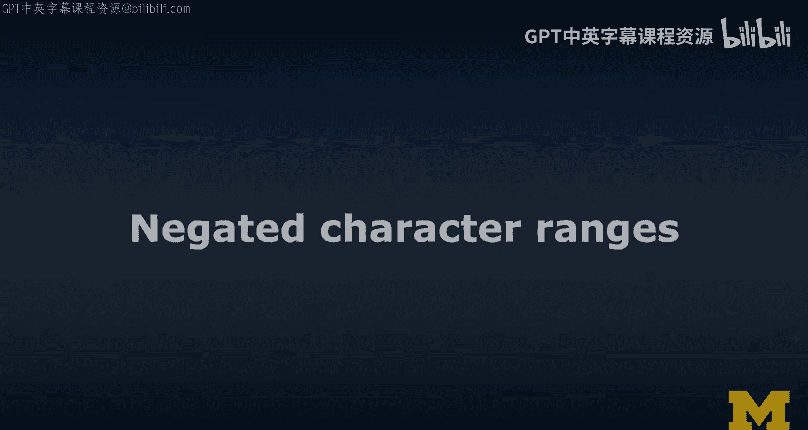
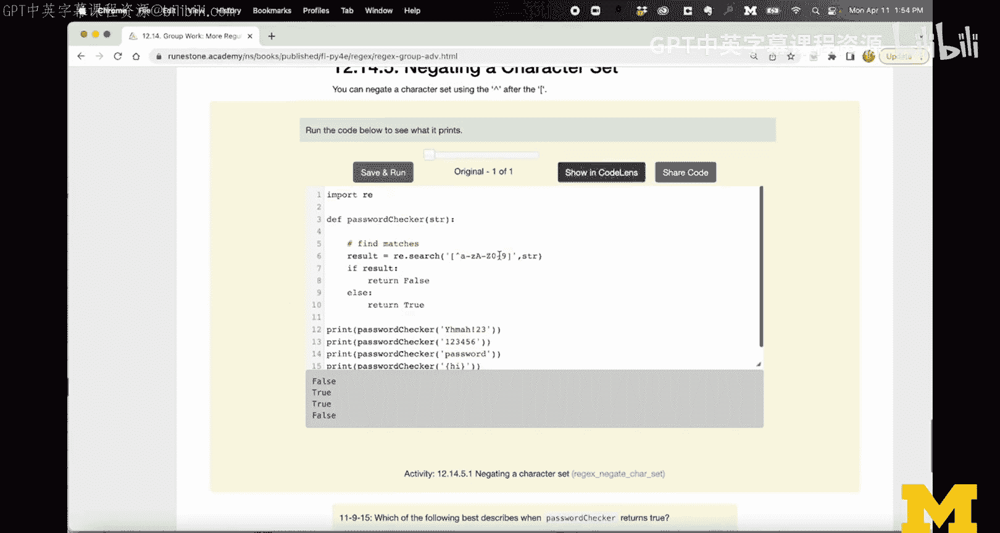
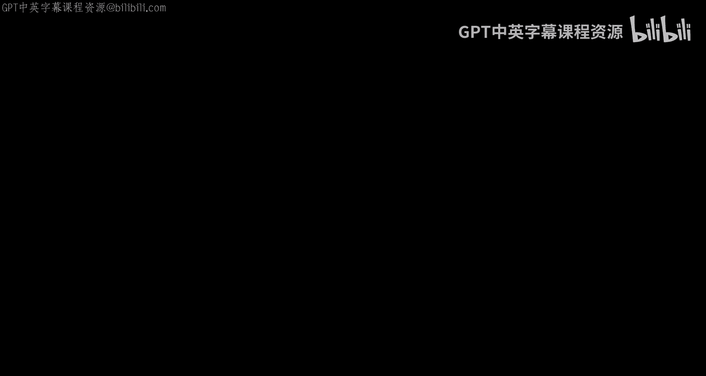

# 43：否定字符范围 🚫


在本节课中，我们将学习如何在正则表达式中使用否定字符范围。这是一种强大的技巧，用于匹配“除了指定字符之外”的任何字符。



上一节我们介绍了如何使用方括号 `[]` 来定义字符范围。本节中我们来看看如何**否定**一个字符范围，即匹配所有**不在**该范围内的字符。

## 核心概念：否定字符范围

否定字符范围通过在方括号内的**开头**添加一个脱字符 `^` 来实现。其基本语法如下：

`[^...]`

这个模式会匹配任何**不**出现在 `...` 所定义字符集合中的单个字符。

## 应用实例：密码验证

一个常见的应用场景是验证密码的合法性。例如，假设我们要求密码只能包含以下字符：
*   小写字母 a-z
*   大写字母 A-Z
*   数字 0-9

我们的目标是检查密码中是否含有**除此之外**的任何字符（如特殊符号 `@`、`#`、`$` 或空格等）。

以下是实现此逻辑的思路：
1.  使用否定字符范围 `[^a-zA-Z0-9]` 来搜索任何“非字母数字”的字符。
2.  如果在字符串中找到了这样的字符，说明密码非法。
3.  如果没找到，则密码合法。

用伪代码可以表示为：
```python
if re.search('[^a-zA-Z0-9]', password):
    return False  # 密码包含非法字符
else:
    return True   # 密码合法
```



## 语法要点总结



以下是关于否定字符范围的关键点：
*   脱字符 `^` 必须紧跟在左方括号 `[` 之后，即 `[^`。
*   它否定的是**整个**方括号内定义的字符集合。
*   它仍然只匹配**一个**字符位置，除非与量词（如 `*` 或 `+`）结合使用。


本节课中我们一起学习了正则表达式中否定字符范围 `[^...]` 的用法。通过这个技巧，我们可以方便地检查字符串中是否包含不被允许的字符，这在数据验证和清洗任务中非常实用。记住，`^` 在方括号内开头位置时，功能是“取反”，这与它在方括号外表示“字符串开头”的含义完全不同。