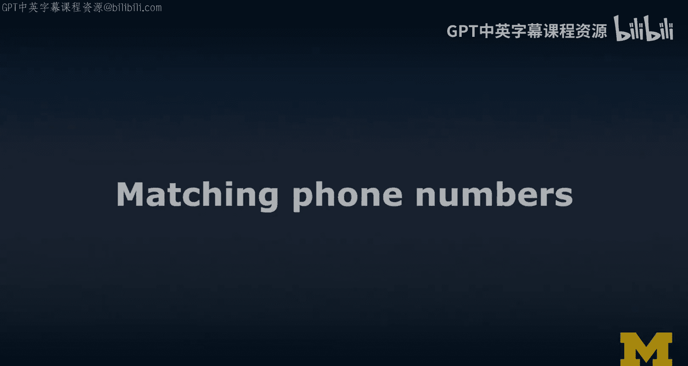
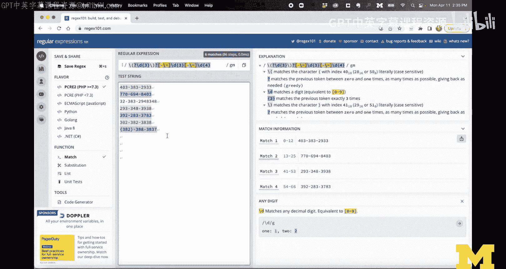

# 正则表达式教程：第44章：电话号码匹配实践 📞




在本节课中，我们将学习如何使用正则表达式来匹配电话号码。电话号码的格式通常包含数字和分隔符，我们将逐步构建一个能够灵活匹配多种常见格式的正则表达式。

## 电话号码的基本模式

一个典型的美国电话号码格式包含三组数字：前三位、中间三位和最后四位，通常由连字符或空格分隔。例如：`123-456-7890`。

上一节我们介绍了正则表达式的基本元字符，本节中我们来看看如何将它们组合起来匹配具体的模式。

## 构建匹配模式

以下是构建电话号码匹配模式的核心步骤：

1.  **匹配数字**：使用 `\d` 或 `[0-9]` 来匹配单个数字。
2.  **指定数量**：使用花括号 `{n}` 来指定需要匹配的数字个数。
3.  **匹配分隔符**：电话号码中的分隔符通常是连字符 `-` 或空格。

根据以上概念，一个匹配 `123-456-7890` 格式的初始正则表达式可以写成：
```regex
\d{3}-\d{3}-\d{4}
```
或者
```regex
[0-9]{3}-[0-9]{3}-[0-9]{4}
```

这个模式会精确匹配上述格式，如果数字位数过多或过少，或者缺少连字符，则无法匹配。

## 处理可选的分隔符

然而，电话号码并不总是使用连字符。有时人们会用空格分隔，或者混合使用连字符和空格。因此，我们需要让分隔符变得可选。

我们可以使用方括号 `[]` 来定义一个字符集，匹配其中任意一个字符。为了匹配一个连字符或一个空格，模式可以写成 `[- ]`。需要注意的是，在方括号内，连字符 `-` 通常表示一个范围（如 `[a-z]`），因此为了将其作为普通字符处理，有时需要对其进行转义，写成 `[\- ]`。

以下是更新后的模式，允许分隔符是连字符或空格：
```regex
\d{3}[- ]\d{3}[- ]\d{4}
```

现在，这个模式可以匹配 `123-456-7890`、`123 456 7890`，甚至是 `123-456 7890` 这样的混合格式。

## 处理可选的括号

有时，电话号码的前三位数字会被括号括起来，例如 `(123) 456-7890`。但括号并不是必须的。

在正则表达式中，圆括号 `()` 有特殊含义，它们用于定义捕获组。为了匹配字面意义上的括号，我们需要使用反斜杠进行转义：`\(` 和 `\)`。

为了让括号成为可选项，我们可以在其后面加上问号 `?`，这表示前面的元素出现零次或一次。

以下是最终的模式，它允许电话号码的开头有可选的括号：
```regex
\(?\d{3}\)?[- ]\d{3}[- ]\d{4}
```

这个模式现在可以成功匹配多种格式：
*   `123-456-7890`
*   `123 456 7890`
*   `(123) 456-7890`
*   `(123)456-7890`

## 实践建议



在构建复杂的正则表达式时，建议从一个简单的、能匹配最小核心模式的表达式开始。然后，逐步添加功能，并频繁使用像 [RegEx 101](https://regex101.com/) 这样的在线工具进行测试，确保每一步的修改都按预期工作。


本节课中我们一起学习了如何构建一个灵活的电话号码匹配正则表达式。我们从匹配固定格式开始，逐步引入了对可选分隔符（连字符或空格）和可选括号的支持。关键点在于理解如何使用字符集 `[]` 匹配多个选项，以及如何使用转义字符 `\` 和量词 `?` 来处理具有特殊含义的字符和可选元素。通过这种渐进式的构建和测试方法，你可以创建出强大且适应性强的模式来匹配各种文本数据。