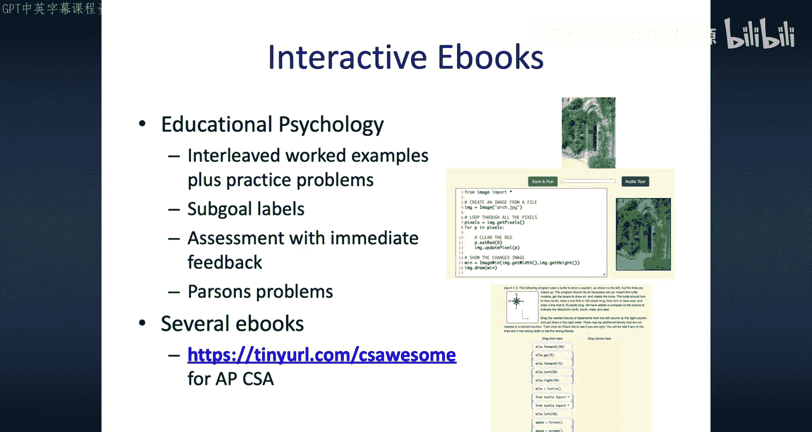
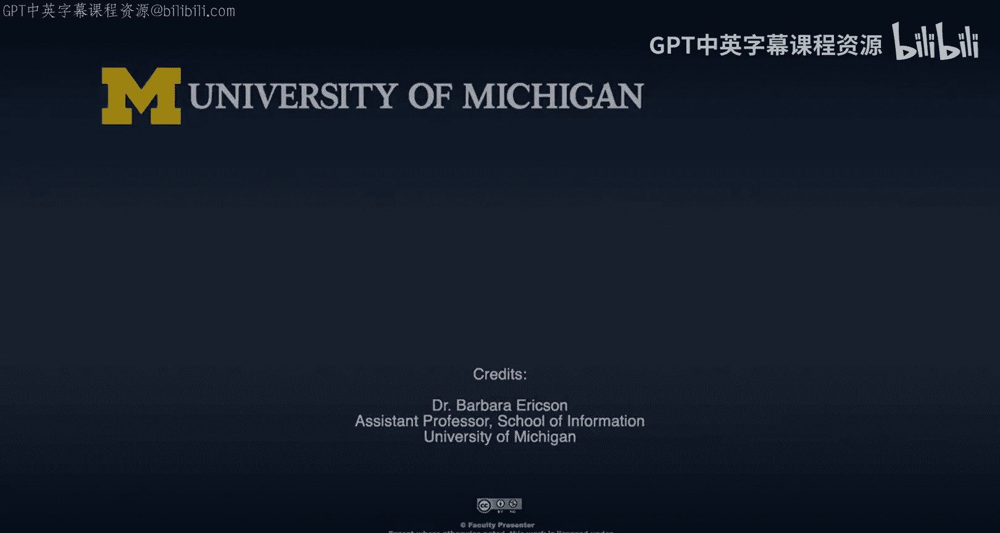

# 创造性编程：0：遇见Barb Ericson博士 👩‍🏫

在本节课中，我们将通过Barb Ericson博士的自我介绍，了解她的学术与职业背景，以及她为计算机科学教育所做的贡献。

## 个人背景介绍

Barb Ericson博士是密歇根大学信息学院的助理教授。她担任此教职已有三年，但其在计算机科学领域的经验远不止于此。

## 教育与早期职业选择

她的高中职业规划曾是在兽医和律师之间选择。她热爱动物，同时也在高中参加过辩论队。后来，她获得了底特律市中心的韦恩州立大学的奖学金。由于该校没有兽医学院，她决定主修政治学，并考虑将来就读法学院。为了增加选择，她决定攻读双学位。

以下是她在高中时期接触编程的经历：
*   她在高中时曾学习过一门使用BASIC语言的编程课程，当时使用的是电传打字机。
*   她觉得编程很有趣，因此决定将计算机科学作为她的第二专业。

最终，她发现自己更喜欢计算机科学。通过几次实习，她确认了自己对此领域的热情，并决定坚持走下去。她于1983年获得了韦恩州立大学的理学学士学位。

## 职业生涯发展

上一节我们介绍了Barb Ericson博士的教育背景，本节中我们来看看她丰富的职业生涯。

她的第一份工作是在通用汽车研究实验室。起初她在计算机机房工作，后来负责支持使用3D图形软件包的人员。

之后，她转到贝尔通信研究所，从事了大量数据库相关工作。公司资助她在密歇根大学攻读硕士学位。在此期间，她做了许多关于双音多频信号输入和语音合成输出的工作，旨在帮助电话维修人员。她曾跟随维修人员实地考察，以了解他们如何使用她开发的软件。

接着，她回到通用汽车研究实验室，开发了帮助设计师从油泥模型中创建3D数学模型的软件。汽车设计师会先用油泥雕塑出汽车模型。她在此主要从事用户界面设计和3D图形方面的工作。

随后，她先后在造纸科学技术研究所和克拉克亚特兰大大学工作。在克拉克亚特兰大大学，她参与了一个有趣的项目，旨在利用人工智能帮助医生在X光片中检测肿块等异常。

这项工作又引领她与NCR公司合作，研究基于案例的推理技术，应用于中风和脑肿瘤的诊断，试图用人工智能辅助医生进行诊断。

后来，她在佐治亚理工学院工作了很长时间，担任讲师和计算推广主任，并最终在那里获得了博士学位。

## 教育推广与贡献

在获得博士学位前后，Barb Ericson博士投入了大量精力进行教育推广工作。

她为教师举办了大量研讨会，帮助他们学习如何教授计算机科学。她还为学生组织了许多夏令营，并协助修订了佐治亚州的课程。

其中，她最为人所知的工作之一是与她的丈夫Mark Guzdial博士合作编写关于“媒体计算”的书籍。这是一种通过编写程序来操作媒体（如图片中的像素、声音中的样本、视频中的帧）来教授计算的方法。

作为推广人员，她还与学生，特别是低龄学生，开展了许多活动。例如，他们举办了计算夏令营、与青年服务组织合作的研讨会、小学周末项目等。此外，她还领导了一个名为“Rise Up for CS”或“Sisters Rise Up for CS”的项目，旨在帮助来自代表性不足群体的学生在高中AP计算机科学课程中取得成功。

## 近期研究方向与教学理念

获得博士学位后，她近期专注于交互式电子书的研究与开发，本课程中你们将会使用到这些电子书。

这些电子书基于教育心理学的原则设计。核心理念是：通过“示例+练习”的模式可以更好地学习。因此，她的电子书包含了交互式分步示例和带有子目标标签的练习。子目标标签是一种试图将代码抽象到更高层次的注释。

书中提供了大量不同类型的练习题，并能即时给出反馈，这对学习很有帮助。她特别研究的一类问题是“代码排序题”，即给出解决一个问题的正确代码块，但顺序被打乱，学习者需要将其拖拽到正确的顺序。

她已创建了多本交互式电子书，你们将在本课程中使用其中一本。

## 总结

本节课中我们一起学习了Barb Ericson博士从学生到教育者的历程，了解了她在工业界的丰富实践、对计算机科学教育的热情投入，以及她基于教育心理学原理开发交互式电子书的教学创新。她的经历展示了计算机科学应用的广泛性和教育工作的多样性。