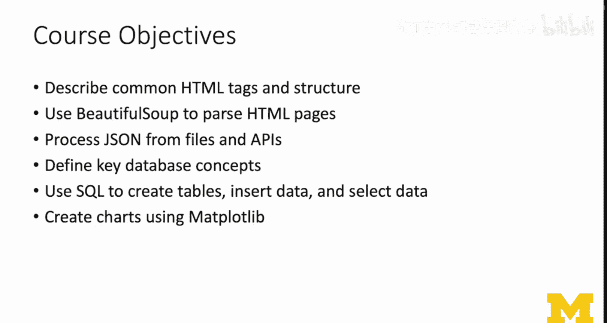
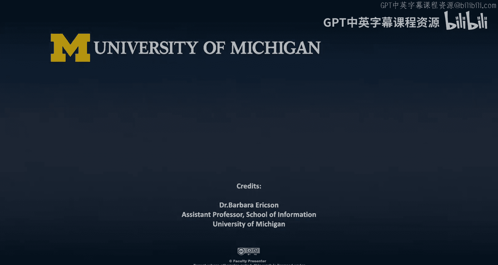

# 1：欢迎来到本课程 🎉

在本课程中，我们将学习如何从网络获取数据、处理数据、将其存储到数据库，并最终通过图表来分析和理解数据。

## 课程概述

我们将从网络数据的基础开始。网络页面主要由HTML构成，这是一种用于创建网页的标准标记语言。您将学习HTML的基本结构、常见标签以及它们之间的关系。

接下来，我们将介绍如何使用Beautiful Soup库来解析HTML页面，从而精确地提取您需要的信息。此外，我们还将处理来自文件和API的JSON数据，这是一种轻量级的数据交换格式。

掌握了数据获取与解析后，我们将进入数据库部分。您将学习关键的数据库概念，包括如何创建规范化的数据表，以及如何向表中插入数据和从表中查询数据。

最后，我们将利用处理好的数据，使用图表库（如Matplotlib）来创建可视化图表，帮助我们更直观地理解数据背后的模式和趋势。

以下是本课程将涵盖的核心主题列表：

*   **HTML基础**：学习网页的构成元素——HTML（超文本标记语言），了解其常见标签和结构关系。
*   **数据解析**：使用Beautiful Soup解析HTML页面，精准提取目标数据。
*   **JSON处理**：学习如何处理来自文件和API的JSON格式数据。
*   **数据库操作**：掌握核心数据库概念，学习创建规范化表、插入及查询数据。
*   **数据可视化**：使用图表库（如`matplotlib`）基于数据创建图表，进行数据分析。

## 总结

本节课我们一起了解了本课程的整体框架和学习目标。我们从网络数据的源头HTML讲起，到数据的解析、存储，最终落脚于数据的可视化呈现。在接下来的章节中，我们将逐一深入这些主题，带领您从零开始，逐步掌握用Python进行创造性数据处理的全套技能。