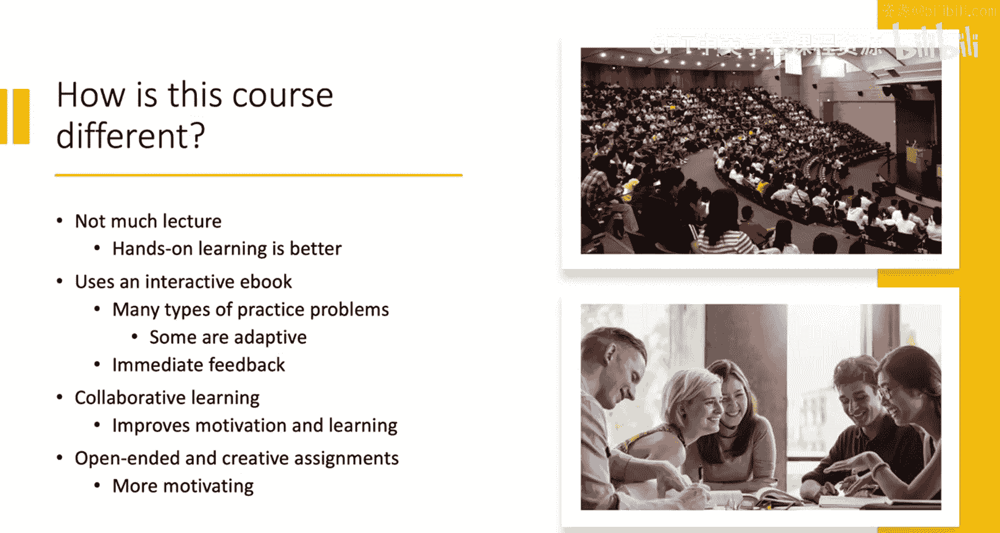
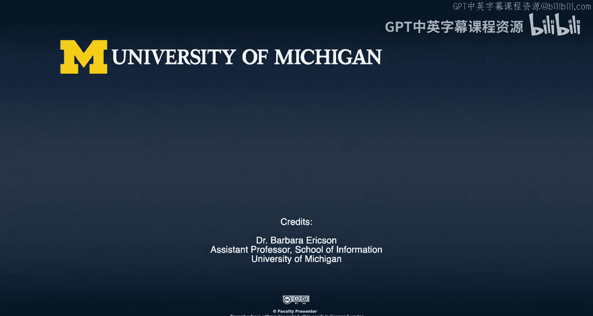

# 2：本课程的独特之处 🎨

在本节课中，我们将了解这门课程与其他在线课程的不同之处，以及它如何通过实践、协作和创意项目来帮助你学习编程。

欢迎来到这门课程。它将与许多在线课程不同，不会包含大量讲座，而是更侧重于动手实践学习。

我们将鼓励你与他人合作，进行小组学习，因为这能提升你的学习效果和动力。人类是社会性生物，我们可以通过观察他人和与他人讨论来学习。电子书中包含大量互动练习，并且如果你需要复习，可以随时返回前面的章节或完成更多练习题。其中一些练习题是自适应的，这意味着它们会帮助你真正找到正确的解决方案。

## 创意与实践作业 ✨

上一节我们介绍了课程的实践与协作特色，本节中我们来看看具体的作业形式。

除了常见的编程入门练习，这门课程还包含开放式编辑和创意作业。常见的入门编程练习通常是计算销售税或将摄氏温度转换为华氏温度。而在这门课程中，你将绘制艺术作品或创作个性化的故事。希望这能让你感觉更有趣，并激发你的学习动力。

以下是课程作业的几个核心特点：
*   **实践导向**：课程强调动手操作，而非单纯听讲。
*   **协作学习**：鼓励小组合作，通过观察和讨论共同进步。
*   **自适应练习**：练习题能引导你找到正确答案，巩固学习。
*   **创意项目**：作业内容围绕艺术创作和故事叙述，更具趣味性和激励性。

本节课中我们一起学习了这门课程的独特教学理念。它通过强调动手实践、鼓励小组协作、提供自适应练习以及设计富有创意的项目，旨在为你提供一个更引人入胜且高效的学习体验。