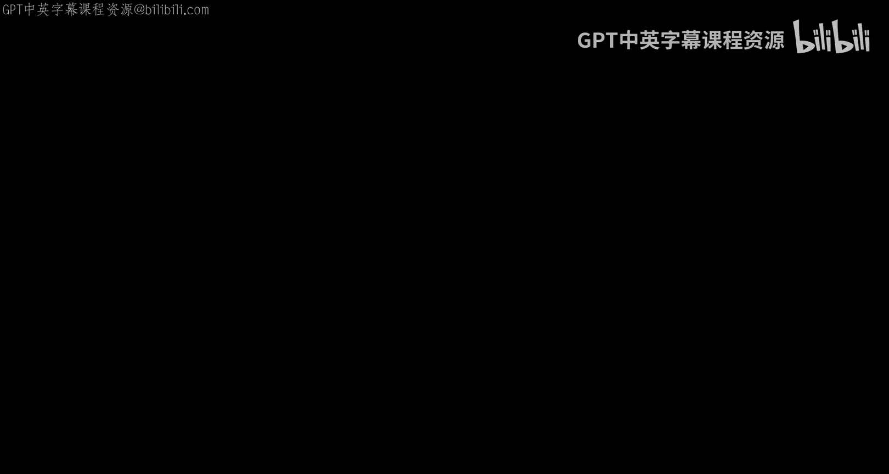
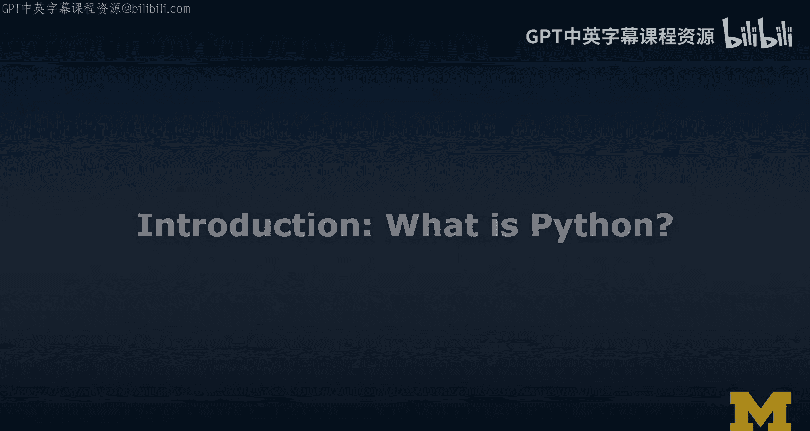
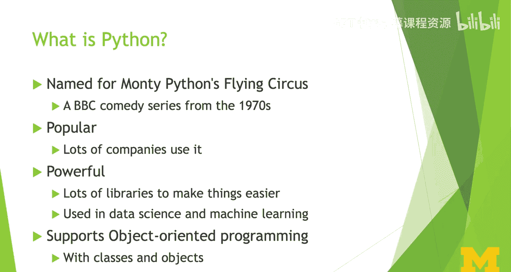
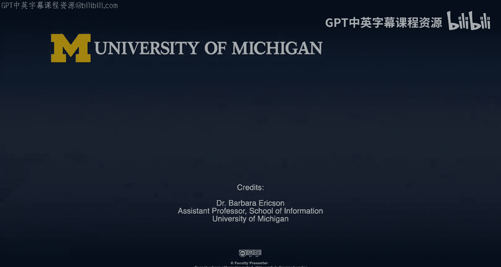

# 密歇根大学《创造性编程》： 1.3： Python是什么 🐍





在本节课中，我们将要学习Python编程语言的基本概念，了解它的起源、特点以及为什么它在当今如此流行。

大家好，我是Barbar Erickson。我是信息学院的助理教授。我很高兴能带领大家开启学习Python的旅程。

那么，Python到底是什么？它是一条巨蟒吗？不，Python是以《蒙提·派森的飞行马戏团》命名的。这是一部20世纪70年代的BBC喜剧系列。如果你没看过，可以去看看。

Python是一门非常流行的编程语言，许多公司都在使用它。它之所以流行，部分原因在于它非常强大。有大量的库可以让编程变得更简单，它被广泛应用于数据科学和机器学习领域。

与许多其他文本编程语言相比，Python也相对更容易学习。它还支持面向对象编程，这是当今人们开发程序最常用的方式。这意味着它支持“类”（即事物的分类）和实际执行程序工作的“对象”。

上一节我们了解了Python的命名由来和基本定位，本节中我们来看看它的核心特性。

以下是Python的几个关键特点：

*   **强大且功能丰富**：拥有大量库，简化开发。
*   **应用领域广泛**：尤其在数据科学和机器学习中占据重要地位。
*   **易于学习**：语法相对简洁明了。
*   **支持面向对象编程（OOP）**：这是现代软件开发的主流范式。

面向对象编程的核心概念可以用以下方式描述：

*   **类（Class）**：是创建对象的蓝图或模板，定义了对象的属性和方法。例如，可以定义一个“汽车”类。
    ```python
    class Car:
        def __init__(self, brand, color):
            self.brand = brand  # 属性
            self.color = color  # 属性
    ```
*   **对象（Object）**：是类的实例，是根据类创建出来的具体实体。例如，根据“汽车”类创建一辆红色的特斯拉。
    ```python
    my_car = Car("Tesla", "red")  # my_car 是一个对象
    ```



所以，让我们开始吧。




本节课中我们一起学习了Python的起源、它作为一门流行编程语言的特点，以及其核心的面向对象编程概念。Python因其强大、易学和广泛的应用而成为入门和进阶开发的优秀选择。