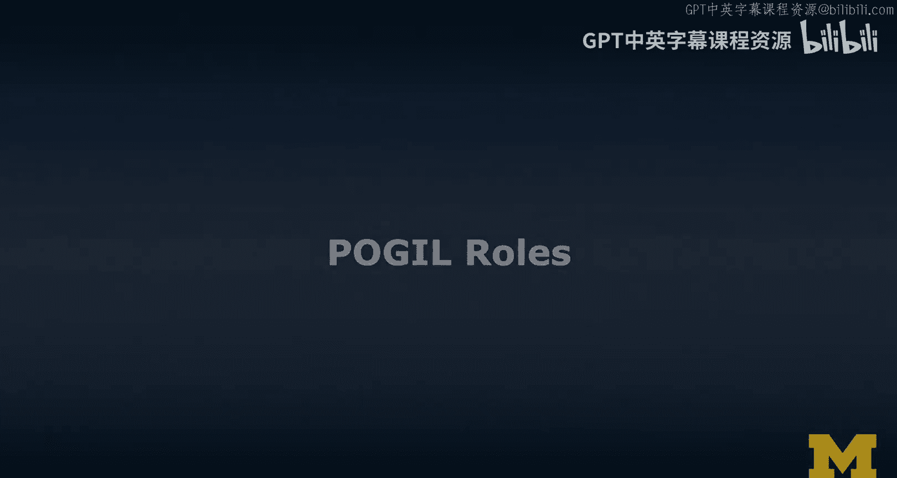
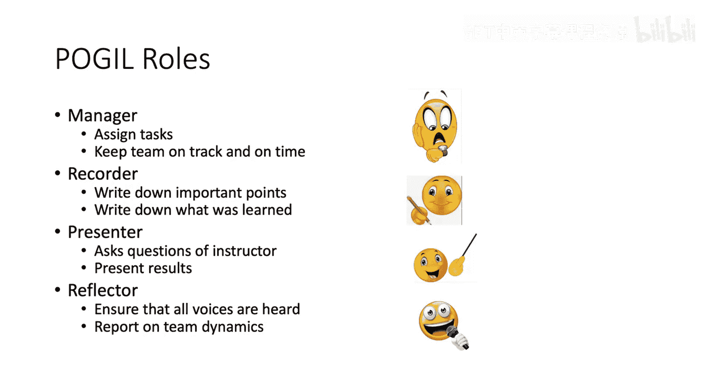
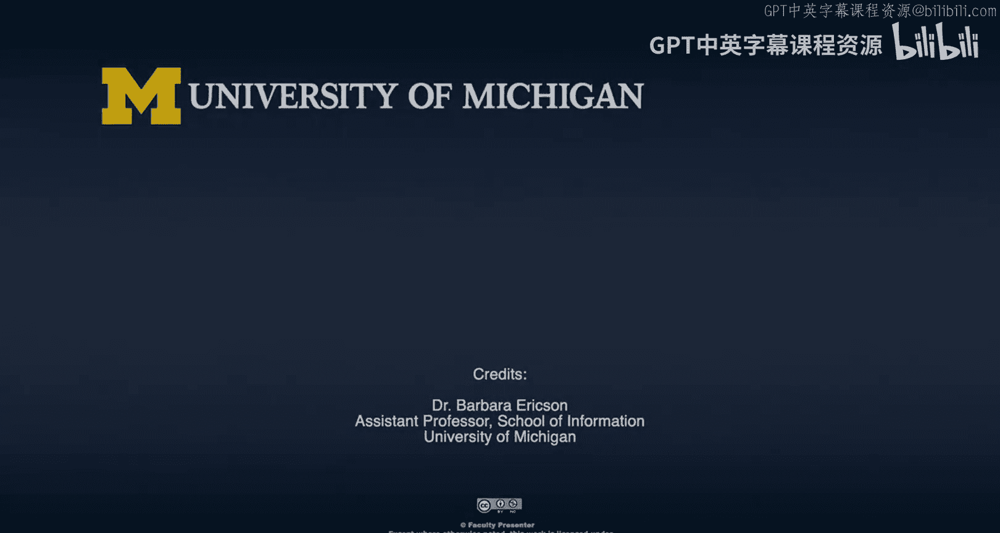

# 5：POGIL角色解析 🧩

在本节课中，我们将学习一种名为POGIL的协作学习方法，并详细解析其团队中的四个核心角色。理解这些角色有助于在小组编程项目中更高效、更有组织地工作。

---

## 什么是POGIL？🤔

上一节我们介绍了小组协作的重要性，本节中我们来看看POGIL的具体含义。POGIL代表**过程导向的引导式探究学习**。在这种模式下，小组成员共同工作，但每位成员都承担一个被明确定义的角色。

## POGIL的四个核心角色 👥

以下是POGIL活动中通常包含的四个角色及其职责。

1.  **管理者**
    *   为组内成员分配任务。
    *   确保整个团队按计划、按时完成任务。
    *   在团队遇到困难时，鼓励大家继续前进或调整方向。

2.  **记录员**
    *   负责记录讨论中的重要观点。
    *   写下团队所学到的知识或达成的结论。

3.  **汇报者**
    *   当对任务说明有不清楚之处时，负责向指导者提问。
    *   负责向全班或指导者展示团队的工作成果。

4.  **反思者**
    *   确保团队中每位成员的意见都被倾听，避免只有一个人主导讨论。
    *   观察并反馈团队的协作动态，评估团队合作是否良好，并提出可以改进的地方。

---

本节课中，我们一起学习了POGIL协作学习法的四个关键角色：**管理者**、**记录员**、**汇报者**和**反思者**。每个角色都有其独特的职责，共同保障团队高效、公平地运作。在未来的小组编程项目中，尝试分配这些角色，体验结构化的团队协作。