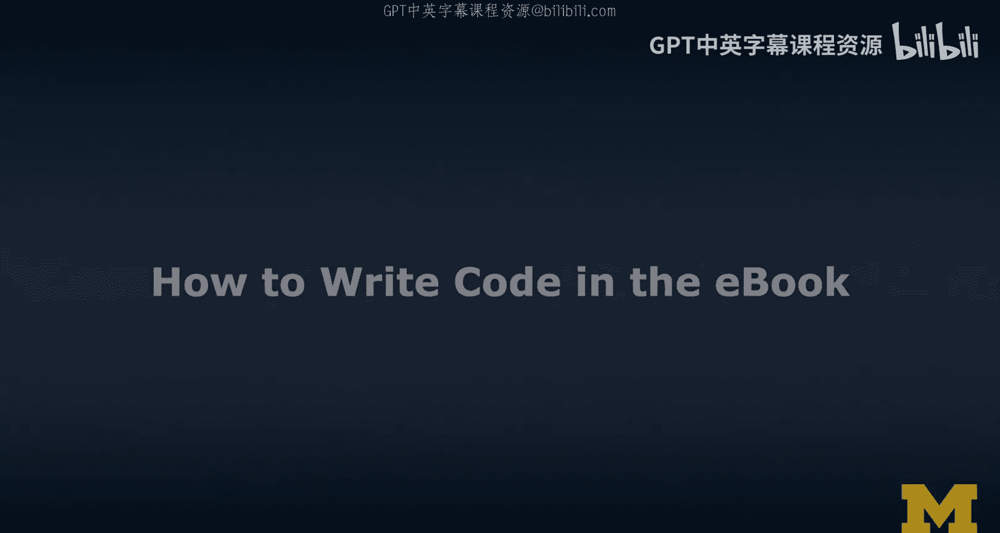
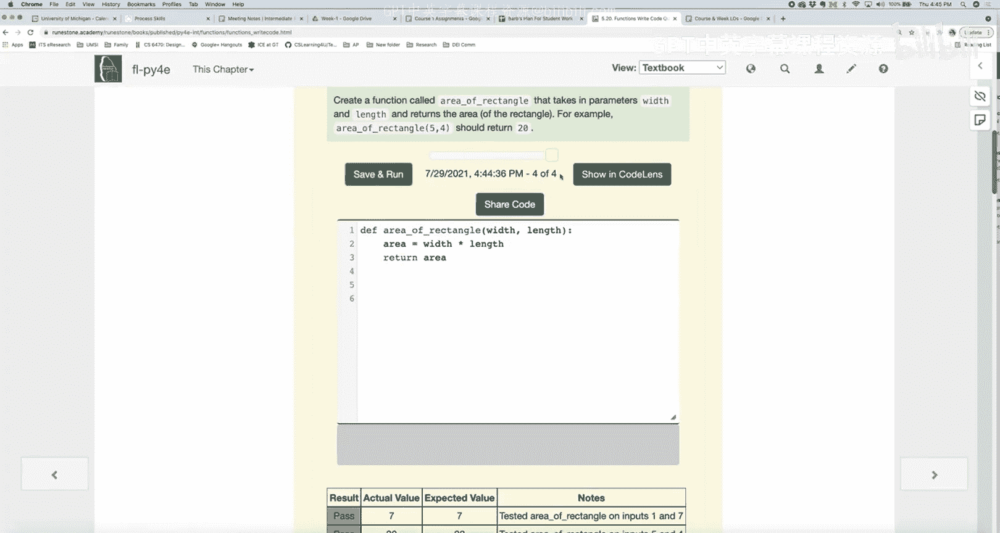

# 创造性编程：6：电子书中编写代码的方法 📖


在本节课中，我们将学习如何在电子书中直接编写、测试和调试Python代码。这是一种便捷的学习方式，允许你即时实践并查看结果。



---

## 概述

电子书的一个显著特点是允许你直接在书中编写代码。本节将演示如何操作，包括编写函数、运行测试、调试代码以及使用历史记录功能。

---

## 在电子书中编写代码

上一节我们介绍了电子书的基本界面，本节中我们来看看如何具体编写代码。

电子书允许你直接在页面内编写Python代码。例如，创建一个计算矩形面积的函数。

```python
def area_of_rectangle(width, length):
    area = width * length
    return area
```

以上代码定义了一个函数 `area_of_rectangle`，它接收宽度和长度两个参数，计算并返回矩形的面积。例如，调用 `area_of_rectangle(5, 4)` 应返回 `20`。

---

## 运行与测试代码

编写代码后，你可以直接运行它来测试功能。

初次尝试时，你可能会忘记返回计算结果。例如，只写了计算语句 `area = width * length` 而缺少 `return area`。运行测试用例（如 `area_of_rectangle(5, 4)`）会提示错误，帮助你发现遗漏。

修正后再次运行，测试用例将通过。你可以在“代码透镜”中查看运行结果，也可以将代码分享给团队中的其他成员。

---

## 使用代码编辑窗口

如果你对某些语法或操作不确定，可以使用额外的编辑窗口进行尝试。

在电子书右上角有一个铅笔图标。点击它会弹出一个独立的Python代码编辑窗口。你可以在此编写临时代码进行测试，例如：

```python
print(5 * 4)
```

执行后，窗口会显示结果 `20`。测试完成后，可以关闭该窗口。这个功能非常适合快速验证想法或调试代码片段。

---

## 查看代码历史记录

另一个有用的功能是代码历史记录，它允许你回顾代码的修改过程。

请确保你已登录账户。登录后，你会看到一个历史滑块控件。通过拖动滑块，你可以回溯查看代码的所有历史版本：

以下是你可以查看的内容：
*   代码最初的样子。
*   第二次修改后的状态。
*   后续各次修改的记录。

这让你能够清晰地追踪自己的编程思路演变过程，或在需要时恢复到之前的某个版本。



---


## 总结


本节课中我们一起学习了在电子书中编写代码的完整流程。我们实践了如何直接编写函数、运行测试用例来验证代码正确性，并利用编辑窗口进行快速测试。我们还了解了查看代码历史记录的功能，这有助于跟踪修改和调试。掌握这些方法能让你的学习过程更加高效和直观。