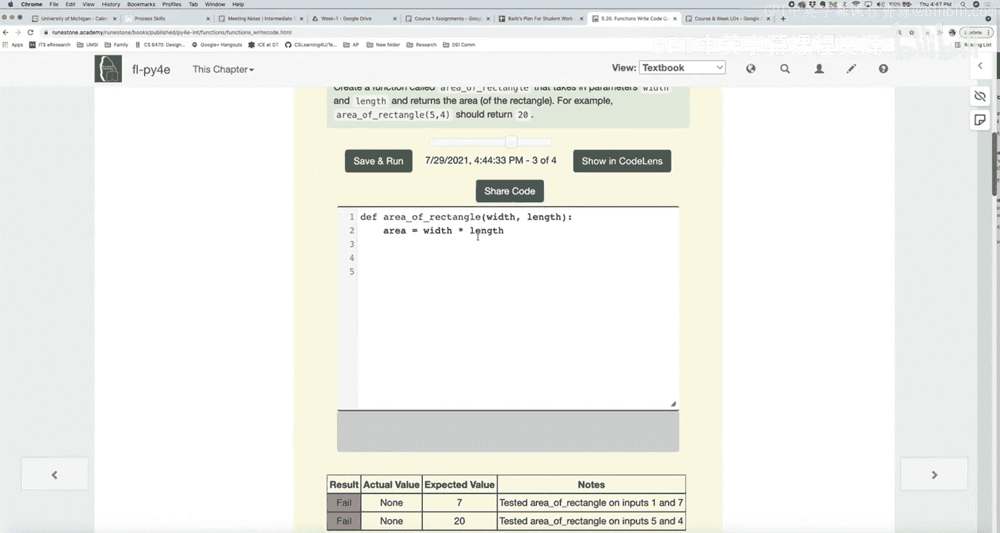

# 创造性编程：7：重载代码历史记录 🔄

在本节课中，我们将学习如何在编程环境中找回之前保存的代码。如果你离开后又返回，可能会发现代码编辑器是空的，但只要你之前登录过，你的代码其实已经被保存了。本节将指导你如何通过“加载历史记录”功能恢复你的工作。

---

如果你在书中进行编程练习，中途离开后又返回，可能会惊讶地发现编辑器里似乎没有保存你的代码。但请放心，只要你上次操作时处于登录状态，你的代码就已经被保存了。

接下来，我们来看看如何找回这些已保存的代码。

以下是恢复代码的具体步骤：
1.  返回编程练习界面。
2.  注意并找到“加载历史记录”按钮。
3.  点击该按钮。

如果你上次运行代码时是登录状态，系统将加载你所有的历史记录。这样，你就能看到上次运行时所写的全部代码。

你甚至可以查看更早的版本来回顾之前的操作。因此，无需惊慌，只要登录后所做的所有操作都会被保存。

最后，请务必记住点击“加载历史记录”按钮来恢复你的工作进度。

---

本节课中，我们一起学习了“加载历史记录”功能的重要性与操作方法。关键在于：只要保持登录，你的代码就会被自动保存；返回后，记得点击“加载历史记录”按钮来恢复之前的工作。这能有效防止意外丢失进度，让你能从容地继续编程练习。