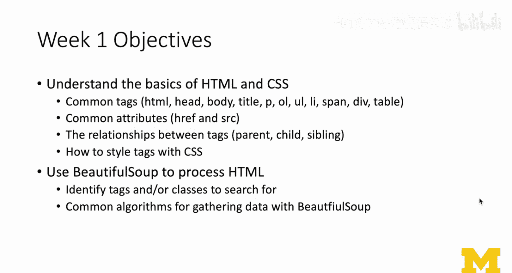
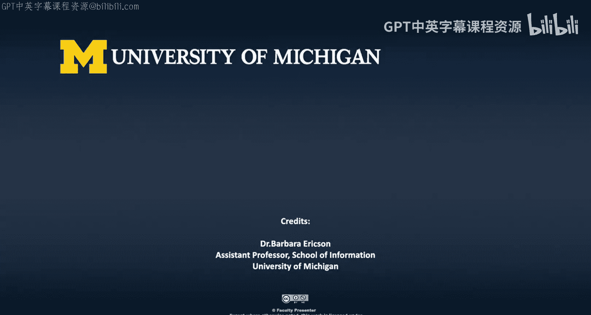

# 8：欢迎进入第一周 🚀

在本节课中，我们将要学习网页开发的基础知识，包括超文本标记语言和层叠样式表。我们还将介绍如何使用Beautiful Soup库来处理HTML数据。

## 概述 📋

第一周的学习目标是掌握HTML和CSS的基础。HTML是构建网页结构的语言，而CSS则用于美化这些结构。我们将学习常见的HTML标签、它们的属性以及标签之间的关系。最后，我们将使用Beautiful Soup库来解析和处理HTML文档，为后续的数据收集工作打下基础。

## HTML与CSS基础 🏗️

上一节我们概述了本周的学习内容，本节中我们来看看HTML和CSS的具体定义。

超文本标记语言是创建网页的标准标记语言。它使用一系列标签来描述网页的内容和结构。层叠样式表则是一种样式表语言，用于描述HTML文档的呈现方式，包括布局、颜色和字体等。

## 常见HTML标签 🏷️

了解了基本概念后，我们来认识一些构建网页时最常用的HTML标签。

以下是您将学习到的一些核心HTML标签：
*   **`<h1>` 到 `<h6>`**： 标题标签，用于定义不同级别的标题。
*   **`<head>` 和 `<body>`**： 文档的头部和主体部分。`<head>`包含元信息，`<body>`包含可见内容。
*   **`<title>`**： 定义浏览器工具栏或页面标签的标题。
*   **`
`**： 段落标签。
*   **`<ol>` 和 `<ul>`**： 分别用于创建有序列表和无序列表。
*   **`` 和 `
`**： 用于对行内元素和块级元素进行分组和样式化。
*   **`<table>`**： 用于创建表格。

## 标签属性与关系 🔗

仅仅知道标签还不够，我们还需要了解如何通过属性来配置它们，以及标签之间是如何组织的。

每个HTML标签都可以拥有属性，这些属性提供了关于元素的额外信息。例如，`<a>`标签的`href`属性定义了链接的目标地址。

HTML标签之间存在层级关系，这种关系通常被描述为“树状结构”。
*   **父元素与子元素**： 一个标签可以包含其他标签，被包含的标签称为子元素，包含它们的标签称为父元素。
*   **兄弟元素**： 拥有相同父元素的多个子元素互为兄弟元素。

理解这些关系对于使用CSS选择器或Beautiful Soup定位元素至关重要。

## 使用CSS样式化 🎨

在构建好网页结构之后，下一步就是使用CSS来为其添加样式，使其更加美观。

CSS允许您为HTML元素设置样式规则。您可以通过标签名、类名或ID来选中元素，然后为其定义颜色、字体、边距等属性。例如，将段落文字设置为红色的CSS代码是：`p { color: red; }`。

## 使用Beautiful Soup处理HTML 🥣

掌握了静态网页的构建与样式化后，我们将转向动态数据处理。本节将介绍如何使用Python的Beautiful Soup库来解析和提取HTML文档中的信息。

Beautiful Soup是一个Python库，能够从HTML或XML文件中提取数据。它提供了简单的方法来导航、搜索和修改解析树。

以下是使用Beautiful Soup时的两个核心步骤：
1.  **识别标签或类**： 您需要确定要搜索的特定HTML标签或CSS类。
2.  **应用常见算法**： 我们将展示一些常用的数据收集算法，例如遍历文档树、按条件过滤元素以及提取文本或属性值。

## 总结 🎯

本节课中我们一起学习了第一周的核心内容。我们介绍了HTML和CSS作为网页开发基础语言的角色，列举了常见的HTML标签及其属性和相互关系，解释了如何使用CSS为网页添加样式，并初步了解了使用Beautiful Soup库处理HTML文档以收集数据的方法。这些知识是进行创造性编程和网络数据操作的重要基石。