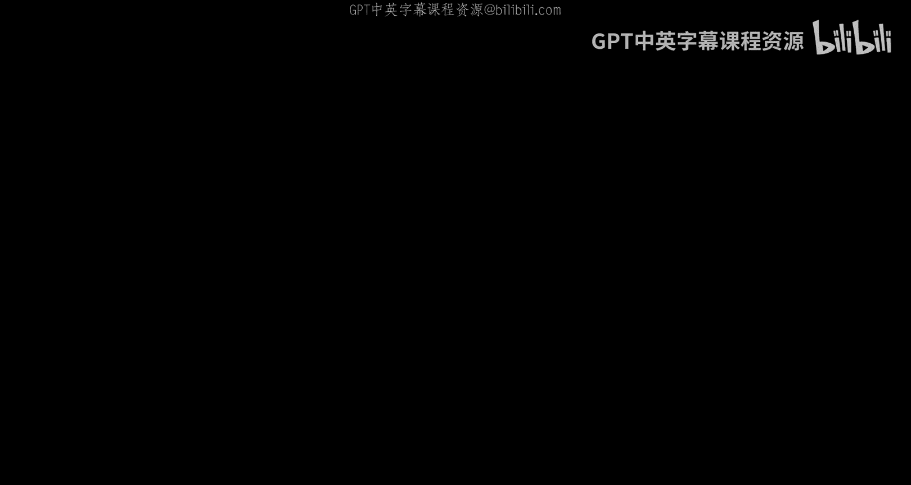
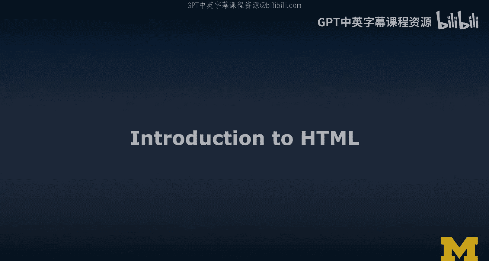
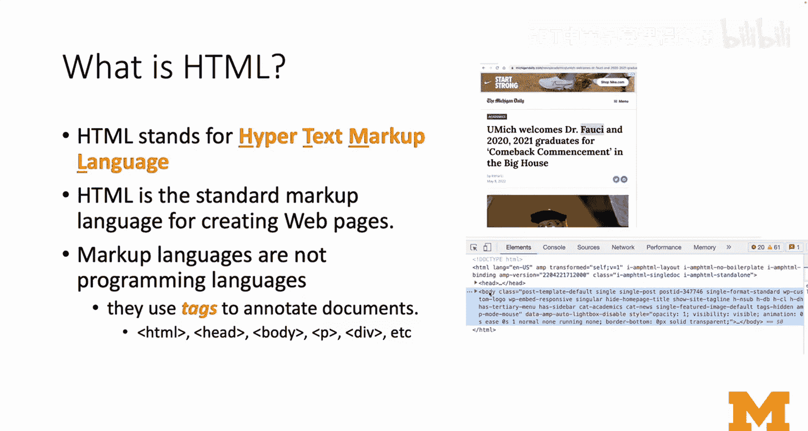
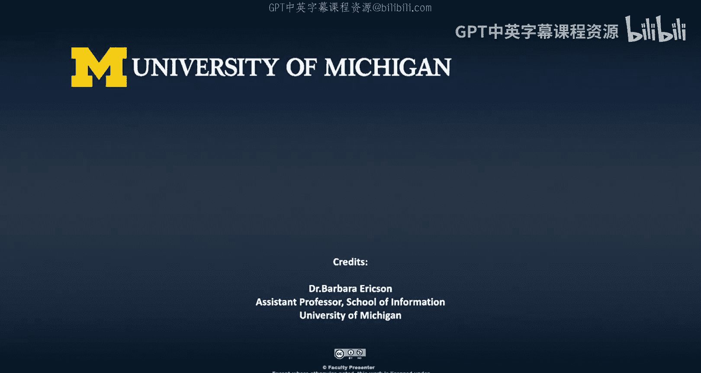

# 9：HTML入门 🚀

在本节课中，我们将要学习HTML的基础知识。HTML是构建网页的核心技术，它并非编程语言，而是一种用于描述网页内容和结构的标记语言。理解HTML是进行Web开发和创意编程的重要第一步。



## 什么是HTML？



上一节我们介绍了课程背景，本节中我们来看看HTML究竟是什么。

HTML代表**超文本标记语言**。它不是一种编程语言，而是一种用于创建网页的标记语言。HTML使用**标签**来指定文档的各个部分。

例如，你可以在这里看到一个简单的页面，它来自密歇根大学的在线日报《密歇根日报》。页面以一个文档类型声明开始，用以说明这是一个HTML文档。接着是`<html>`标签，然后有`<head>`标签和闭合的`</head>`标签，以及一个打开的`<body>`标签。最后是闭合的`</body>`标签和闭合的`</html>`标签。

因此，HTML通常由成对出现的开始和结束标签组成，这些标签描述了文档的内容。

---

## HTML文档的基本结构

了解了HTML的定义后，我们来看看一个标准HTML文档的基本骨架。

一个最简单的HTML文档结构如下所示：

```html
<!DOCTYPE html>
<html>
  <head>
    <!-- 头部信息，如标题、字符集、样式表链接等 -->
    <title>页面标题</title>
  </head>
  <body>
    <!-- 网页主体内容在这里显示 -->
    <h1>这是一个标题</h1>
    <p>这是一个段落。</p>
  </body>
</html>
```

以下是上述代码中关键部分的解释：

*   `<!DOCTYPE html>`：声明文档类型为HTML5，确保浏览器以标准模式渲染页面。
*   `<html>`：根元素，包裹整个HTML文档。
*   `<head>`：头部元素，包含不直接显示在页面上的元信息，如标题、字符集定义和对外部资源（CSS， JavaScript）的链接。
*   `<title>`：定义浏览器标签页上显示的页面标题。
*   `<body>`：主体元素，包含所有在网页上可见的内容，如文本、图片、链接等。

---

## 核心概念：标签与元素

上一节我们看到了HTML的骨架，本节中我们来深入理解其核心构件：标签和元素。

HTML通过**标签**来标记内容。大多数标签是成对出现的：一个开始标签和一个结束标签。它们共同定义了一个**HTML元素**。

开始标签的格式是`<tagname>`，结束标签的格式是`</tagname>`。两者之间的内容就是该元素的内容。

例如，段落元素：
`<p>这是一个段落。</p>`

有些标签是自闭合的，不需要单独的结束标签，例如换行标签：
`<br>` 或图像标签 ``。



---



## 总结

本节课中我们一起学习了HTML的基础知识。我们了解到HTML是一种用于构建网页结构的标记语言，其核心是通过成对的标签来定义文档中的各种元素。我们掌握了一个标准HTML文档的基本结构，包括`<!DOCTYPE>`、`<html>`、`<head>`和`<body>`等关键部分。理解这些概念是后续学习更复杂的网页样式（CSS）和行为（JavaScript）的坚实基础。