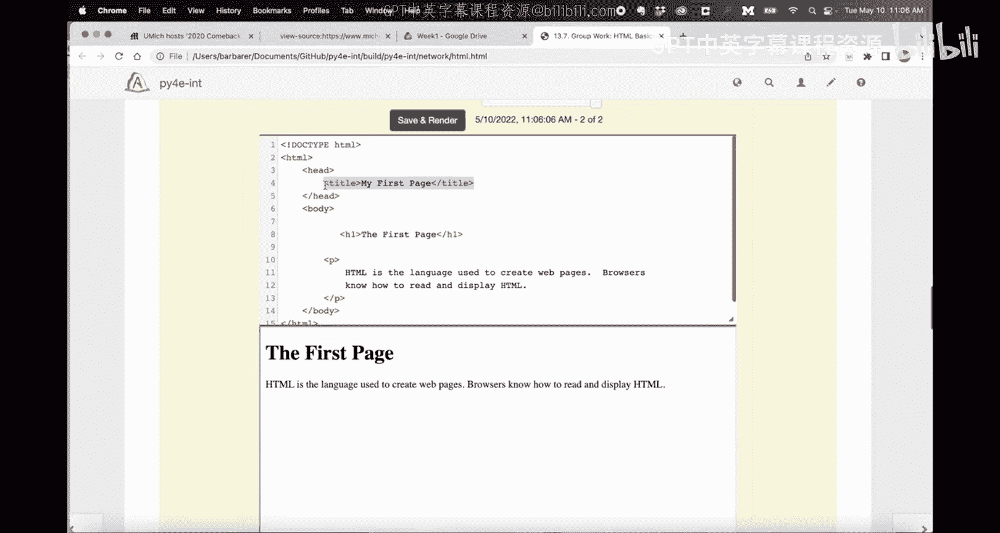
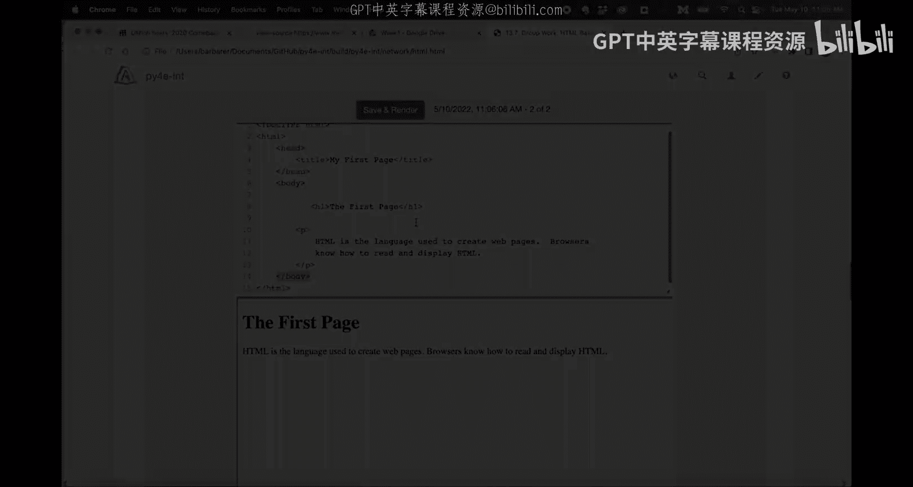
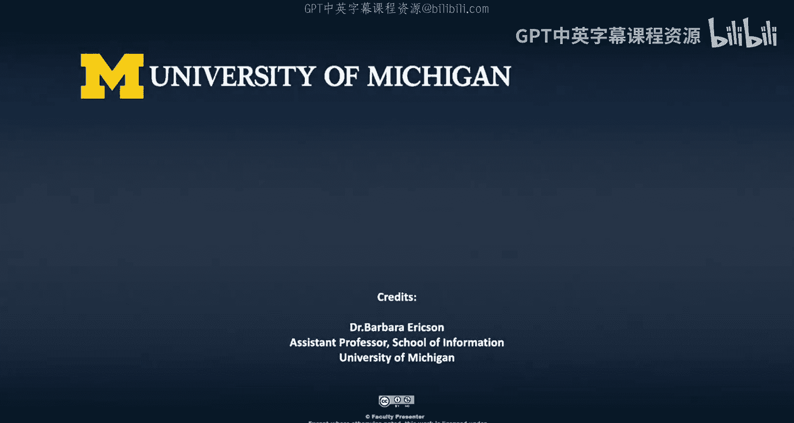

# 创造性编程：10：修复HTML代码 🛠️


在本节课中，我们将学习如何识别并修复一段存在错误的HTML代码。我们将遵循HTML的基本结构规则，确保每个开始标签都有对应的结束标签，并理解文档各部分（如头部和主体）的正确组织方式。

## 识别缺失的标签

上一节我们介绍了HTML的基本概念，本节中我们来看看如何修复一段结构不完整的HTML代码。首先，我们需要检查代码，找出所有缺失的开始或结束标签。

以下是修复步骤：

1.  **添加缺失的HTML开始标签**：文档应以`<html>`标签开始，但示例中只有`</html>`结束标签。因此，我们需要在文档顶部添加`<html>`。
2.  **修复头部（Header）区域**：在`<head>`部分，有一个`</title>`结束标签，但没有对应的`<title>`开始标签。我们需要添加`<title>`开始标签。
3.  **修复主体（Body）内的标题**：在主体部分，有一个`</h1>`结束标签，但没有对应的`<h1>`开始标签。我们需要添加`<h1>`开始标签。
4.  **确保头部正确闭合**：在添加了`<title>`标签后，需要确保`<head>`部分被`</head>`标签正确闭合。
5.  **添加主体开始标签**：所有显示在页面上的内容都应放在`<body>`标签内。因此，在`</head>`之后，我们需要添加`<body>`开始标签。

## 修复后的代码结构

遵循以上步骤修复后，完整的、结构正确的HTML代码应如下所示：

```html
<!DOCTYPE html>
<html>
<head>
    <title>页面标题</title>
</head>
<body>
    <h1>这是一个标题</h1>
    <p>这是一个段落。</p>
</body>
</html>
```

## 核心规则总结

本节课中我们一起学习了修复HTML代码的关键点。请记住以下核心规则：



*   对于每一个开始标签（如`<tag>`），都必须有一个对应的结束标签（如`</tag>`）。
*   文档可以（也建议）以`<!DOCTYPE html>`声明开始。
*   文档内容必须包含在`<html>`和`</html>`标签之内。
*   在`<html>`标签内，通常包含`<head>`和`<body>`两部分。
*   `<head>`部分包含不直接显示在页面上的信息，例如标题（`<title>`）或脚本。
*   `<body>`部分包含所有会显示在网页上的内容，如标题、段落、图片等。





通过应用这些规则，我们就能将混乱的HTML代码修复为结构清晰、能被浏览器正确渲染的有效文档。