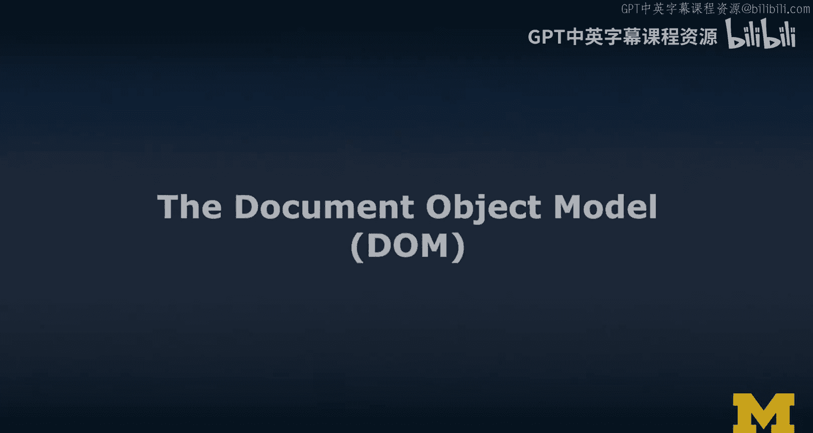
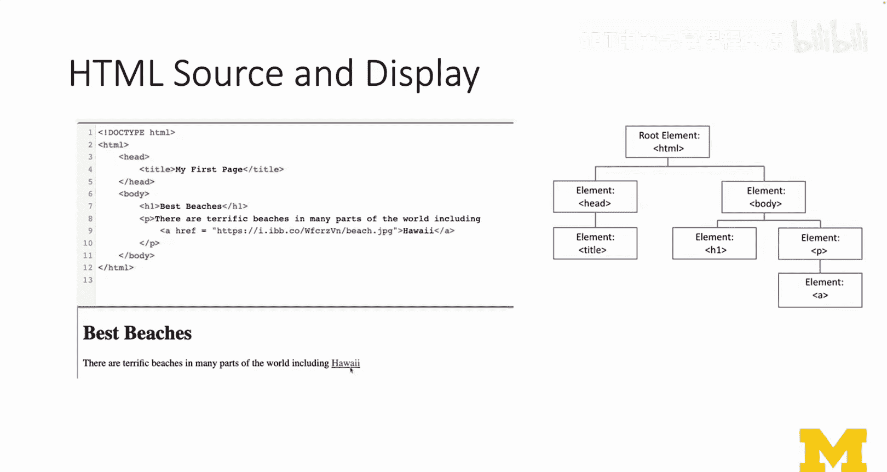
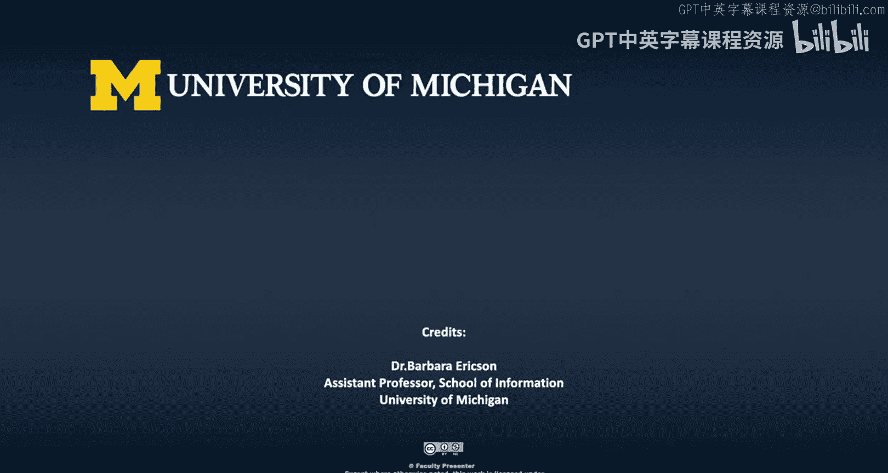

# 创造性编程：11：文档对象模型(DOM)解析




在本节课中，我们将要学习文档对象模型（DOM）的基本概念。DOM是HTML文档的结构化表示，理解它对于解析网页和提取信息至关重要。我们将探讨DOM如何将文档内容组织成树形结构，并了解其核心组成部分。

## 结构与表现的分离

在HTML中，一个核心思想是分离文档的结构、样式和交互行为。文档的结构由HTML标签定义，例如 `<h1>`、`<p>` 等。文档的外观则由层叠样式表（CSS）指定。而文档的交互行为，则通过JavaScript来实现。

## 什么是文档对象模型（DOM）？

文档对象模型（DOM）是一种树形结构。你可以将其想象成一棵倒置的树，树根在顶部，树枝向下延伸。

在HTML文档中，`<html>` 标签是这棵树的根元素。它有两个主要的子节点：`<head>` 和 `<body>`。

*   `<head>` 包含了所有不会直接显示在页面上的内容，例如文档的标题（`<title>`）。
*   `<body>` 包含了所有将要显示的内容，即文档的主体结构。

以下是一个简单的HTML示例及其对应的DOM树：

```html
<html>
  <head>
    <title>我的页面</title>
  </head>
  <body>
    <h1>标题</h1>
    <p>这是一个包含<a href="#">链接</a>的段落。</p>
  </body>
</html>
```

对应的DOM树结构可以这样理解：
*   根节点：`<html>`
    *   子节点1：`<head>`
        *   子子节点：`<title>`（内容：“我的页面”）
    *   子节点2：`<body>`
        *   子子节点1：`<h1>`（内容：“标题”）
        *   子子节点2：`<p>`
            *   子子子节点：`<a href="#">`（内容：“链接”）

当这个页面在浏览器中显示时，你只会看到“标题”和“这是一个包含链接的段落。”这些文本内容。

## 解析HTML与DOM的应用

上一节我们介绍了DOM的树形结构，本节中我们来看看它的一个关键用途。当我们编写程序来自动化地从网页中查找和提取信息时，就会用到DOM解析。程序会将HTML文档加载并构建成DOM树，然后我们可以像在文件系统中导航文件夹一样，在这棵树上定位和访问特定的元素、属性或文本内容。

例如，我们可以编写代码来找到所有 `<a>` 标签并提取它们的 `href` 属性值，从而收集页面上的所有链接。





本节课中我们一起学习了文档对象模型（DOM）的基础知识。我们了解到DOM是HTML文档的树形表示，它清晰地展示了标签之间的嵌套关系。理解DOM是进行网页数据抓取和解析的第一步，为我们后续学习如何使用Python库来操作DOM打下了基础。