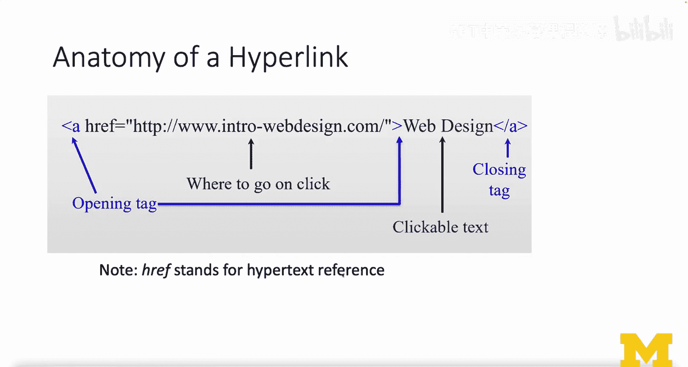

# 创造性编程：12：HTML属性详解 🏷️


在本节课中，我们将深入学习HTML标签的另一个重要组成部分——属性。我们将了解什么是属性，它们如何为标签提供额外信息，以及如何在代码中正确地使用它们。

上一节我们介绍了HTML标签的树状结构和关系。本节中我们来看看如何通过属性为这些标签增添更多细节和功能。

## 什么是属性？ 🔍

标签可以拥有属性。属性为标签提供了所需的额外信息。属性总是在标签的开始部分进行指定。

例如，一个图像标签 `` 没有结束标签，其所有信息都包含在开始标签中。一个图像标签通常有两个属性：`src`（来源）和 `alt`（替代文本）。它们以“属性名=值”的成对形式出现。

以下是属性的基本语法格式：
```html
<tag_name attribute_name="attribute_value">
```

## 属性示例 📸

让我们通过两个常见的例子来具体理解属性的用法。

### 图像标签 (``)

图像标签使用 `src` 属性来指定图片的路径，使用 `alt` 属性来提供替代文本。替代文本对于使用屏幕阅读器的用户（例如有视力障碍的人）非常重要。

其代码结构如下：
```html

```
在这个例子中，`src` 是属性名，`"image_path.jpg"` 是属性值；`alt` 是属性名，`"描述图片的文字"` 是属性值。

### 锚点/超链接标签 (`<a>`)

另一个例子是 `<a>` 标签，或称锚点标签、超链接标签。它有一个开始标签，其中包含 `href` 属性。`href` 的值是点击链接后将要跳转的网址。

在开始标签和结束标签之间，是实际显示给用户、可供点击的文本。

其代码结构如下：
```html
<a href="https://example.com">点击这里的文字</a>
```
这里，`href` 是属性名，`"https://example.com"` 是属性值。`href` 代表“超文本引用”。

以下是关于属性的关键点总结：
*   属性以名称/值对的形式出现，格式为 `name="value"`。
*   它们位于HTML标签的开始部分。
*   它们为标签提供了核心功能所需的必要信息（如图片地址、链接目标）。




## 总结 📝


本节课中我们一起学习了HTML属性。我们了解到属性是为标签提供额外信息的名称/值对，始终位于开始标签内。我们通过 `` 标签的 `src` 和 `alt` 属性，以及 `<a>` 标签的 `href` 属性，具体分析了属性的语法和作用。记住属性是构建功能丰富网页的基础。