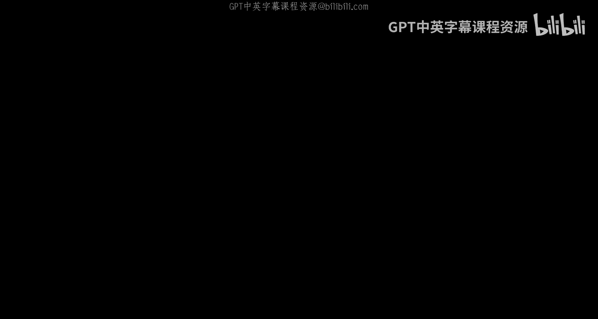
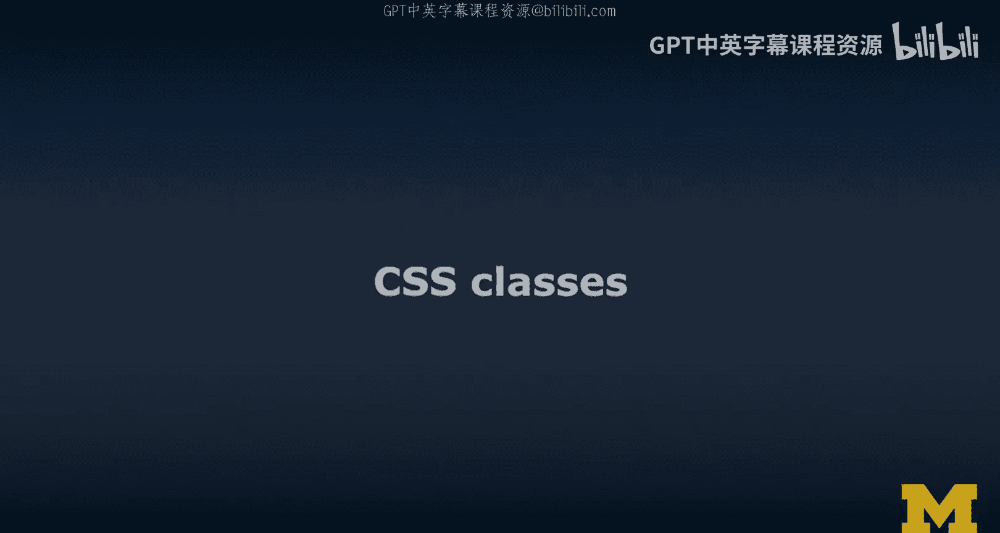
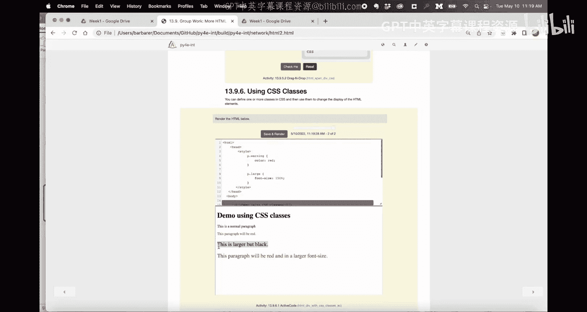
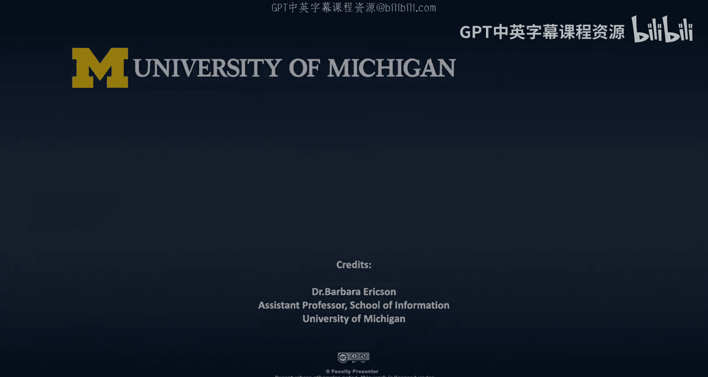

# 创造性编程：13：CSS类应用 🎨

在本节课中，我们将学习CSS类的基本概念和应用。我们将了解如何将HTML文档的结构与其样式分离，并通过定义和应用CSS类来控制网页元素的外观。

---

让我们来看一个小组作业中的例子。

这里有一个HTML页面，其头部包含一些CSS。CSS代表层叠样式表，其核心理念是将文档结构（如什么是标题、什么是段落）与其外观样式分离开来。层叠样式表就是我们用来指定事物外观的方式。

那么，如何将两者（结构和样式）连接起来呢？我们可以使用不同的方法。一种方法是添加一组类。例如，我可以在段落标签上创建一个名为 `warning` 的类，并规定当看到这个类时，使用红色。同时，我还可以在段落标签上创建一个名为 `large` 的类，并规定当看到这个类时，使用特定的字体大小。

然后，我可以将它们组合使用。例如，我可以创建一个只应用了 `warning` 类的段落，也可以创建一个同时应用了 `warning` 和 `large` 两个类的段落。这样，该段落就会同时应用两种样式。

这就是我们在这里看到的情况。如果我们使用只带有 `warning` 类的段落，我们会看到它是红色的。如果它同时带有 `warning` 和 `large` 类，那么它既是红色的，字体也更大。

如果我再在这里添加一个段落，我可以添加一个只应用 `larger` 类的段落。请注意，属性值需要用引号括起来。

并且，我会记得闭合段落标签。大多数浏览器都比较宽容，即使你忘记闭合标签，它也能工作，但你真的应该包含所有闭合标签。

现在你可以看到，这个段落使用了 `larger` 样式，但仍然是黑色的，因为我并没有同时添加两个类。

所以，HTML的基础是：使用HTML来构建你的文档结构，使用CSS来指定该文档的外观样式。

---

本节课中，我们一起学习了CSS类的基本应用。我们了解到，通过定义不同的CSS类（如 `.warning` 和 `.large`），并将其组合应用到HTML元素上，可以灵活地控制网页的视觉呈现。记住，良好的实践是将文档结构与样式分离，并使用正确的语法（如用引号包裹属性值、闭合所有标签）来编写代码。