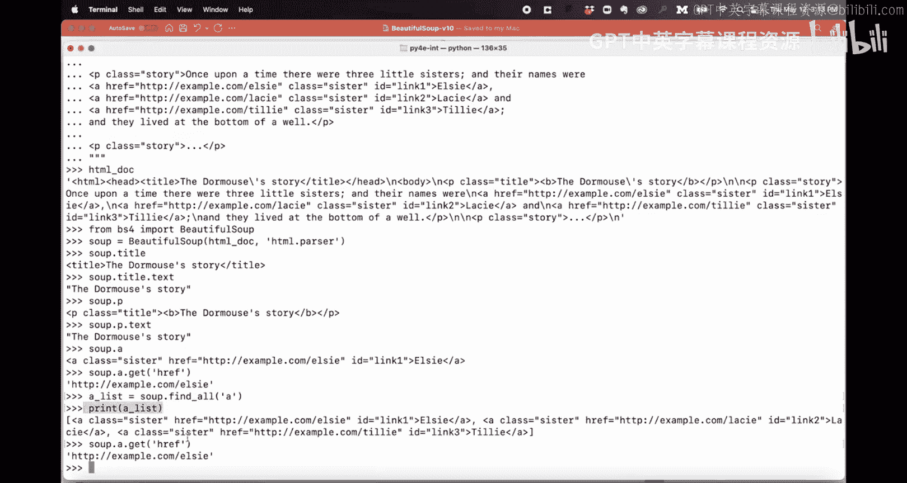

# 14：Beautiful Soup入门 🍲


在本节课中，我们将学习如何使用Python库Beautiful Soup来处理HTML页面。我们将了解如何创建Beautiful Soup对象，以及如何从HTML文档中提取信息，例如标签、属性和文本内容。


---

## 什么是Beautiful Soup？

Beautiful Soup是一个Python库，它允许我们处理HTML或XML格式的文档。通过这个库，我们可以根据标签从HTML文档中获取信息，也可以查看标签的属性。

## 导入库与创建对象

要使用Beautiful Soup，首先需要导入该库。然后，我们可以从一个代表HTML页面的字符串创建一个Beautiful Soup对象。

以下是导入库和创建对象的代码示例：

```python
from bs4 import BeautifulSoup

# 假设html_doc是一个包含HTML内容的字符串
soup = BeautifulSoup(html_doc, 'html.parser')
```

这段代码将解析HTML字符串，并返回一个结构化的`soup`对象，我们可以通过这个对象来查询文档内容。

## 解析HTML文档示例

为了更好地理解，我们来看一个来自Beautiful Soup教程的简单HTML页面示例。该页面结构如下：

```html
<html>
<head>
    <title>The Dormouse's story</title>
</head>
<body>
    <p class="title"><b>The Dormouse's story</b></p>
    <p class="story">
        Once upon a time there were three little sisters; and their names were
        <a href="http://example.com/elsie" class="sister" id="link1">Elsie</a>,
        <a href="http://example.com/lacie" class="sister" id="link2">Lacie</a> and
        <a href="http://example.com/tillie" class="sister" id="link3">Tillie</a>;
        and they lived at the bottom of a well.
    </p>
</body>
</html>
```

## 从soup对象提取信息

创建`soup`对象后，我们可以开始查询其中的信息。以下是几种常见的查询方式：

### 获取标题

我们可以询问`soup`对象的标题。请注意，`.title`会返回包含开始和结束标签的完整元素。

```python
print(soup.title)
# 输出: <title>The Dormouse's story</title>
```

如果只想获取标题的文本内容，可以使用`.text`属性。

```python
print(soup.title.text)
# 输出: The Dormouse's story
```

### 获取第一个段落

我们可以获取文档中的第一个段落标签。

```python
print(soup.p)
# 输出: <p class="title"><b>The Dormouse's story</b></p>
```

同样，也可以只获取该段落的文本。

```python
print(soup.p.text)
# 输出: The Dormouse's story
```

### 获取第一个链接及其属性

我们可以获取文档中的第一个链接（`<a>`标签）。

```python
print(soup.a)
# 输出: <a class="sister" href="http://example.com/elsie" id="link1">Elsie</a>
```

要获取链接的特定属性（例如`href`），可以像使用字典一样使用`.get()`方法。

```python
print(soup.a.get('href'))
# 输出: http://example.com/elsie
```

### 查找所有链接

如果我们想找到文档中的所有链接，可以使用`.find_all()`方法。

```python
all_links = soup.find_all('a')
print(all_links)
# 输出: 一个包含所有<a>标签的列表
```

然后，我们可以遍历这个列表，获取每个链接的属性。

```python
for link in all_links:
    print(link.get('href'))
```




---


本节课中，我们一起学习了Beautiful Soup库的基础知识。我们了解了如何导入库、创建Beautiful Soup对象，以及如何从HTML文档中提取标题、段落、链接和属性等信息。掌握这些基本操作是进行网页数据抓取和分析的第一步。