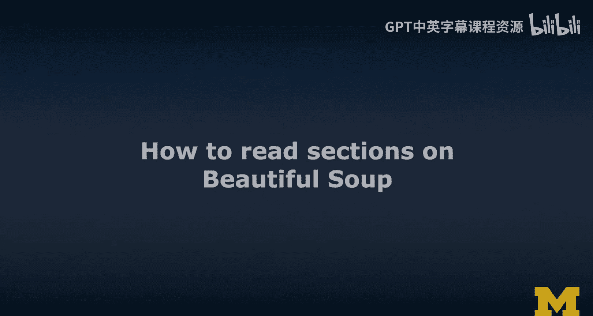
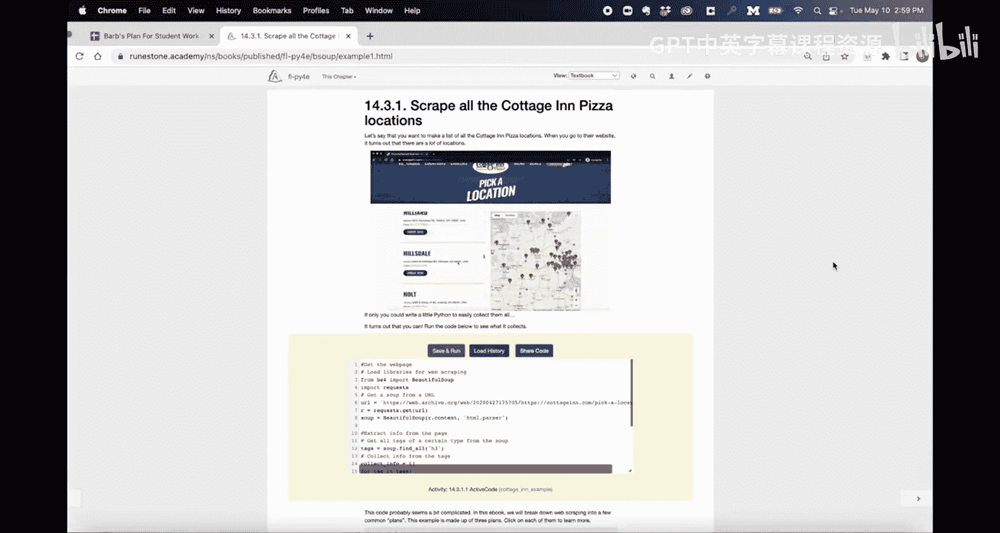
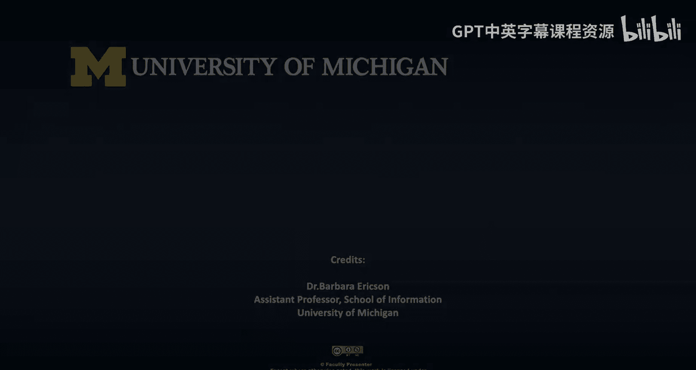

# 15：Beautiful Soup章节阅读指南 📖

在本节课中，我们将学习如何正确阅读《创造性编程》电子书中关于Beautiful Soup的章节。这一章的阅读方式与常规章节不同，我们将详细介绍其结构和使用方法。

## 章节结构概述

上一节我们介绍了网络爬虫的基础概念。本节中，我们来看看第15章“Beautiful Soup”的具体阅读方法。这一章的核心是教你如何使用Beautiful Soup库来抓取网页或HTML数据。

## 独特的阅读流程

本章的阅读方式与本书其他部分不同。它并非简单的线性阅读。

如果你从第14章“学习网络爬虫”进入本章，你会先看到关于网络爬虫的简要定义和本书工作方式的说明。

接着，你会点击一个链接，进入“抓取所有小屋和披萨店位置”的示例。这个示例展示了如何使用Beautiful Soup抓取网络数据或HTML数据，并提供了一个可运行的示例代码。

## 分步编程计划

本章内容随后会分解为多个不同的编程计划。

以下是阅读本章的正确步骤：

1.  查看每个编程计划，每个计划都会引导你进入一个新页面。
2.  在该页面末尾，你可以返回到“小屋和披萨店”示例。
3.  然后，进入下一个计划，重复相同的过程：浏览页面、学习页面上的所有内容、完成所有练习。
4.  完成后再返回主示例。

**关键提醒**：不要像阅读普通章节那样，仅仅使用“下一页”按钮来浏览本章。必须按照上述计划流程进行深入学习。

## 总结

本节课中，我们一起学习了《创造性编程》第15章关于Beautiful Soup的特殊阅读方法。重点是理解其非线性的结构，通过跟随不同的编程计划来深入实践和掌握使用Beautiful Soup进行网络数据抓取的技能。