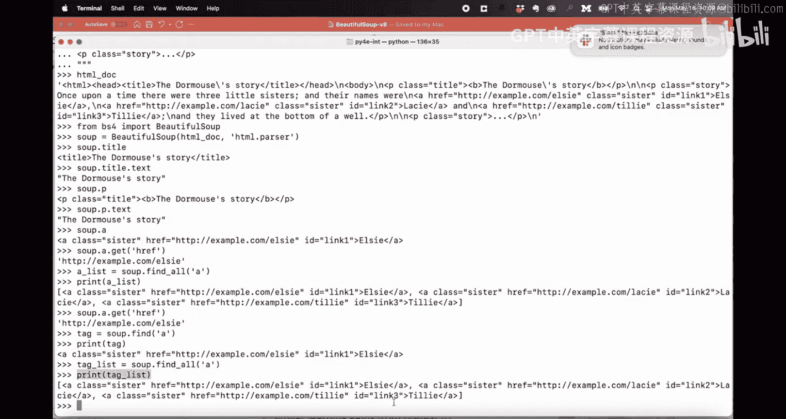

# 16：`find`与`find_all`方法对比 🔍

在本节课中，我们将学习Beautiful Soup库中两个最常用的方法：`find`和`find_all`。我们将通过一个具体的HTML示例，清晰地展示它们的功能差异和使用场景。


## 概述

Beautiful Soup是一个用于解析HTML和XML文档的Python库。在处理网页数据时，我们经常需要定位和提取特定的HTML元素。`find`和`find_all`方法正是完成这项任务的核心工具。简单来说，`find`用于查找并返回**第一个**匹配的元素，而`find_all`则返回**所有**匹配的元素列表。

## 示例HTML文档

为了理解这两个方法，我们首先需要一个HTML文档作为示例。假设我们有以下HTML结构：

```html
<html>
    <head>
        <title>示例页面</title>
    </head>
    <body>
        <p>第一个段落：老鼠的故事。</p>
        <p>第二个段落包含一个故事，其中有三个链接：<a href=“#link1”>链接一</a>，<a href=“#link2”>链接二</a>，和<a href=“#link3”>链接三</a>。</p>
    </body>
</html>
```

这个文档包含一个`<body>`，其中有两个段落（`<p>`标签）。第二个段落内包含了三个锚点（`<a>`）或链接元素。

## 使用 `find` 方法

`find`方法用于在文档中查找并返回第一个匹配指定条件的标签。

假设我们已经将上面的HTML字符串解析为一个Beautiful Soup对象，命名为`soup`。当我们执行以下代码时：

```python
first_a_tag = soup.find(‘a’)
print(first_a_tag)
```

这段代码会搜索整个文档，找到第一个出现的`<a>`标签并将其返回。打印出的结果将是这个完整的标签，包括其开始标签、属性、文本内容以及结束标签。在我们的示例中，它会输出第一个链接“链接一”对应的整个`<a href=“#link1”>链接一</a>`标签。

**核心概念**：`find`方法返回**单个**匹配的Tag对象。如果未找到任何匹配项，则返回`None`。

## 使用 `find_all` 方法

与`find`不同，`find_all`方法会查找文档中所有匹配指定条件的标签，并将它们作为一个列表返回。

继续使用同一个`soup`对象，执行以下代码：

```python
all_a_tags = soup.find_all(‘a’)
print(all_a_tags)
```

这段代码会找到文档中所有的`<a>`标签。打印`all_a_tags`，你将得到一个Python列表，其中包含了三个Tag对象，分别对应示例中的三个链接。

**核心概念**：`find_all`方法返回一个**列表**，包含所有匹配的Tag对象。如果没有找到任何匹配项，则返回一个空列表`[]`。

## 方法对比总结

上一节我们分别介绍了`find`和`find_all`的独立用法，现在我们来对它们进行直接对比。

以下是两个方法的核心区别：

*   **`find(‘tag_name’)`**：返回文档中**第一个**匹配的`‘tag_name’`标签。结果是单个对象。
*   **`find_all(‘tag_name’)`**：返回文档中**所有**匹配的`‘tag_name’`标签。结果是一个对象列表。



简单记忆：当你只需要一个特定元素（如页面第一个链接）时，使用`find`；当你需要收集所有同类元素（如页面所有链接）时，使用`find_all`。


## 总结


本节课中，我们一起学习了Beautiful Soup中两个至关重要的方法：`find`和`find_all`。我们通过一个包含多个链接的HTML示例，清晰地演示了`find`如何返回第一个匹配的标签，而`find_all`如何返回所有匹配标签的列表。掌握这两个方法的区别和适用场景，是使用Beautiful Soup高效提取网页数据的基础。在接下来的实践中，你可以灵活运用它们来定位和抓取所需的网页内容。