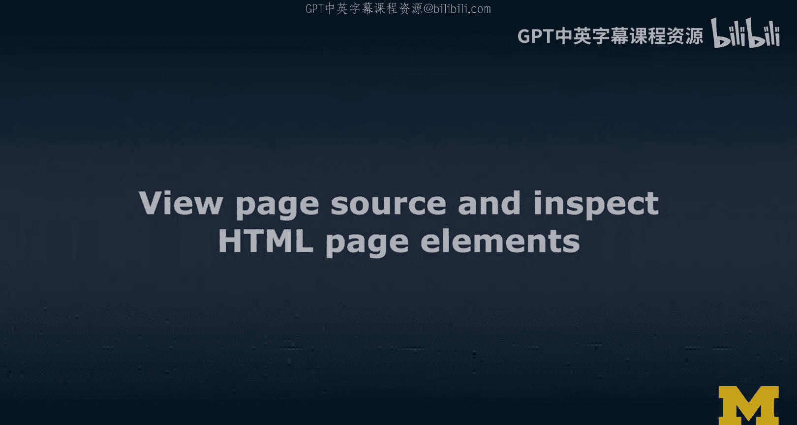
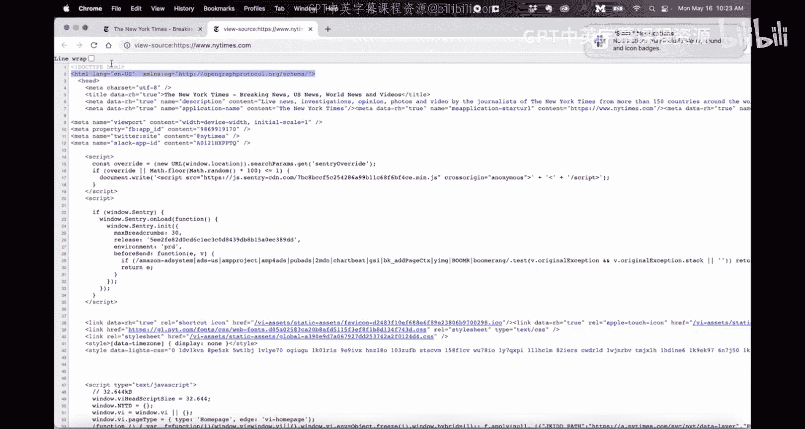
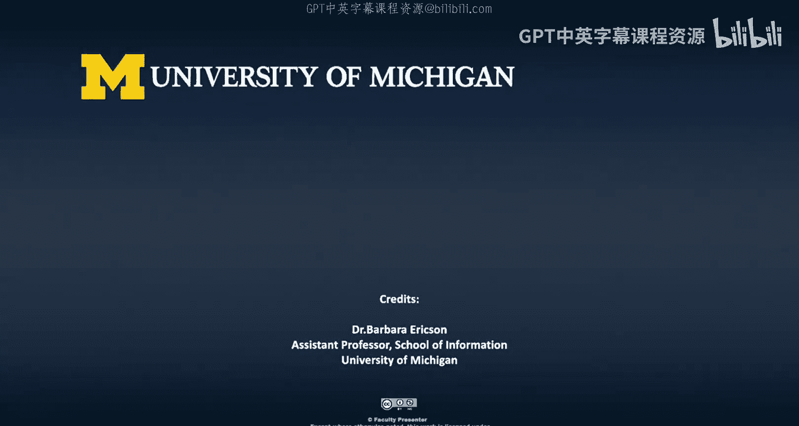

# 17：查看页面源码与审查元素 🔍

在本节课中，我们将学习如何在复杂的真实网页中定位特定元素。我们将介绍两种关键方法：查看页面源码和使用浏览器的“审查元素”功能。这些技能对于使用Beautiful Soup等工具进行网页抓取至关重要。

## 在真实HTML页面中定位元素

上一节我们介绍了基础的HTML结构。本节中我们来看看如何处理远比我们之前所见更复杂的实际网页。

如何在实际的HTML页面中找到特定的内容？真实的网页可能比我们目前所看的例子复杂得多。

## 查看页面源码

以下是查看页面源码的步骤：

1.  在浏览器中打开目标网页。
2.  在页面任意位置右键点击。
3.  从上下文菜单中选择“查看页面源代码”。

你可以通过查看页面源码来了解网页的实际构成。例如，这是一个像《纽约时报》这样的页面，它比我们之前处理的简单网页要复杂得多。

如果我们想在其中找到特定的内容，直接查找可能会很困难。例如，我正在寻找“world”链接，而源码中有很多“world”出现，因此很难定位。

通过查看页面源码，我可以看到HTML标签，比如`<h>`标题标签。如果你能在HTML源码中找到目标内容，那么你就能使用Beautiful Soup来定位它。

## 动态网页的局限性

然而，也存在一些动态网页，其内容是由JavaScript脚本生成的。如果你在页面源码中找不到目标内容，那么你将无法使用Beautiful Soup来抓取它。

## 使用“审查元素”功能

除了查看整个页面的源码，我们还可以在页面上审查特定元素，这非常有用。

以下是使用“审查元素”功能的步骤：

1.  在网页上找到你感兴趣的元素。
2.  在该元素上右键点击（在Windows机器上，也可以使用Ctrl+右键点击）。
3.  从菜单中选择“检查”或“审查元素”。

例如，我右键点击并检查该元素，它显示这是一个带有`css-1`类的`<a>`标签，并且有“world”部分。如果我想获取每个小标题的URL，我可以通过查找所有具有这个特定类的`<a>`标签来实现。

## 总结

本节课中我们一起学习了在复杂网页中定位元素的两种核心方法。首先，我们介绍了如何通过**查看页面源码**来获取网页的原始HTML结构。其次，我们探讨了如何使用浏览器的**审查元素**功能来精确定位页面上的特定部分及其属性（如`class`）。理解这些方法是有效使用Beautiful Soup等网页抓取工具的基础，同时我们也认识到对于由JavaScript动态生成内容的页面，这些静态分析方法存在局限性。