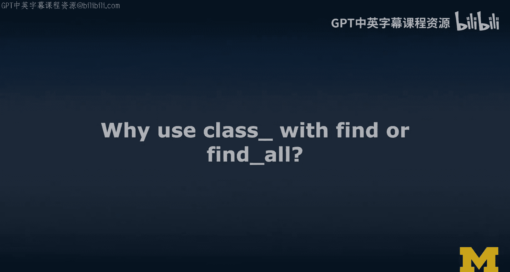
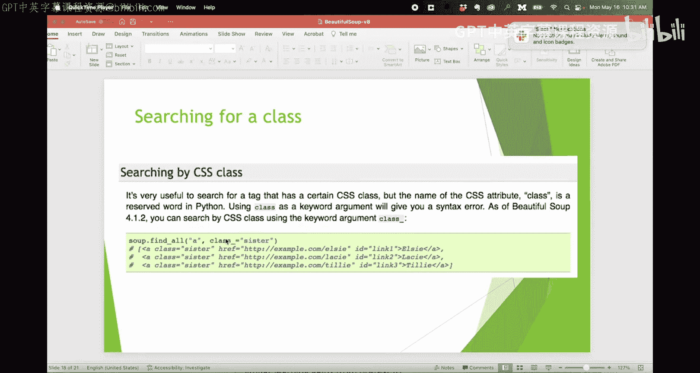

# 18：为何在查找时使用类属性


在本节课中，我们将探讨在使用BeautifulSoup库解析HTML时，为何需要使用`class_`（带下划线）来查找具有特定CSS类的元素，而不是直接使用`class`。我们将解释其中的原因，并说明这种查找方式如何帮助我们更精确地定位页面中的元素。



## 为何使用`class_`而非`class`

上一节我们介绍了如何使用BeautifulSoup查找元素。本节中我们来看看一个特殊的查找场景：通过CSS类名查找。

在BeautifulSoup中，当我们需要查找带有特定CSS类的HTML元素时，必须使用`class_`参数，而不是`class`。这是因为`class`是Python编程语言中的一个保留关键字，用于定义类。如果我们在代码中直接使用`class`作为参数名，会导致语法错误。

以下是正确的查找方式示例：

```python
# 查找所有CSS类名为"example"的元素
soup.find_all(class_="example")
```

## 使用类属性查找的优势

使用CSS类名进行查找，尤其是在处理结构复杂的HTML页面时，具有显著优势。它可以帮助我们缩小查找范围，精确地定位到我们真正关心的元素。

以下是使用类属性查找的两个主要好处：

1.  **提高精确性**：我们可能不希望获取页面中所有的`<a>`（锚）标签，而只想要那些具有特定样式或功能的链接。通过指定类名，我们可以过滤掉无关的元素。
2.  **简化选择逻辑**：相比于编写复杂的层级选择器，直接使用类名通常更简洁、更易读。

## 与通过ID查找的对比



需要注意的是，通过ID查找元素则没有这个限制。因为`id`不是Python的保留字，所以我们可以直接使用`id`参数。


```python
# 查找ID为"main-content"的元素
soup.find(id="main-content")
```


本节课中我们一起学习了在BeautifulSoup中使用`class_`参数查找CSS类元素的原因和方法。我们了解到，由于`class`是Python的保留关键字，因此必须使用带下划线的`class_`作为替代。同时，我们也认识到通过CSS类进行查找能够帮助我们更精确、更高效地从复杂的HTML文档中提取目标数据。