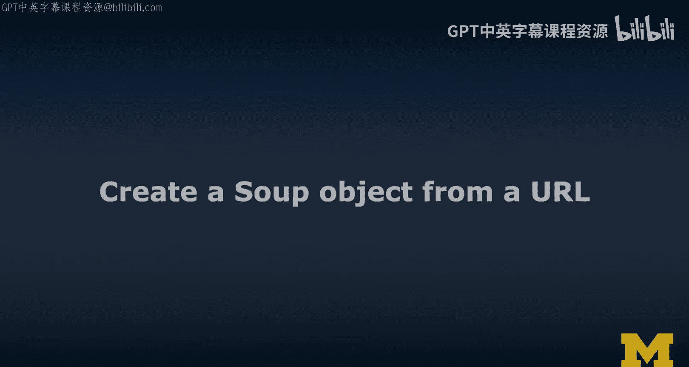
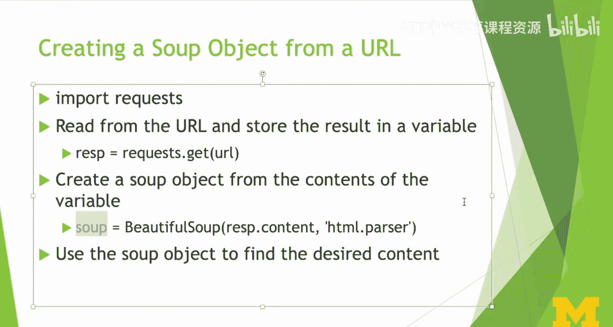

# 19：从URL创建Soup对象 🕸️


在本节课中，我们将学习如何直接从网络URL获取HTML数据，并使用BeautifulSoup库来解析它，而无需先将HTML内容保存到本地文件。



之前我们已经介绍了如何从字符串或本地文件中读取HTML并创建Soup对象。本节中，我们来看看如何直接从互联网上的URL获取数据并进行处理。

## 核心步骤

要从URL创建Soup对象，需要遵循以下步骤。以下是具体操作流程：

1.  **导入必要库**：首先，需要导入`requests`库来获取网页内容，以及`BeautifulSoup`库来解析HTML。
2.  **发送网络请求**：使用`requests.get()`函数，传入目标网页的URL地址，向服务器发送请求。
3.  **获取响应内容**：`requests.get()`会返回一个响应对象。可以通过检查响应对象的`.status_code`属性（例如，`200`表示成功，`404`表示未找到）来确认请求是否成功。此步骤是可选的，如果你确信URL有效，可以跳过。
4.  **解析HTML内容**：从响应对象的`.content`属性中获取原始的HTML字节数据，然后将其传递给`BeautifulSoup`构造函数进行解析。需要指定解析器，例如`‘html.parser’`。
5.  **使用Soup对象**：成功创建BeautifulSoup对象（通常命名为`soup`）后，它就成为了整个HTML文档的根节点。之后，你就可以使用之前学过的各种方法（如`.find()`, `.find_all()`）来查找和提取所需的页面内容了。

## 代码示例

以下是一个将上述步骤整合在一起的代码示例：

```python
import requests
from bs4 import BeautifulSoup

# 目标网页的URL
url = ‘https://example.com‘

# 发送GET请求获取网页内容
response = requests.get(url)

# （可选）检查请求是否成功
if response.status_code == 200:
    print(“请求成功！”)
else:
    print(f“请求失败，状态码：{response.status_code}”)

# 使用响应内容创建BeautifulSoup对象，指定HTML解析器
soup = BeautifulSoup(response.content, ‘html.parser’)

# 现在可以使用soup对象来查找元素了
# 例如，查找所有的段落标签
paragraphs = soup.find_all(‘p’)
for p in paragraphs:
    print(p.get_text())
```

## 关键概念解析




*   **`requests.get(url)`**：这是`requests`库的核心函数之一，用于向指定的`url`发起HTTP GET请求。它返回一个`Response`对象，其中包含了服务器返回的所有信息，如状态码、头部信息和网页内容。
*   **`response.content`**：这是`Response`对象的一个属性，它包含服务器返回的原始字节流内容。对于HTML网页，这就是我们需要解析的源代码。使用`.content`而非`.text`可以确保编码正确。
*   **`BeautifulSoup(response.content, ‘html.parser’)`**：这是创建Soup对象的关键语句。我们将从网络获取的原始内容（`response.content`）和指定的解析器（`‘html.parser’`）传递给`BeautifulSoup`类，从而构造出一个可以方便地进行导航、搜索和修改的文档树对象。


本节课中我们一起学习了如何直接从URL获取网页数据并创建BeautifulSoup对象。你掌握了使用`requests`库发起网络请求，以及将响应内容传递给BeautifulSoup进行解析的完整流程。这为从动态的、在线的网页中提取信息打开了大门，是网络数据抓取（Web Scraping）的基础技能。