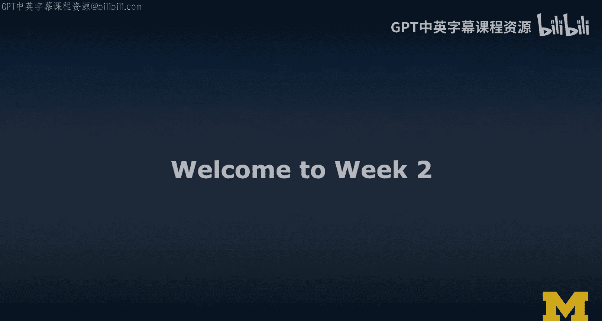
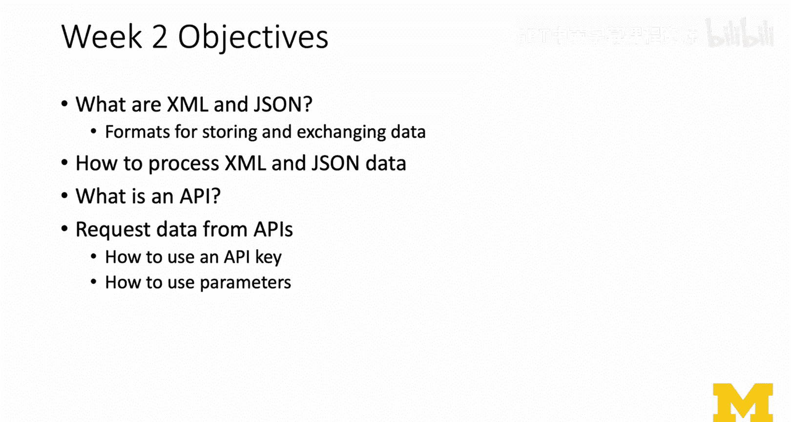
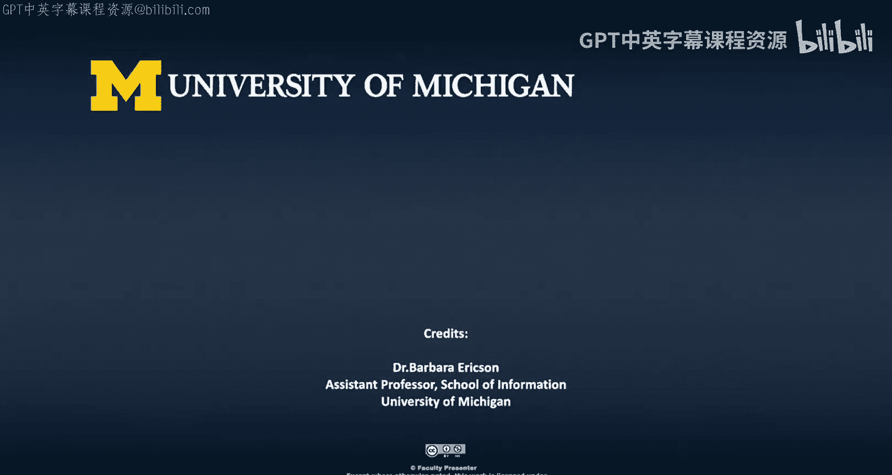

# 创造性编程：第二周：欢迎进入第二周 🚀

在本节课中，我们将要学习如何与两种重要的数据格式——XML和JSON——进行交互，并探索如何通过API（应用程序编程接口）从其他应用程序请求数据。

## 概述

本周的学习内容将围绕数据交换和处理展开。首先，我们将介绍XML和JSON这两种用于数据交换的格式。接着，我们将学习如何处理这些格式的数据。最后，我们将深入理解什么是API，并掌握如何向API发起请求以获取数据，包括使用API密钥和请求参数。

## 学习XML与JSON

上一节我们概述了本周的学习目标，本节中我们来看看具体要掌握的内容。

以下是本周你将学习到的核心技能：

*   你将学习如何使用XML和JSON。这两种是可用于交换数据的格式。
*   你还将学习如何处理XML和JSON数据。

## 理解与使用API

在掌握了数据格式后，我们将进入更动态的数据获取环节。

接下来，你将学习什么是API。这是一种应用程序向另一个应用程序请求数据的方式，其全称是**应用程序编程接口**。

具体而言，我们将使用 **`requests.get()`** 方法发起HTTP请求，以从API获取数据。

以下是关于API使用的关键学习点：

*   你将学习如何向API请求数据。
*   你将学习在需要时如何使用API密钥。
*   你将学习如何在请求中使用参数。

## 总结

本节课中，我们一起学习了第二周的核心内容：XML与JSON数据格式的处理，以及通过API进行数据请求的基本概念和方法。掌握这些技能将使你能够与各种网络服务和数据源进行交互，为你的创意编程项目注入丰富的外部数据。