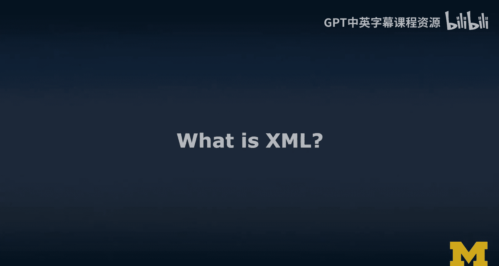
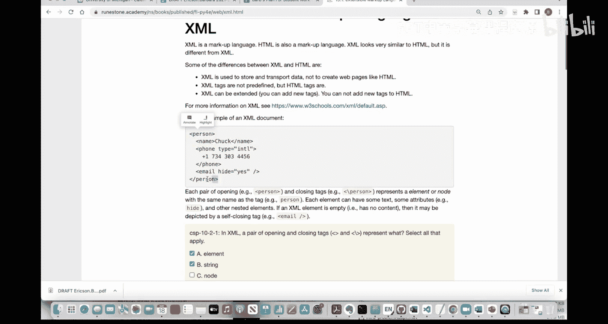

# 21：XML概念解析 📚

在本节课中，我们将要学习XML（可扩展标记语言）的基本概念。XML是一种用于存储和交换数据的标记语言，它在结构上与HTML相似，但用途更为广泛。我们将探讨XML的基本语法、结构以及它与HTML的异同。


---

## 什么是XML？ 🤔



XML代表**可扩展标记语言**。其中，“可扩展”意味着你可以根据需要添加和定义自己的标签。它在某种程度上类似于HTML。

以下是一个XML示例：

```xml
<person>
    <name>John Doe</name>
    <age>30</age>
    <city>New York</city>
</person>
```

如你所见，XML是一种标记语言，它使用与HTML相同的尖括号（`<` 和 `>`）。它同时包含开始标签和结束标签，并且标签可以嵌套。在上面的例子中，`<person>`标签内部嵌套了包含个人信息的其他标签。

本质上，XML是另一种我们可以用来存储和交换数据的格式。

---

## XML与HTML的异同 🔄

上一节我们介绍了XML的基本定义和结构，本节中我们来看看XML与HTML的主要异同。

两者都使用类似的标签语法，但目的不同：
*   HTML用于描述网页的结构和内容（如标题、段落、链接）。
*   XML用于描述和传输数据本身，其标签含义由使用者自定义。

---

## XML的核心结构 🏗️

理解了XML的用途后，我们来详细解析其核心结构。一个格式良好的XML文档必须遵循以下规则：

以下是构成XML文档的基本元素列表：
1.  **根元素**：XML文档必须有一个唯一的根元素，所有其他元素都包含在其中。例如，`<catalog>`。
2.  **开始与结束标签**：每个元素必须由开始标签（如`<book>`）和对应的结束标签（如`</book>`）闭合。
3.  **元素嵌套**：元素可以相互嵌套，但必须正确闭合，不能交叉。例如，`<a><b></b></a>`是正确的，而`<a><b></a></b>`是错误的。
4.  **属性**：开始标签内可以包含属性来提供元素的额外信息。例如，`<book id="123">`。
5.  **文本内容**：元素可以包含文本内容，如`<title>Python编程</title>`。

---

## 为什么使用XML？ 💡



我们已经了解了XML的语法规则，你可能会问，为什么要使用它？XML的主要优势在于其**可扩展性**和**平台无关性**。


由于标签是自定义的，XML可以描述各种类型的数据结构，从简单的通讯录到复杂的配置文档。同时，纯文本格式使其易于被不同的系统和编程语言读取和处理，因此它成为应用程序之间交换数据的常用格式。


---

本节课中我们一起学习了XML的基础概念。我们了解到XML是一种可扩展的标记语言，用于存储和传输数据。我们分析了它的基本语法结构，包括标签、嵌套和属性，并比较了它与HTML的异同。最后，我们探讨了XML在数据交换和存储中的实用价值。掌握XML是理解许多现代数据格式和网络通信协议的重要一步。