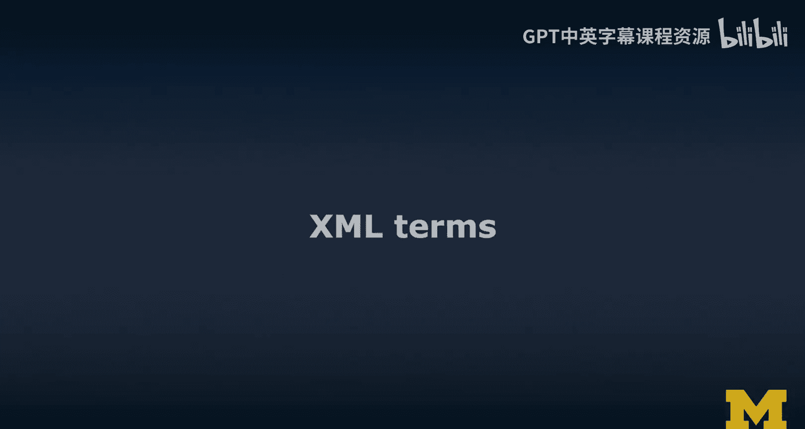
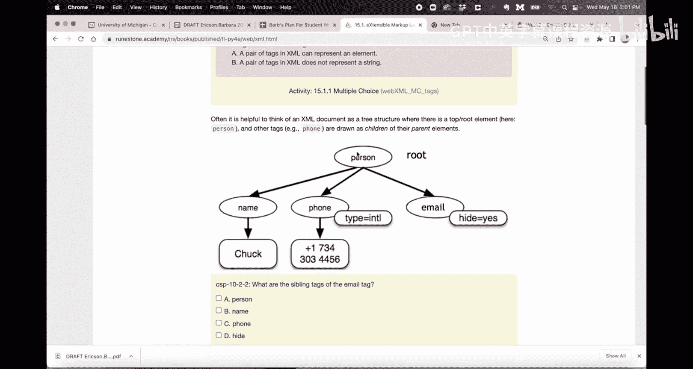

# 创造性编程：22：XML术语详解 📖


在本节课中，我们将详细学习XML文档的基本结构和相关术语。我们将通过一个具体的例子，了解XML中的标签、元素、属性以及树形结构是如何组织的。



---

## XML文档示例

以下是一个XML文档的例子。

```xml
<person>
  <name>Chuck</name>
  <phone type="intl">+1 734 303 4456</phone>
  <email hide="yes"/>
</person>
```

## XML术语详解

上一节我们看到了一个XML示例，本节中我们来详细看看其中的各个组成部分。

### 开始标签与结束标签

XML文档由标签构成。一个元素通常由**开始标签**和**结束标签**包围。例如，`<name>`是开始标签，`</name>`是结束标签，它们之间的内容是元素的值。

### 自闭合标签

如果一个标签没有内容，即开始标签和结束标签之间没有任何文本或其他元素，则可以使用**自闭合标签**。其写法是在开始标签的末尾加上一个斜杠 `/` 和右尖括号 `>`。

例如，`<email hide="yes"/>` 就是一个自闭合标签。它等价于 `<email hide="yes"></email>`。

### 树形结构

XML数据可以表示为一个**树形结构**。在这个结构中，有一个**根元素**，其他元素都是它的子节点。

以下是上述XML示例对应的树形结构：
*   **根节点**：`person`
    *   **子节点**：`name`
        *   **文本值**：`Chuck`
    *   **子节点**：`phone`
        *   **属性**：`type="intl"`
        *   **文本值**：`+1 734 303 4456`
    *   **子节点**：`email`
        *   **属性**：`hide="yes"`

### 元素与属性

*   **元素**：如 `<name>`、`<phone>`，是树形结构中的节点。
*   **属性**：提供关于元素的额外信息，位于开始标签内。例如，在 `<phone type="intl">` 中，`type` 是属性名，`"intl"` 是属性值。

### 层级关系



XML结构体现了清晰的**父子关系**和**层级关系**。
*   在上面的例子中，`person` 是根元素，也是 `name`、`phone` 和 `email` 的**父节点**。
*   反过来，`name`、`phone` 和 `email` 是 `person` 的**子节点**。


---


本节课中我们一起学习了XML的核心术语。我们了解了XML文档由开始标签、结束标签和自闭合标签构成，数据可以组织成具有父子关系的树形结构，并且元素可以拥有提供额外信息的属性。理解这些基本概念是后续解析和处理XML数据的基础。