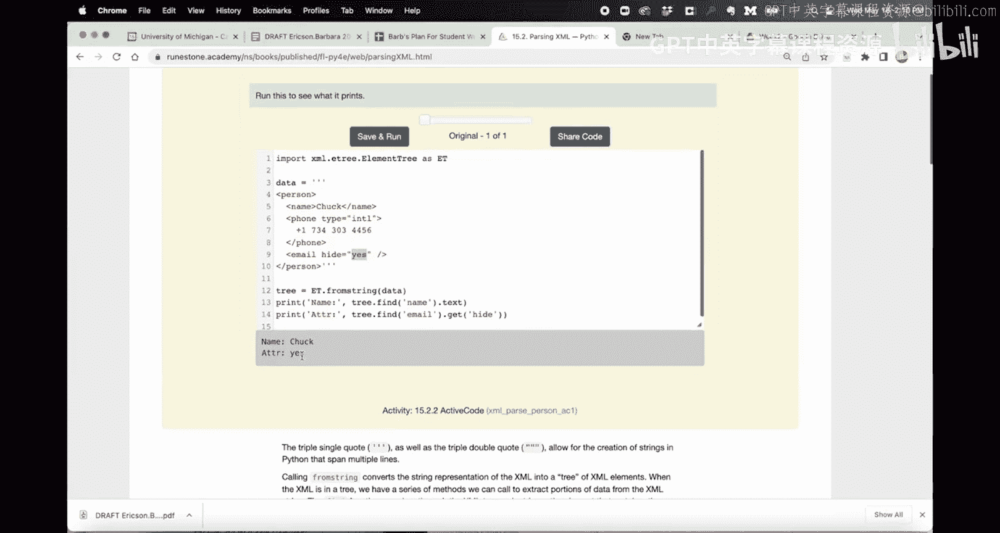

# 创造性编程：23：XML解析技术


在本节课中，我们将要学习如何使用Python解析XML数据。XML是一种常见的数据格式，用于存储和传输结构化信息。我们将使用Python内置的`xml.etree.ElementTree`库来读取XML字符串，并从中提取所需的数据。


## 导入库与解析XML

首先，我们需要导入处理XML所需的库。与Beautiful Soup类似，`xml.etree.ElementTree`是一个强大的工具，它允许我们将XML数据解析成一个树形结构，从而方便地访问其中的元素。

```python
import xml.etree.ElementTree as ET
```

我们使用`as ET`为这个模块创建一个简短的别名，以便在后续代码中更方便地引用它。

接下来，我们创建一个包含XML数据的多行字符串。在Python中，使用三个引号可以定义跨越多行的字符串。

```python
data = '''
<person>
  <name>Chuck</name>
  <phone type="intl">
    +1 734 303 4456
  </phone>
  <email hide="yes"/>
</person>
'''
```

然后，我们使用`ET.fromstring()`函数来解析这个字符串。这个函数会读取XML数据，将其转换为一个树形结构，并返回代表整个XML文档的根节点对象。

```python
tree = ET.fromstring(data)
```

现在，变量`tree`指向XML树的根节点，即`<person>`标签。

## 查找元素与提取数据

上一节我们介绍了如何将XML字符串解析为树结构。本节中我们来看看如何从这棵树中查找特定的元素并提取信息。

我们可以使用`find()`方法来查找当前节点的子元素。例如，要查找`<name>`标签，可以这样做：

```python
name_element = tree.find('name')
```

`find('name')`会返回第一个匹配的`<name>`子元素对象。要从这个元素对象中获取其包含的文本内容，我们可以访问其`.text`属性。

```python
name_text = name_element.text
```

以下是提取XML中不同数据的步骤列表：

1.  **查找并提取文本内容**：使用`find()`方法定位标签，然后使用`.text`属性获取其内部的文本。
2.  **查找并提取属性值**：同样使用`find()`方法定位标签，然后通过类似字典的方式访问其属性，例如`element.get('attribute_name')`。

让我们实践一下。为了提取电子邮件标签的`hide`属性，我们可以这样做：

```python
email_element = tree.find('email')
hide_attribute = email_element.get('hide')
```

最后，我们可以将提取出的信息打印出来：

```python
print('Name:', name_text)
print('Attribute:', hide_attribute)
```



这段代码将输出：
```
Name: Chuck
Attribute: yes
```


## 总结


本节课中我们一起学习了XML解析的基础技术。我们首先导入了`xml.etree.ElementTree`库，然后将一个XML字符串解析为树形结构。接着，我们使用`find()`方法在树中定位特定的元素标签，并通过`.text`属性获取元素的文本内容，或通过`.get()`方法获取元素的属性值。这些操作为处理更复杂的XML数据打下了坚实的基础。