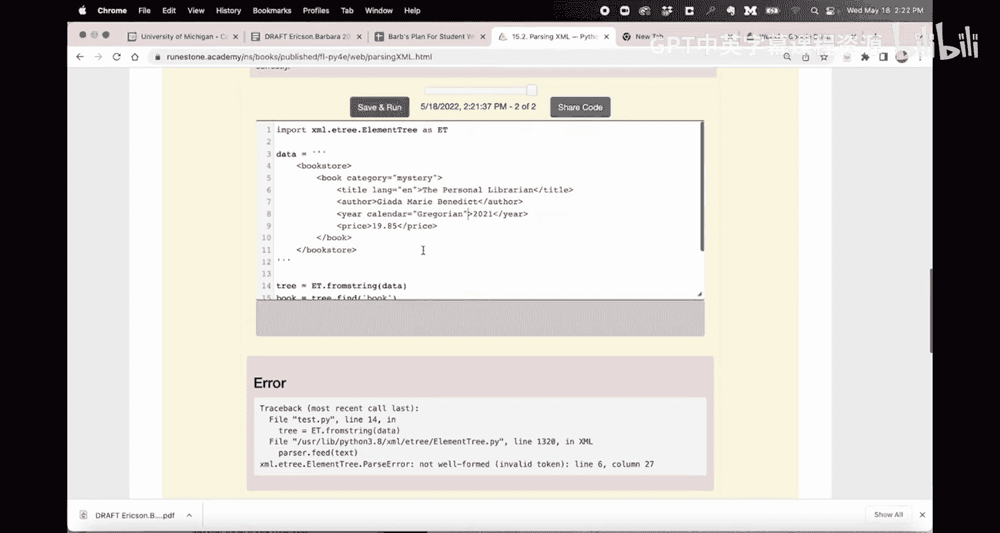

# 24：修复XML文档 🛠️

在本节课中，我们将学习如何识别和修复XML文档中的常见错误。XML是一种用于存储和传输数据的标记语言，其结构必须严格遵守语法规则，否则解析器将无法正确读取数据。我们将通过一个具体的例子，逐步分析错误原因并实施修复。

## 识别错误

上一节我们介绍了XML的基本结构，本节中我们来看看如何定位文档中的错误。首先，尝试运行一个有问题的XML文件，解析器通常会返回错误信息，指出问题所在的行和大致原因。

例如，解析器可能报告“第14行错误，XML无效标记位于第6行”。这表明我们需要重点关注文档的第6行附近。

## 分析并修复错误

以下是修复XML文档时需要检查的几个关键点：

1.  **检查标签是否闭合**：每个开始标签都必须有一个对应的结束标签。例如，`<title>` 必须有 `</title>` 与之匹配。在上述错误中，第6行附近的 `<title>` 标签就缺少了闭合标签。
2.  **检查标签嵌套顺序**：标签必须正确嵌套，后开始的标签必须先闭合。确保结束标签的位置没有放错。
3.  **检查属性值引号**：所有属性的值都必须用双引号 `"` 或单引号 `'` 括起来。例如，`category="cooking"` 是正确的，而 `category=cooking` 会导致解析失败。案例中 `Gregorian` 属性值就缺少了引号。

通过逐一检查并修正这些问题，例如补全缺失的 `</title>` 和 `</author>` 标签，为 `Gregorian` 属性加上引号，最终可以使XML文档变得有效。

## 总结

本节课中我们一起学习了修复XML文档的核心步骤。关键在于确保**每个开始标签都有匹配的结束标签**，并且**所有属性值都被引号正确包裹**。遵循这些简单的规则，就能解决大部分XML格式错误，使文档能够被顺利解析。