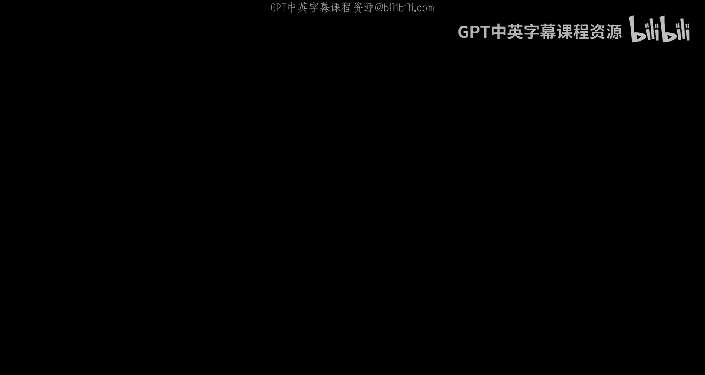
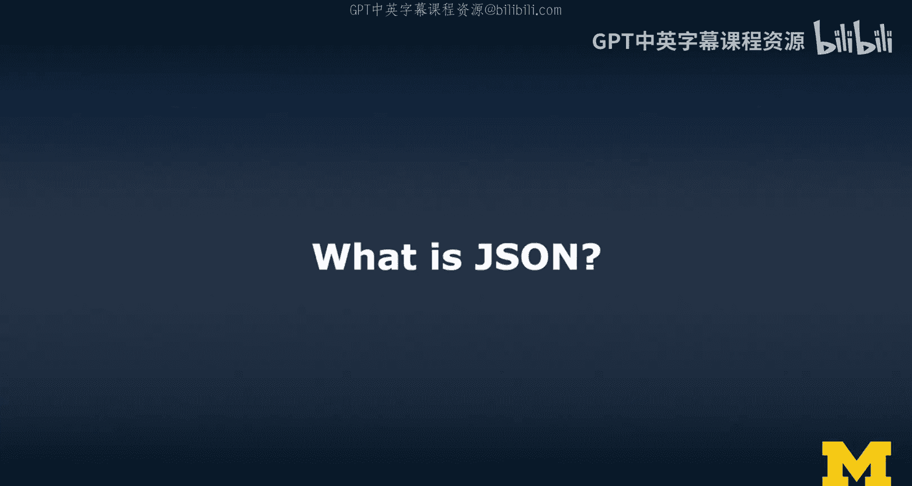
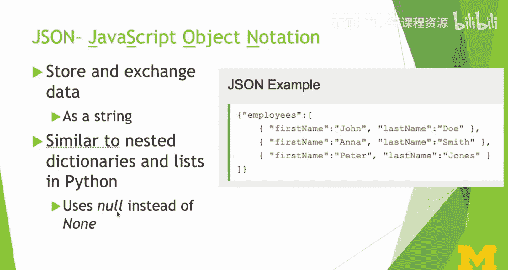
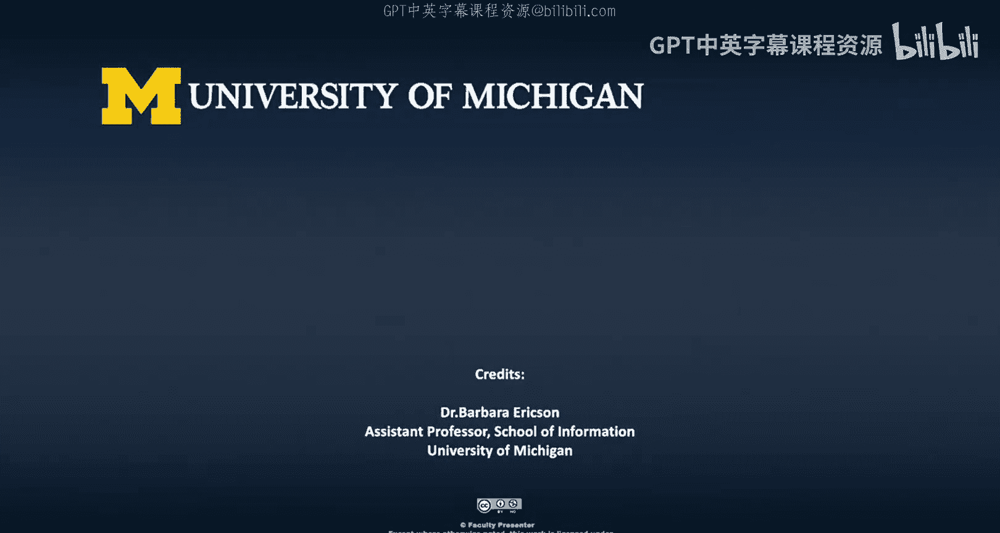
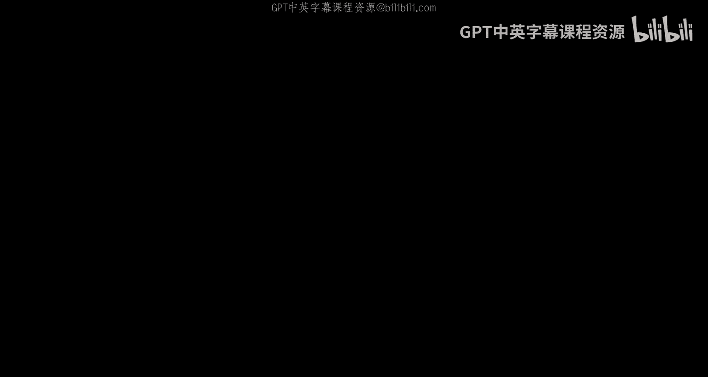

# 创造性编程：25：JSON基础介绍 📚



在本节课中，我们将要学习JSON的基础知识。JSON是一种轻量级的数据交换格式，广泛应用于网络数据传输和配置文件。理解JSON的结构和用法，对于从网络API获取数据或存储结构化信息至关重要。



## 什么是JSON？ 🤔

上一节我们介绍了课程主题，本节中我们来看看JSON的具体定义。

JSON代表JavaScript对象表示法。它是一种用于存储和交换数据的方式，特别是我们可以从Web服务器以字符串形式获取数据。然而，该字符串表示的是嵌套的字典和列表，这与我们在Python中看到的结构非常相似。

## JSON的结构示例 📊

了解了JSON的基本概念后，我们通过一个具体例子来观察其典型结构。

以下是一个JSON示例，它展示了一个包含员工信息的结构：

```json
{
  "employees": [
    {
      "firstName": "John",
      "lastName": "Doe"
    },
    {
      "firstName": "Anna",
      "lastName": "Smith"
    }
  ]
}
```

在这个例子中，我们有一个字典，它有一个键`"employees"`，其值是一个字典列表。然后，每个内部字典都有`"firstName"`和`"lastName"`键。

## JSON与Python数据结构的异同 🔄

看过了JSON的示例结构，接下来我们将其与熟悉的Python数据结构进行对比。

JSON与Python非常相似，但它使用`null`而不是`None`来表示空值。以下是核心数据类型的对比：



*   **对象/字典**： 在JSON中用花括号`{}`表示，在Python中用`dict`表示。
*   **数组/列表**： 在JSON中用方括号`[]`表示，在Python中用`list`表示。
*   **字符串**： 在JSON中必须使用双引号`""`，在Python中单双引号均可。
*   **数字**： 表示方式相同（整数、浮点数）。
*   **布尔值**： JSON中使用`true`和`false`（小写），Python中使用`True`和`False`（首字母大写）。
*   **空值**： JSON中使用`null`，Python中使用`None`。



## 总结 📝



本节课中我们一起学习了JSON的基础知识。我们了解了JSON是一种用于数据交换的文本格式，其结构类似于Python的字典和列表。我们比较了JSON与Python在数据类型表示上的关键区别，例如使用`null`而非`None`。掌握JSON是进行网络数据交互和处理结构化配置文件的重要一步。