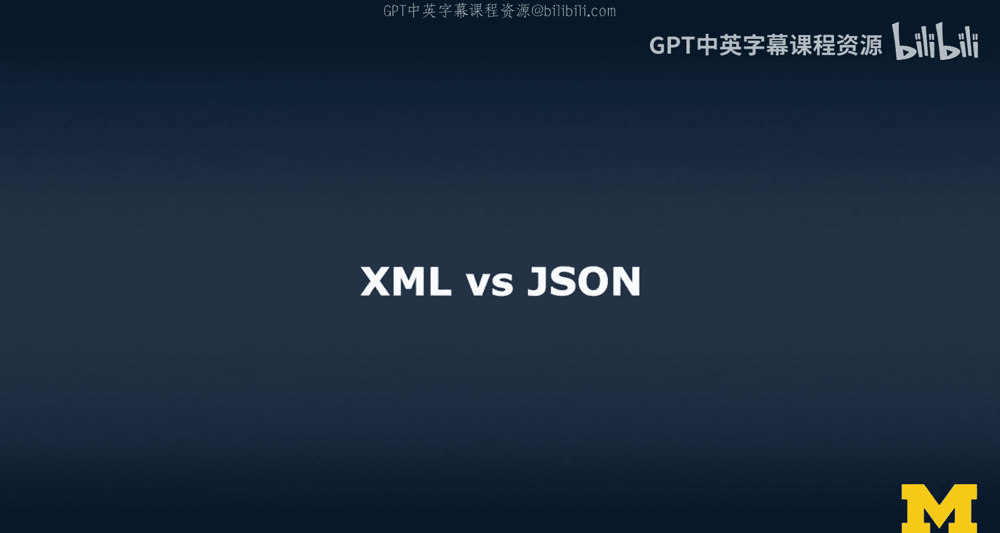
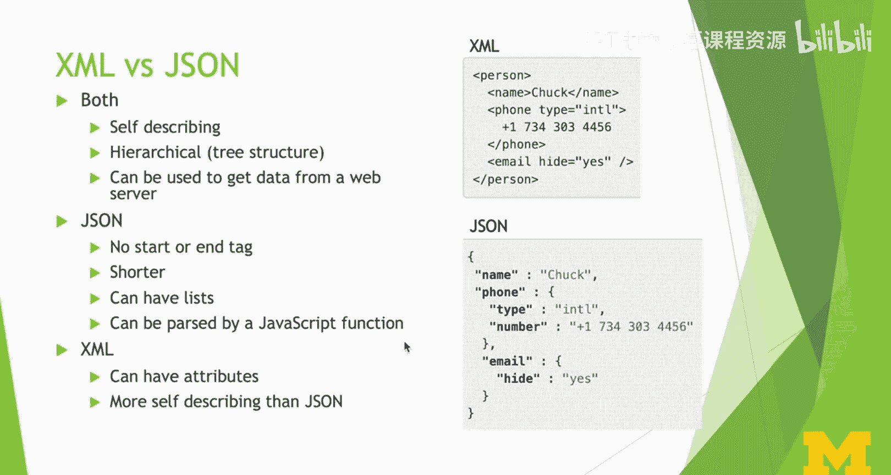

# 26：XML与JSON对比 🆚




在本节课中，我们将要学习两种常见的数据交换格式：XML和JSON。我们将通过对比它们的结构、特点和使用场景，帮助你理解它们之间的异同，并了解在何种情况下选择使用哪一种格式。

## XML与JSON概述

上一节我们介绍了数据交换的基本概念，本节中我们来看看两种具体的数据格式：XML和JSON。它们都是用于存储和传输结构化数据的常用格式。

## XML格式示例

以下是XML格式的一个简单示例。XML是一种标记语言，使用尖括号来定义标签，其外观与HTML非常相似。

```xml
<person>
  <name>John Doe</name>
  <phone type="mobile">123-456-7890</phone>
  <email hide="yes"/>
</person>
```

在XML中，你可以在开始标签中包含属性，也可以使用自闭合标签。它通过标签的嵌套来构建数据的层次结构。

## JSON格式示例

以下是JSON格式的一个简单示例。JSON使用嵌套的字典和列表结构来表示数据。

```json
{
  "name": "John Doe",
  "phone": {
    "type": "mobile",
    "number": "123-456-7890"
  },
  "email": {
    "hide": "yes"
  }
}
```

JSON通过键值对来组织数据，可以轻松地表示复杂的嵌套结构。

## 两者对比分析

现在我们来具体对比XML和JSON的特性。以下是它们的主要区别和共同点：

*   **自描述性**：两者都具有一定的自描述性，能够解释它们所包含的数据类型。XML通常在自描述性方面更胜一筹，因为它提供了更多关于数据类型的细节（例如，明确指出`<phone>`标签）。JSON则通过键名（如`"phone"`）来实现类似的功能。
*   **层次结构**：两者都是分层的，具有树状结构。
*   **数据交换**：两者都可用于从Web服务器获取数据。
*   **语法差异**：JSON没有像XML那样的开始和结束标签（例如，没有`<person>`和`</person>`这样的配对标签）。JSON的语法通常更简洁。
*   **数据结构**：JSON可以包含列表（数组），而XML可以通过元素序列实现类似功能。
*   **解析方式**：JSON可以被JavaScript函数直接解析，这在Web开发中非常方便。XML则通常需要特定的解析器。
*   **属性处理**：XML支持标签内的属性。在JSON中，这些属性通常被转化为嵌套的字典值。



## 使用场景总结

本节课中我们一起学习了XML和JSON的对比。总的来说，XML的自描述性通常比JSON更强。

目前，大多数人在传输数据时更倾向于使用JSON。XML则更多地被用于需要高度自描述性的场景，例如文字处理器文档格式或电子书的创建。


在选择使用XML还是JSON时，你可以根据项目需求、数据结构的复杂性以及与现有系统的兼容性来决定。