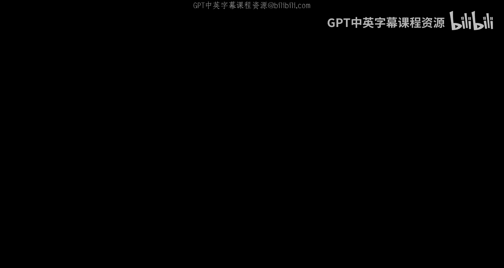
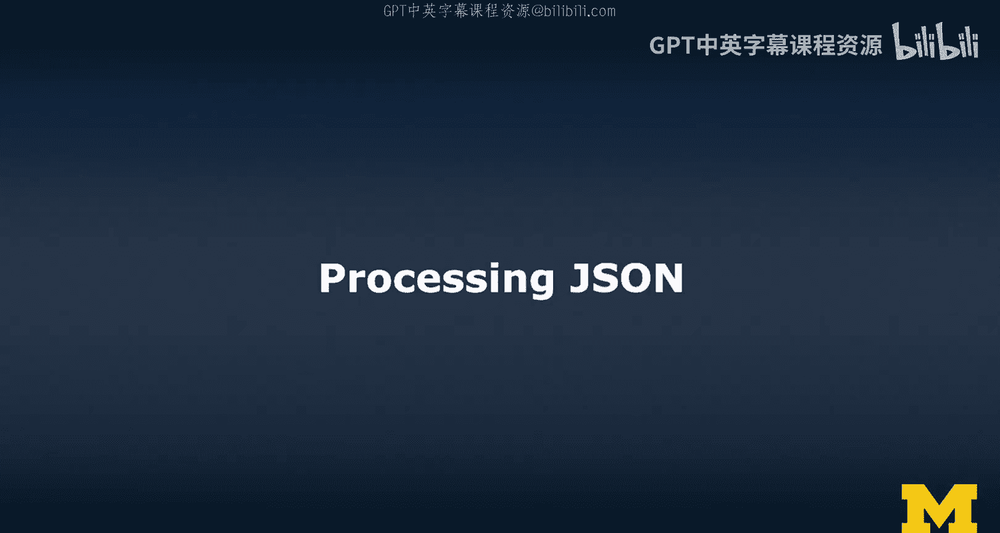
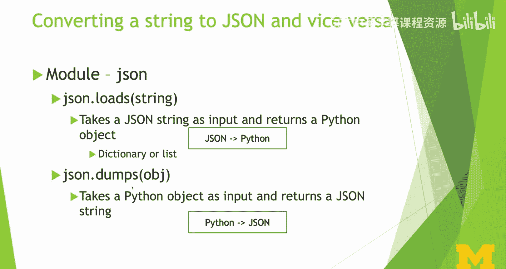
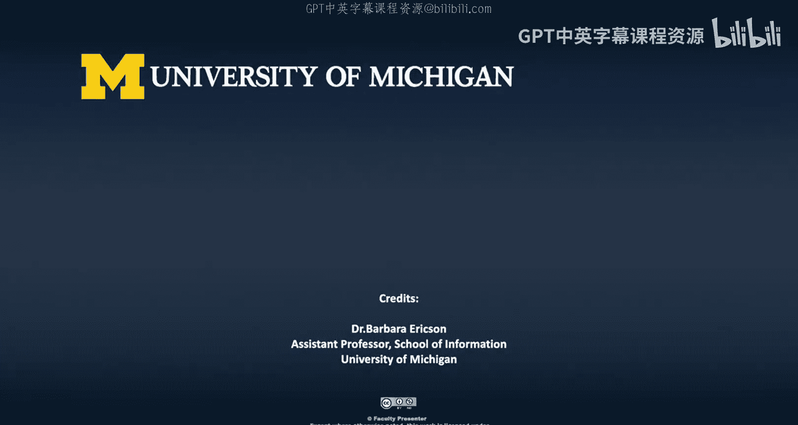

# 27：JSON数据处理 🗂️

在本节课中，我们将学习如何在Python中处理JSON数据。JSON是一种常见的数据交换格式，广泛用于网络通信和配置文件。我们将了解如何将JSON字符串转换为Python对象，以及如何将Python对象转换回JSON字符串。

---

上一节我们介绍了JSON的基本概念，本节中我们来看看具体的转换方法。

要在Python对象和JSON字符串之间进行转换，我们必须导入`json`模块。这是一个允许我们处理JSON的库。

然后，我们可以获取一个字符串，并使用`json.loads()`函数将其转换为Python对象（列表或字典）。该函数接收一个字符串参数，并返回一个Python列表或字典。因此，我们需要知道我们期望的JSON结构是什么，或者需要立即检查它。

接着，如果我们有一个Python列表或字典，我们可以使用`json.dumps()`函数将其转换为JSON字符串。该函数接收一个对象参数，并返回一个字符串。然后，我们可以将这个字符串写入文件。

以下是处理JSON的基本步骤：

1.  **导入模块**：首先，需要导入`json`模块。
2.  **解析JSON**：使用`json.loads()`将JSON字符串转换为Python对象。
3.  **生成JSON**：使用`json.dumps()`将Python对象转换为JSON字符串。

这就是处理JSON的方法。

---

本节课中我们一起学习了JSON数据处理的核心操作。我们掌握了使用`json.loads()`函数将JSON字符串解析为Python列表或字典，以及使用`json.dumps()`函数将Python对象序列化为JSON字符串。这些是进行数据交换和存储的基础技能。