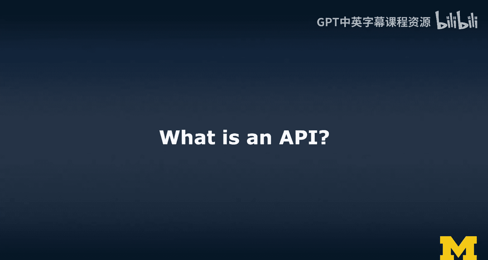
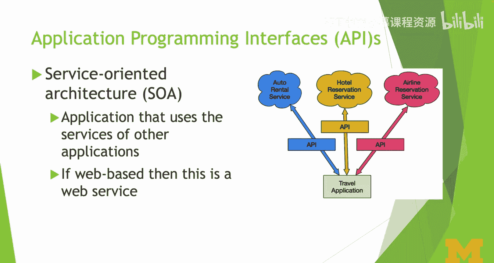
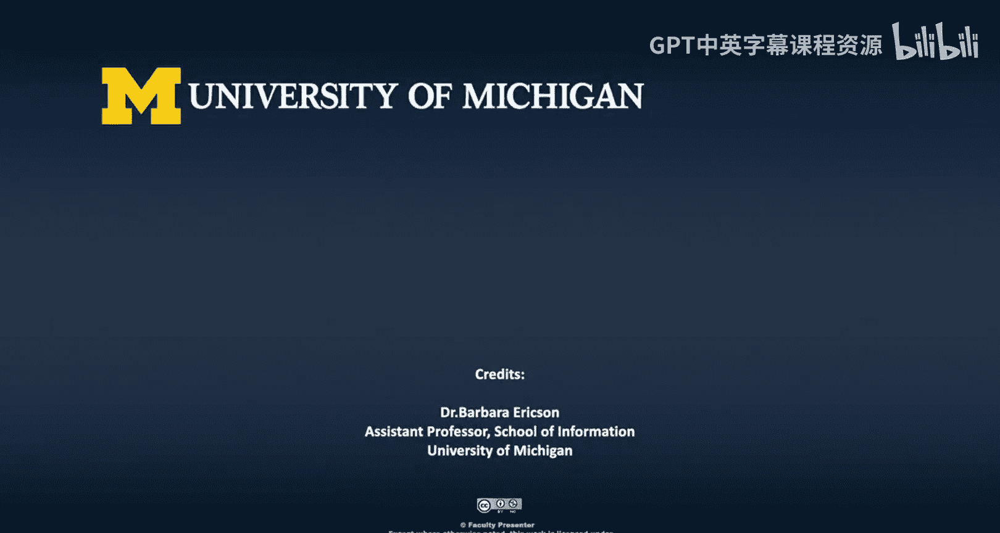

# 28：API核心概念 🧩

在本节课中，我们将要学习API的核心概念。API是连接不同应用程序的桥梁，它允许程序之间相互请求和交换数据。我们将了解API的含义、常见的数据格式以及它在现代软件架构中的作用。

---

## 什么是API？

API代表**应用程序编程接口**。它是两个应用程序之间进行通信的一种方式。一个应用程序可以请求数据，另一个应用程序则返回数据。

我们倾向于使用我们刚刚学过的两种数据格式：XML和JSON。如今，你更可能使用的是JSON。

---

## 面向服务的架构

如果一个应用程序使用了其他应用程序的服务，我们称之为**面向服务的架构**或**SOA**。

例如，你可能访问一个网站，一次性预订了最喜欢的书籍、航班、酒店和租车服务。该网站本身并不存储所有这些数据，而是通过API联系其他网站来获取这些信息并完成预订。

---

## Web服务

如果上述所有交互都通过网络进行，我们称之为**Web服务**。

---

本节课中，我们一起学习了API的核心概念。我们了解到API是应用程序间的通信接口，常用JSON格式交换数据。我们还探讨了面向服务的架构，以及API如何支撑起现代Web服务，让不同平台能够无缝协作。