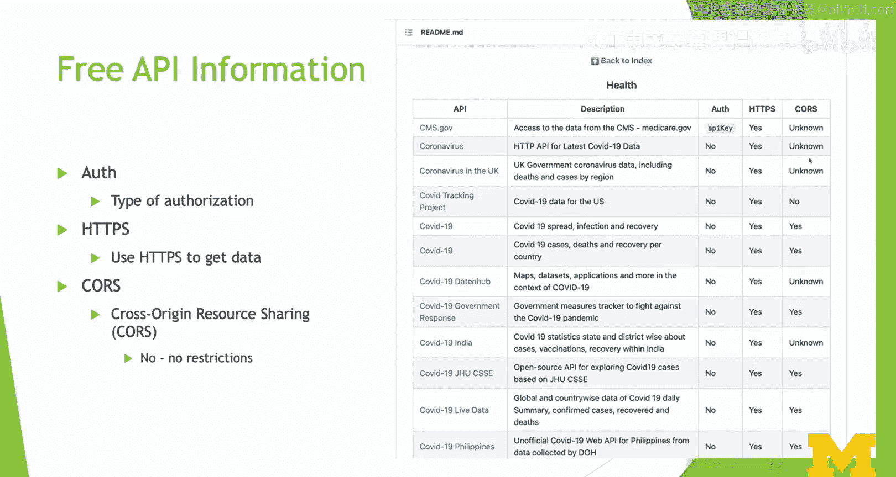

# 29：免费API资源

在本节课中，我们将学习如何寻找和利用免费的API资源。我们将介绍一个包含大量免费API列表的GitHub仓库，并演示如何查看API的详细信息、理解其授权方式，以及如何初步测试和使用一个API。

## 寻找免费API资源

当你开始使用API时，拥有一份可用资源列表会很有帮助。这份列表可以告诉你能够获取哪些数据，以及需要何种授权。

这里有一个非常棒的GitHub仓库，其URL如下。该仓库的索引中列出了不同主题的API。当你访问该仓库并向下滚动时，会看到一个分类列表。

## 探索API列表

以下是探索该列表的步骤：

1.  **浏览分类**：在仓库主页，你可以看到按主题（如健康、动物等）分类的列表。
2.  **查看详情**：点击某个分类，例如“动物”，你会看到一个表格，其中包含该类别下的各个API信息。
3.  **理解信息**：表格中通常包含以下列：
    *   **API名称**：你可以点击它直接跳转到API的官方文档或网站。
    *   **描述**：关于该API功能的简要说明。
    *   **授权方式**：访问该API所需的授权类型，例如“无需授权”、“需要API密钥”或“需要OAuth授权”。
    *   **HTTPS**：该API是否支持HTTPS安全连接。
    *   **CORS**：跨源资源共享设置。这关系到你的网页应用能否从不同域访问该API。“否”通常意味着没有限制，“是”则可能有某些限制，“未知”则需要自行查明。

## 使用一个示例API

一旦你找到一个免费的API，例如“动物”分类下的“免费猫咪趣事”API，你就可以开始尝试使用它。

首先，阅读其文档以了解如何发起请求。文档会指明基础请求URL。例如，该API的基础URL可能是：
`https://cat-fact.herokuapp.com`

然后，你可以在URL后添加不同的**端点**或路径来获取特定数据。例如，添加 `/facts` 端点可以获取猫咪趣事列表，完整的请求URL如下：
`https://cat-fact.herokuapp.com/facts`

## 格式化JSON响应

直接从浏览器或命令行获取的JSON数据有时难以阅读。为了使数据结构更清晰，你可以使用在线JSON格式化工具。

1.  访问一个JSON格式化网站，例如 `https://jsonformatter.org`。
2.  将原始的JSON响应文本粘贴到输入框中。
3.  点击“格式化”或“美化”按钮。
4.  工具会输出结构清晰、缩进分明的JSON，这让你更容易理解数据的层次和内容。

---

本节课中，我们一起学习了如何利用GitHub上的公共仓库寻找免费的API资源，如何解读API列表中的关键信息（如授权方式和CORS），并通过一个具体的猫咪趣事API演示了查找文档、构建请求URL的过程。最后，我们还介绍了使用在线工具格式化JSON响应，以便更轻松地处理和理解数据。掌握这些步骤，你就能自信地探索和集成各种网络API到你的创意编程项目中了。