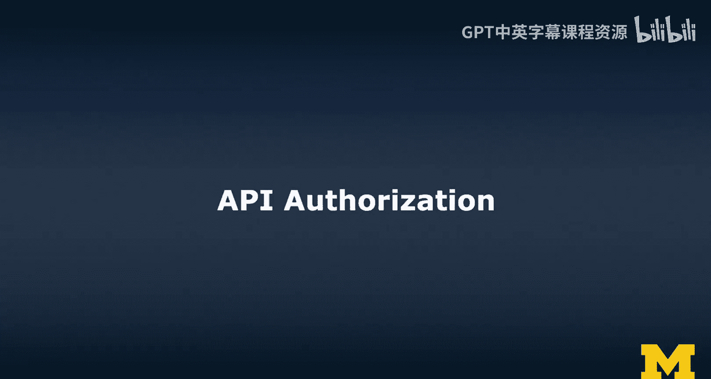
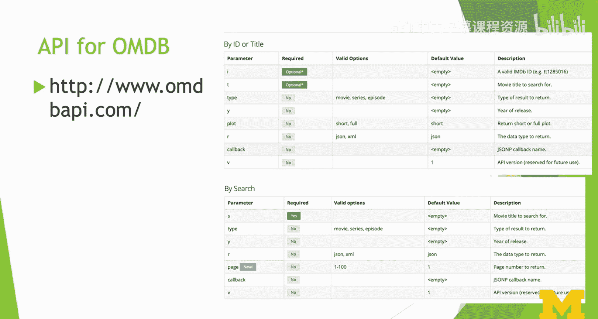
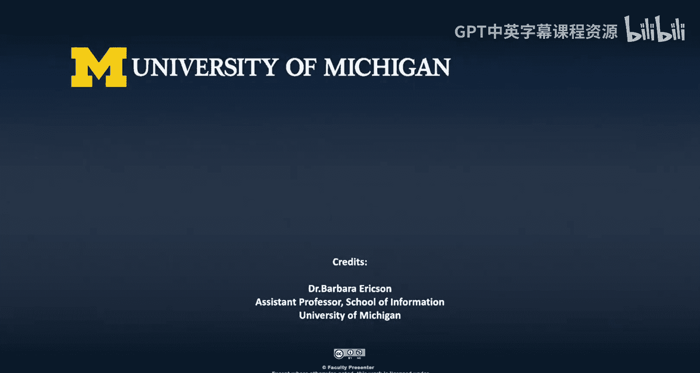

# 创造性编程：30：API授权机制 🔑




在本节课中，我们将要学习如何与需要授权密钥的API进行交互。我们将了解API密钥的作用、如何获取它们，以及如何在请求中使用它们来获取数据。

## 什么是API密钥？

当您使用API时，某些API会要求您提供一个API密钥。服务提供方希望通过密钥来识别谁在使用其服务。他们可能借此来限制您的使用量，甚至可能需要您提供账单信息。此外，一些服务器可能需要更强大的授权机制，称为OAuth授权。OAuth是一个允许第三方应用程序访问网络服务的框架，您可以在此URL阅读更多相关信息。

## 如何获取并使用API密钥？

如果您发现想要连接的API需要一个密钥，例如在线电影数据库OMDB，您通常可以申请一个。以下是获取和使用API密钥的步骤。

以下是获取OMDB API密钥的步骤：
1.  访问 `omdbapi.com/apikey.aspx`。
2.  申请免费密钥，它通常有每日1000次请求的限制，对于学习来说应该足够了。
3.  点击提交并填写您的信息。

获取密钥后，您需要在请求中添加它。具体做法是在您的请求URL中添加 `apikey=` 参数，后面跟上您的密钥。

## 理解API文档

每个API都有不同的使用方式，因此您必须阅读其API文档来了解如何获取所需信息。以OMDB API为例，其文档会说明您可以使用的参数。

以下是OMDB搜索功能的一些关键参数：
*   **`s`** (必需)：要搜索的电影标题。
*   **`type`** (可选)：指定类型，如电影、系列或剧集。
*   **`y`** (可选)：指定发布的年份。

## 实践示例



上一节我们介绍了API密钥的基本概念和获取方法，本节中我们来看看一个具体的请求示例。

以下是一个搜索“教父”电影的请求URL示例：
```
http://www.omdbapi.com/?apikey=你的密钥&s=godfather
```

在这个URL中，不同的参数用“&”符号分隔。API会自动处理特殊字符，例如引号会被转换为`%22`。执行此请求后，服务器会返回关于“教父”的大量信息。

## 总结




本节课中我们一起学习了API授权机制。我们了解到API密钥用于识别用户和控制访问，学习了如何为OMDB等服务申请密钥，并掌握了在HTTP请求中添加`apikey`参数来使用密钥的方法。关键在于，每个API都有其独特的参数和要求，因此仔细阅读官方文档是成功集成API的必要步骤。