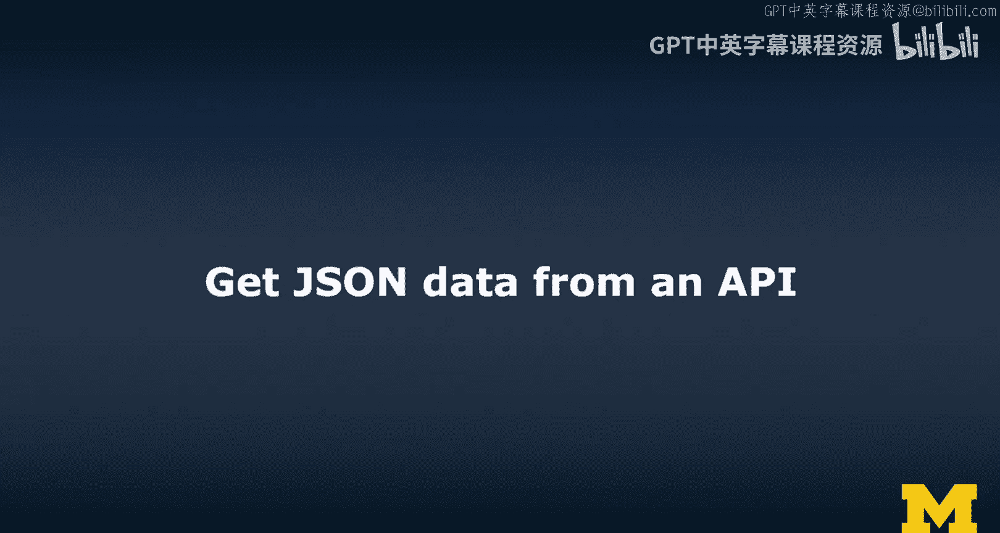
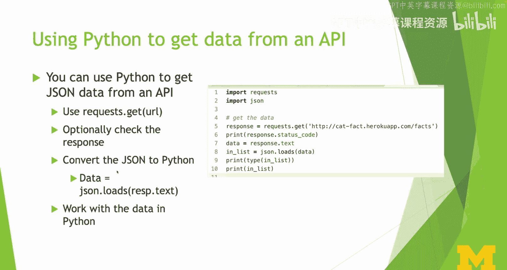

# 创造性编程：31：从API获取JSON数据 🚀

在本节课中，我们将学习如何使用Python从网络API获取数据，并将返回的JSON格式数据转换为Python对象进行处理。


## 概述



我们可以使用Python从API获取数据。具体方法是使用 `requests.get()` 函数向目标URL发送请求。你需要根据API的要求组装请求。之后，我们可以检查响应的状态码。如果状态码是 **200**，表示请求成功；如果是 **404**，则表示未找到资源。我们可以从响应中获取数据，通过 `.text` 属性获取原始文本，然后使用 `json.loads()` 函数将JSON文本转换为Python的列表或字典。在本例中，转换结果将是一个列表。我们可以打印该对象的类型，也可以直接打印其内容。

## 核心步骤详解

上一节我们介绍了从API获取数据的基本概念，本节中我们来看看具体的实现步骤和细节。

### 1. 发送请求与检查状态

首先，使用 `requests.get()` 方法向指定的API端点URL发送HTTP GET请求。发送请求后，检查返回的响应对象的状态码至关重要，它能告诉我们请求是否被服务器成功处理。

以下是发送请求和检查状态码的核心代码：

```python
import requests

response = requests.get('https://api.example.com/data')
status_code = response.status_code
```

*   **200**: 表示请求成功。
*   **404**: 表示请求的资源未找到。
*   其他状态码（如500）表示服务器内部错误。

### 2. 解析JSON数据

如果请求成功（状态码为200），我们就可以处理响应体中的数据。API通常返回JSON格式的数据。我们需要将JSON字符串解析为Python能够直接操作的数据结构。

以下是解析JSON数据的核心代码：

```python
import json

if response.status_code == 200:
    # 获取响应的文本内容
    response_text = response.text
    # 将JSON字符串解析为Python对象（列表或字典）
    data = json.loads(response_text)
    print(type(data))  # 查看转换后的数据类型
    print(data)        # 打印数据内容
else:
    print(f"请求失败，状态码：{response.status_code}")
```

## 工作流程总结



本节课中我们一起学习了从API获取并处理数据的完整流程。


1.  **发送请求**：使用 `requests.get()` 方法。
2.  **检查响应**：通过 `response.status_code` 验证请求是否成功。
3.  **转换数据**：使用 `json.loads(response.text)` 将JSON字符串转换为Python对象（列表或字典）。
4.  **处理数据**：像操作普通Python列表或字典一样使用转换后的数据。


记住，你可以使用 `requests.get` 发送请求，可以选择性地检查响应结果以确认操作是否成功，可以将JSON数据转换为Python对象，然后就可以在Python中自由地使用这些数据了。