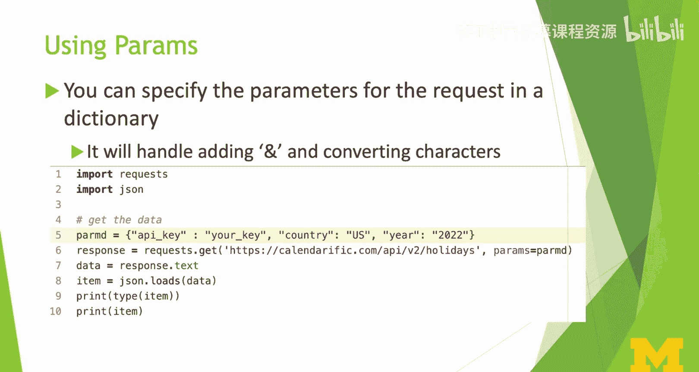

# 创造性编程：32：使用params指定API参数 🛠️

在本节课中，我们将学习如何更便捷地向API发送请求，特别是如何通过`params`参数来指定API密钥和其他查询参数，而无需手动拼接复杂的URL字符串。


## 概述

调用网络API时，通常需要提供一些参数，例如API密钥、搜索条件或筛选选项。虽然你可以手动将这些参数拼接成一个带有`&`符号的查询字符串，但Python的`requests`库提供了一个更简单、更安全的方法。

## 使用`params`字典

`requests`库允许你创建一个字典，其中包含所有需要发送给API的键值对参数。然后，你可以将这个字典传递给`requests.get()`函数的`params`参数。库会自动处理URL的编码和拼接，确保特殊字符被正确转换。

以下是使用`params`参数的基本步骤：

1.  **导入`requests`库**：首先确保你已经安装了`requests`库。
2.  **定义参数字典**：创建一个Python字典，键是API要求的参数名，值是对应的参数值。
3.  **发送请求**：调用`requests.get()`，传入基础URL和参数字典。

## 实践示例

假设我们正在使用一个查询特定国家在某一年所有假日的API。该API要求提供API密钥、国家代码和年份。

以下是如何使用`params`参数来实现的代码示例：

```python
import requests

# 1. 定义基础URL（不包含查询参数）
base_url = "https://api.example.com/holidays"

# 2. 创建参数字典
params = {
    "api_key": "YOUR_ACTUAL_API_KEY_HERE",  # 替换为你的真实API密钥
    "country": "US",
    "year": 2024
}

# 3. 发送GET请求，并传递params参数
response = requests.get(base_url, params=params)

# 4. 处理响应数据
data = response.json()
print(data)
```

在上面的代码中：
*   `base_url`是API的端点地址，不包含`?`后面的查询字符串。
*   `params`字典清晰地列出了所有必需的参数。
*   `requests.get()`函数接收这两个参数，并自动构建出完整的请求URL（例如：`https://api.example.com/holidays?api_key=...&country=US&year=2024`）。

## 优势总结

使用`params`参数的方法相比手动拼接字符串有以下几个主要优势：



*   **代码更清晰**：参数字义明确，易于阅读和维护。
*   **自动编码**：`requests`库会自动处理URL编码，确保特殊字符（如空格、中文等）被正确转换为`%20`等形式，避免错误。
*   **防止错误**：减少了因手动拼接导致的格式错误，如漏掉`&`或`?`符号。


## 总结


本节课我们一起学习了如何高效地使用`requests`库的`params`参数来指定API请求参数。通过创建一个参数字典并将其传递给`get()`函数，我们可以让代码更简洁、更健壮，并避免手动处理URL编码的麻烦。这是与Web API进行交互时一个非常实用且重要的技巧。