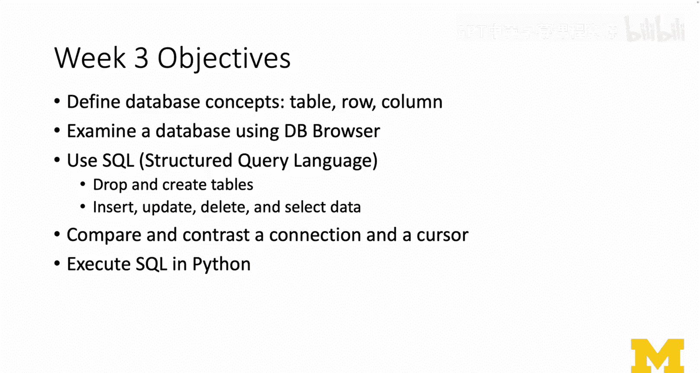
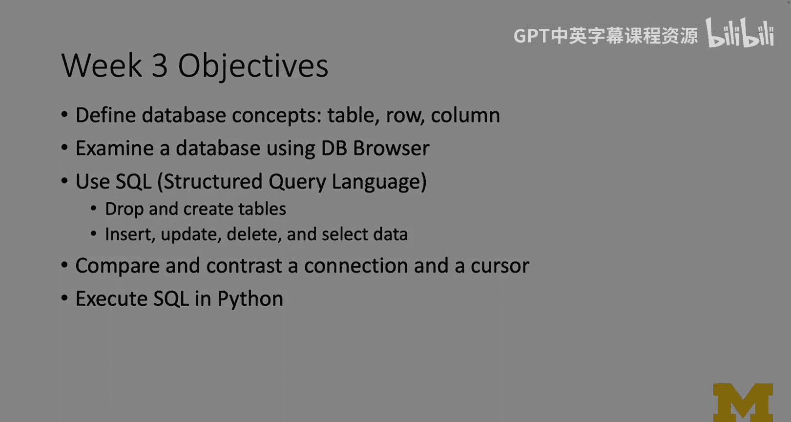
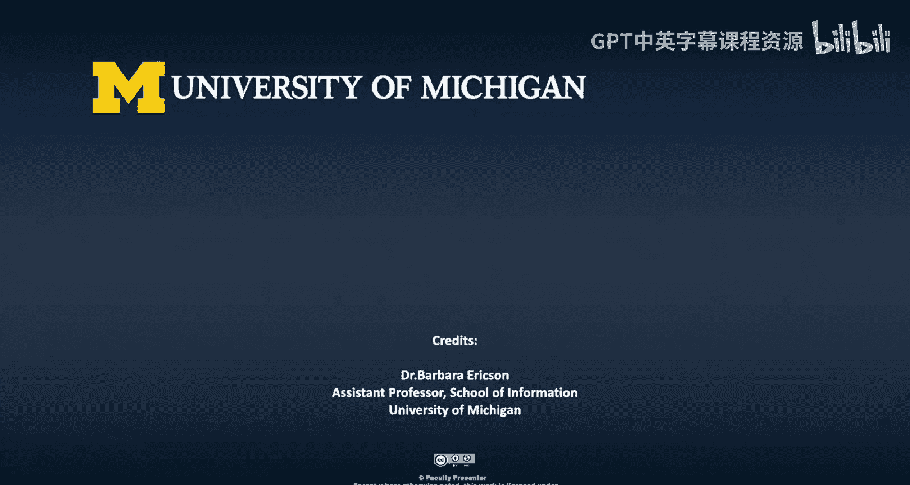

# 创造性编程：第三周：数据库与SQL入门 🗄️

在本节课中，我们将开始学习数据库。数据库是大多数商业应用的核心，我们将了解其基本概念，学习如何使用SQL语言操作数据，并最终掌握如何在Python程序中连接和操作数据库。

## 数据库核心概念 📊

上一节我们开启了第三周的学习，本节中我们来看看数据库的基础构成。数据库用于存储和管理大量结构化数据。其核心概念包括表、行和列。

*   **表**：数据存储的基本单位，类似于Excel中的一个工作表。
*   **行**：表中的一条记录，代表一个独立的数据实体。
*   **列/属性**：表中的字段，定义了记录所包含的数据类型，如“姓名”、“年龄”。

## 使用SQL操作数据库 🔍

了解了数据库的基本结构后，本节我们将学习如何与数据库交互。我们将使用DB Browser工具来查看数据库，并执行SQL语句。SQL是“结构化查询语言”的缩写，是与关系型数据库交互的标准方式。

以下是SQL中最核心的几种操作：

*   **创建与删除表**：使用 `CREATE TABLE` 和 `DROP TABLE` 语句。
*   **插入数据**：使用 `INSERT INTO` 语句向表中添加新记录。
*   **更新数据**：使用 `UPDATE` 语句修改表中已有的记录。
*   **删除数据**：使用 `DELETE FROM` 语句移除表中的记录。
*   **查询数据**：使用 `SELECT` 语句从表中检索所需的数据。

## 在Python中连接数据库 🐍

我们已经学会了直接使用SQL操作数据库，现在来看看如何将这些操作集成到Python程序中。这需要使用特定的库来建立连接并执行命令。

在Python中操作数据库主要涉及两个对象：连接和游标。

*   **连接**：代表与数据库服务器的一个会话。通过它建立通信渠道。创建连接的代码通常类似于：`conn = sqlite3.connect('database.db')`。
*   **游标**：类似于一个指针或导航器，用于在连接上执行SQL命令并获取结果。创建游标的代码通常类似于：`cursor = conn.cursor()`。

我们将学习如何创建连接和游标，解释两者之间的区别，并最终在Python环境中执行SQL语句来操作数据库。

---

本节课中我们一起学习了数据库的基础知识，包括表、行、列等核心概念。我们介绍了使用SQL语言进行增删改查操作，并初步探索了如何在Python中通过建立连接和游标来与数据库进行交互。这些是构建数据驱动应用的重要基石。