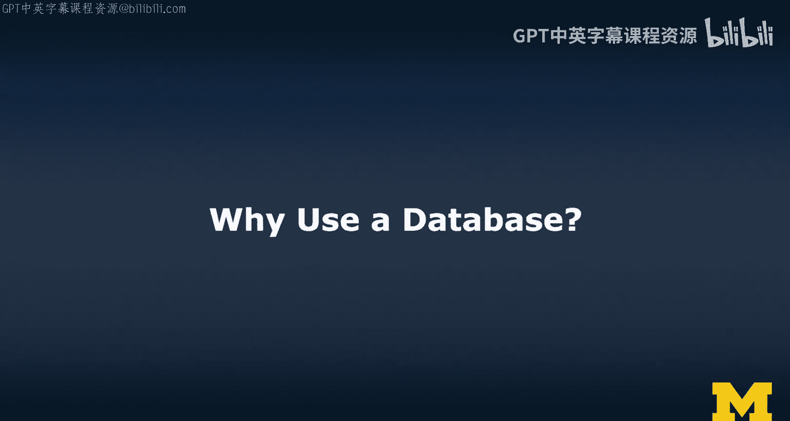
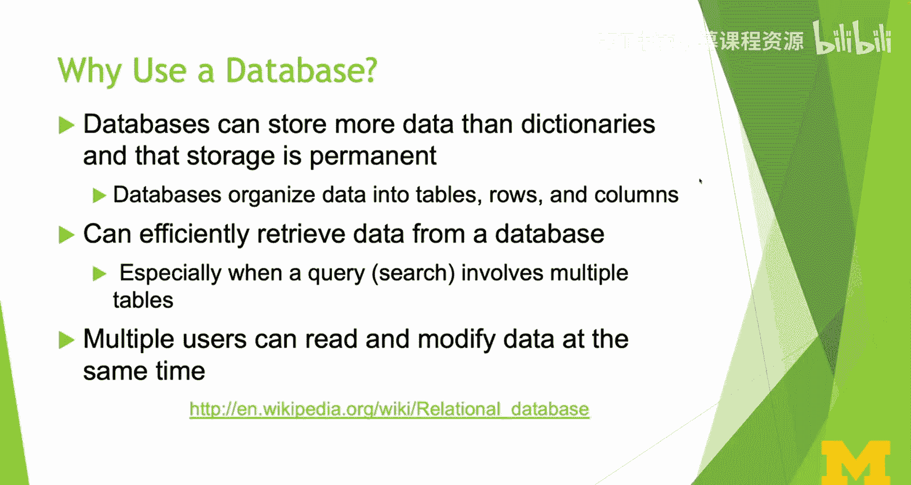

# 创造性编程：34：为何使用数据库




在本节课中，我们将要学习数据库的基本概念，并探讨在编程项目中为何以及何时需要使用数据库。

## 什么是数据库？🤔

上一节我们介绍了数据持久化的重要性，本节中我们来看看数据库的具体定义。你可以将数据库视为一种**文件**，因为它提供了永久存储。这意味着即使你的程序运行结束，数据依然存在。同时，数据库也类似于一个**字典**，因为它能让你通过一个键（key）轻松地查找对应的值（value）。

因此，我们可以将数据库理解为一种功能更强大的字典。它不仅能存储比内存中的字典多得多的数据，而且这种存储是永久性的。

## 数据库的组织结构 📊

理解了数据库的基本概念后，我们来看看它是如何组织数据的。数据库将数据组织成**表**。每个表由行和列组成，类似于电子表格。

以下是数据库表结构的一个简单示例：

```python
# 一个表示“用户”表的简化结构
# 列：id, name, email
# 行：具体的数据记录
users_table = [
    {"id": 1, "name": "Alice", "email": "alice@example.com"},
    {"id": 2, "name": "Bob", "email": "bob@example.com"}
]
```

## 使用数据库的核心优势 ⚡

了解了数据库的结构后，现在我们来探讨使用数据库的几个关键优势。

以下是使用数据库的主要好处：

1.  **高效的数据检索**：给定一个键（如用户ID），我们可以非常高效地从数据库中检索出对应的数据行。这在数据库变得非常庞大时尤为重要。
2.  **强大的关联查询**：数据库允许我们进行跨多个表的搜索和关联查询。现实中的数据通常分散在不同的表中，数据库能高效地处理这种关联。
3.  **并发处理能力**：一个非常关键的理念是，**多个用户可以同时读取和修改数据库中的数据**。例如，当你在网上预订机票或购买衣服时，可能有成千上万的用户也在进行同样的操作。数据库系统就是为处理这种高并发负载而设计的。




## 总结 📝


本节课中我们一起学习了数据库的基础知识。我们了解到数据库是一种提供永久存储的数据组织方式，它结合了文件的持久性和字典的快速查找能力。通过将数据组织成表，并支持高效检索、关联查询和高并发访问，数据库成为处理大量、复杂且需要共享的数据时的理想选择。在后续的课程中，我们将学习如何在实际编程中使用数据库。