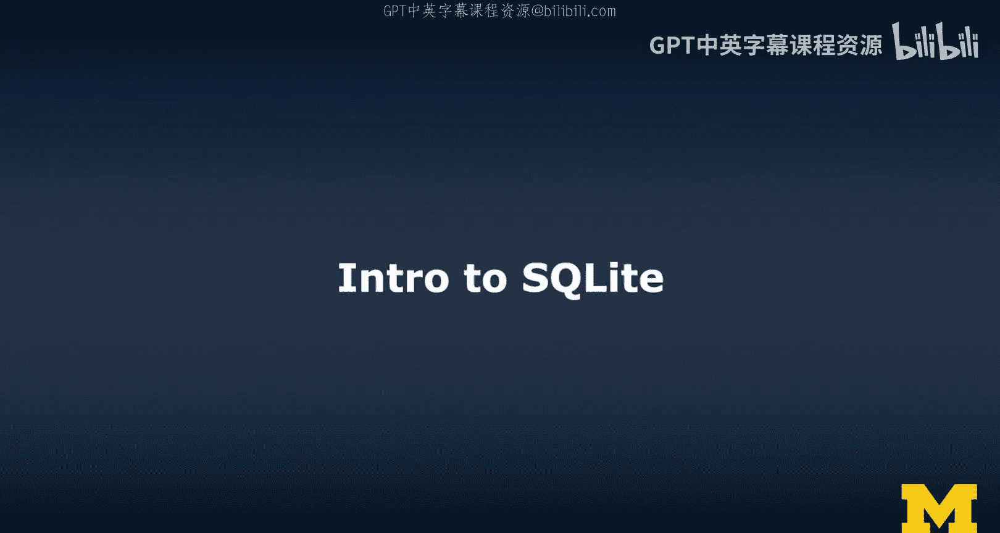
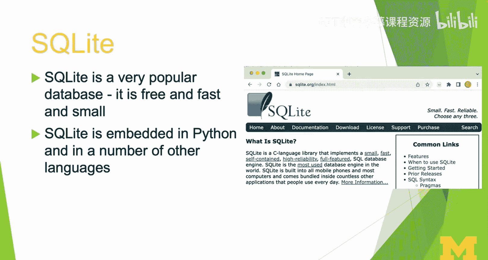

# 创造性编程：35：SQLite入门指南 🗄️

在本节课中，我们将要学习SQLite数据库的基础知识。SQLite是一个免费、快速且小巧的数据库系统，它已经内嵌在Python和许多其他编程语言中。学习使用SQLite将帮助你存储和管理程序中的数据。


## 什么是SQLite？ 🤔

上一节我们介绍了本课程的目标，本节中我们来看看我们将要使用的工具——SQLite。



我们将使用SQLite，这是一个非常流行的数据库，它免费、快速且小巧。这些特性都是你所需要的。它已经内嵌在Python和许多其他语言中。因此，一旦你学会了它，你可以在很多地方使用它。

## 核心概念与连接数据库 🔌

了解了SQLite的基本优点后，接下来我们看看如何开始使用它。使用SQLite的第一步是连接到数据库文件。

在Python中，我们使用 `sqlite3` 模块来操作SQLite数据库。连接数据库的代码如下：

```python
import sqlite3

# 连接到数据库文件（如果不存在则会创建）
connection = sqlite3.connect('my_database.db')
```

这段代码会创建一个名为 `my_database.db` 的数据库文件，并建立与它的连接。

## 基本操作步骤 📝



以下是使用SQLite进行数据操作的基本步骤流程：


1.  **导入模块**：首先需要导入 `sqlite3` 模块。
2.  **建立连接**：使用 `connect()` 函数连接到数据库文件。
3.  **创建游标**：通过连接对象创建一个游标（Cursor），用于执行SQL命令。
4.  **执行SQL语句**：使用游标的 `execute()` 方法来创建表、插入或查询数据。
5.  **提交更改**：对数据库进行修改后（如插入、更新、删除），需要使用 `commit()` 方法保存更改。
6.  **关闭连接**：完成所有操作后，使用 `close()` 方法关闭数据库连接。


## 总结 📚

本节课中我们一起学习了SQLite数据库的入门知识。我们了解到SQLite是一个轻量级、易用的数据库，非常适合初学者和小型项目。我们掌握了使用Python连接SQLite数据库的基本代码和操作步骤，这是进行后续数据存储和管理操作的基础。