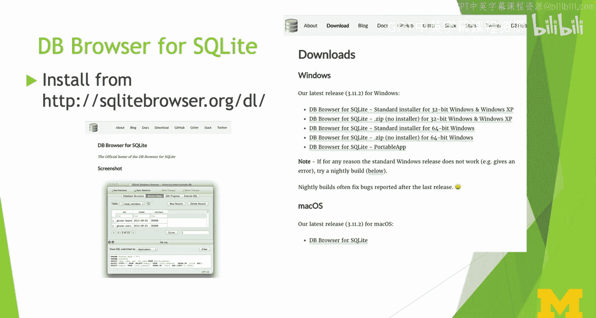

# 创造性编程：36：DB Browser下载教程 🛠️

在本节课中，我们将学习如何下载并安装一个名为“DB Browser for SQLite”的免费图形化工具。这个工具能帮助你更直观地查看和管理数据库，并练习SQL命令。

## 工具介绍与下载步骤

上一节我们介绍了数据库的基本概念，本节中我们来看看如何获取一个实用的数据库管理工具。

我推荐你下载DB Browser for SQLite。这是一个免费工具，它提供了一个图形用户界面来操作数据库。使用这个工具可以让你更容易地查看数据库的状态，并练习SQL命令。你可以在其中编写`SELECT`或`CREATE`等语句，执行它们，并观察执行效果。

以下是下载和安装该工具的步骤：
*   访问指定的URL，该链接将直接带你进入下载页面。
*   根据你的操作系统，找到对应的正确版本。
*   下载并安装该软件。

## 工具界面预览

安装完成后，你将看到该工具的界面。接下来，我将在一个练习数据库上向你展示它的具体样子。

---

本节课中我们一起学习了如何下载和安装DB Browser for SQLite。这个图形化工具将帮助我们更轻松地管理和探索数据库，为后续的SQL命令练习打下基础。