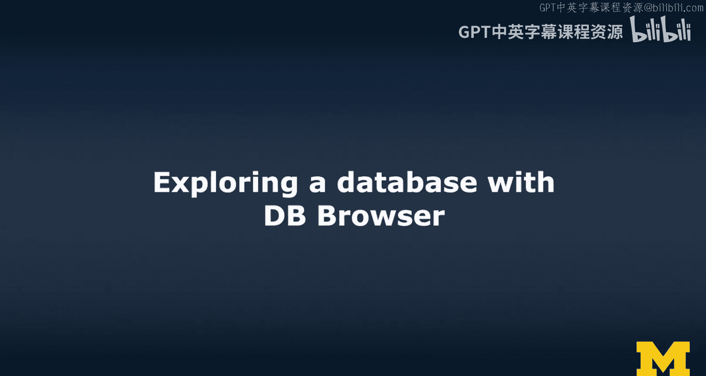
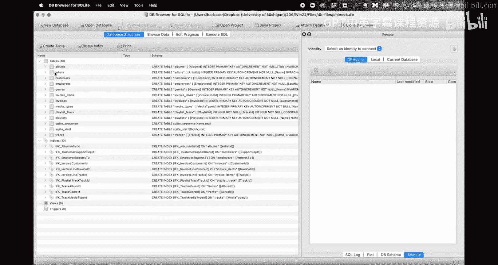

# 37：使用DB Browser探索数据库 🗄️

在本节课中，我们将学习如何使用DB Browser for SQLite工具来打开和探索一个SQLite数据库文件。我们将了解数据库的基本结构，包括表、行和列的概念，以及它们如何与面向对象编程中的类和对象相对应。

---

上一节我们介绍了数据库的基本概念，本节中我们来看看如何使用DB Browser这个图形化工具来实际查看一个数据库。

如果你下载了DB Browser，接下来需要打开`Chinook.db`数据库文件并查看其内容。你可以通过点击“打开数据库”按钮来完成此操作，这将弹出一个导航窗口，你可以用它找到你存放`Chinook.db`文件的位置，然后打开它。

打开后，你将看到数据库的结构。界面上有不同的选项卡。例如，我可以浏览数据，查看不同表中的数据。请记住，在关系型数据库中，数据被分解到不同的表中。你可以将每个表视为一个不同的类，或者代表一个不同的实体或事物类型，这就是为什么我们将其类比为类或分类。

在每个表中，你将看到数据行。我们可以将这些数据行视为该类的对象，用于描述一个特定的事物。以专辑为例，专辑可以有一个ID作为主键以便于查找，但专辑还有标题和创作它的艺术家。请注意，我们这里没有直接存放艺术家姓名，而是存放了一个艺术家ID。一个完全规范化的关系型数据库会有很多表，因为我们不希望有任何重复的数据。

我们也可以看看艺术家表里有什么。例如，对于艺术家ID 1，对应的乐队是AC/DC；艺术家ID 2是Aerosmith。我们将专辑和艺术家信息分开了，在专辑表中存放的是艺术家ID，而不是艺术家姓名。这样，当不同专辑有同一位艺术家时，我们就不会重复存储字符串信息，而只是存储一个ID。这既节省了空间，也提高了效率。

因此，我们将数据库分解为独立的表，每个表代表一个实体或事物。表中的行代表对象，而列则代表该对象的具体数据属性。例如，在员工表中，可能有“名”和“姓”两列，这些就是员工或人员对象的不同属性。

以上是关于如何导航数据库以及一些数据库术语的简要介绍。请查看`Chinook`数据库中的不同表，并通过查看数据库结构来了解所有表。这是一个功能完整的关系型数据库。

---

本节课中我们一起学习了如何使用DB Browser打开和探索SQLite数据库。我们了解了数据库的核心组成部分：**表**（类似于类）、**行**（类似于对象）和**列**（类似于属性）。我们还看到了如何通过使用ID关联不同表来避免数据冗余，这是关系型数据库设计的关键原则。通过图形化工具，我们可以直观地理解数据的组织方式。