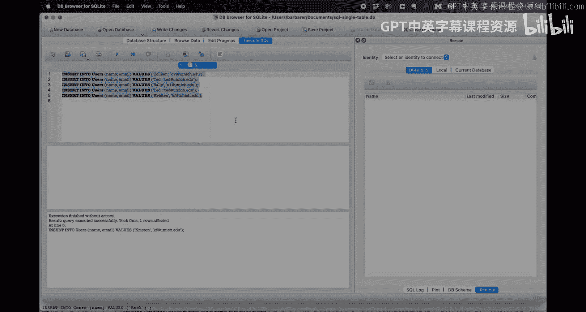

# 创造性编程：38：DB Browser中的SQL基础 🗄️


在本节课中，我们将学习SQL（结构化查询语言）的基础知识。SQL是用于操作数据库的标准语言。我们将学习如何使用`INSERT`命令创建数据，使用`SELECT`命令检索数据，以及如何更新和删除数据。

## 概述

我们将通过一个示例文件来实践SQL命令，并使用DB Browser for SQLite工具来观察这些命令的执行效果。这有助于我们理解如何创建表、插入数据以及处理重复数据等问题。

## 创建数据库与表

首先，我们需要在DB Browser中创建一个新的数据库。以下是具体步骤：

1.  打开DB Browser，选择“新建数据库”。
2.  为数据库命名并保存。
3.  系统可能会提示创建新表，但我们可以直接执行SQL语句来创建。

接下来，我们从示例文件中获取创建表的SQL语句。例如：

```sql
CREATE TABLE users (name TEXT, email TEXT);
```

在DB Browser的“执行SQL”标签页中，粘贴并执行上述语句。执行成功后，你可以在“数据库结构”标签页中看到一个名为`users`的表，它包含`name`和`email`两个文本类型的字段。

## 插入数据

创建表之后，表中还没有任何数据。我们可以使用`INSERT`命令来添加数据。

从示例文件中获取插入数据的SQL语句，例如：

```sql
INSERT INTO users VALUES ('Ted', 'ted@example.com');
```

回到DB Browser的“执行SQL”标签页，执行这条语句。执行后，你可以通过“浏览数据”标签页查看已插入的数据。

## 执行多条SQL语句

你可以一次性执行多条SQL语句。从示例文件中复制剩余的所有`INSERT`语句，粘贴到DB Browser中。

需要注意的是，当执行多条语句时，每条语句必须用分号（`;`）分隔。否则，执行可能会出错。

以下是示例：

```sql
INSERT INTO users VALUES ('Alice', 'alice@example.com');
INSERT INTO users VALUES ('Bob', 'bob@example.com');
INSERT INTO users VALUES ('Ted', 'ted@example.com'); -- 注意：这条数据与之前插入的重复
```

执行这些语句后，系统可能会提示操作成功。但值得注意的是，如果表结构没有设置唯一性约束，数据库是允许插入重复数据的。正如示例中所示，名为“Ted”的记录被插入了两次。

## 总结




本节课我们一起学习了在DB Browser中使用SQL的基础操作。我们实践了如何创建数据库和表，如何使用`INSERT`命令添加数据，以及如何执行多条SQL语句。同时，我们也了解到，在没有约束的情况下，数据库默认允许重复数据的存在。这个工具对于练习创建表、查询数据等操作非常有帮助。