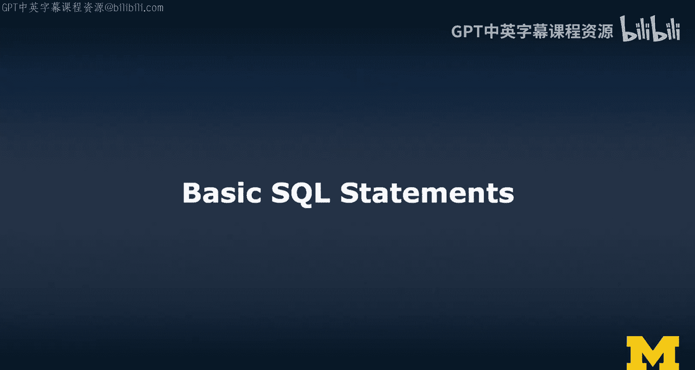
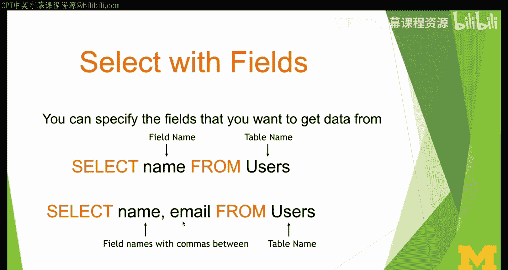

# 39：基础SQL语句 📊


在本节课中，我们将学习一些基础的SQL语句，用于操作数据库。SQL是用于管理和查询关系型数据库的标准语言。掌握这些基础语句是进行数据存储和检索的第一步。



## 创建表

上一节我们介绍了数据库的概念，本节中我们来看看如何创建表来存储数据。使用`CREATE TABLE`语句可以定义一个新表及其结构。

以下是创建表的基本语法：

```sql
CREATE TABLE table_name (
    column1_name column1_type,
    column2_name column2_type,
    ...
);
```

*   `CREATE TABLE`是SQL关键字。
*   `table_name`是你为表起的名字。
*   括号内定义了表的列（字段），包括列名和数据类型（如`TEXT`，类似于Python中的字符串）。

例如，创建一个名为`users`的表，包含`name`和`email`两个文本字段：

```sql
CREATE TABLE users (
    name TEXT,
    email TEXT
);
```

## 插入数据

表创建好后，下一步就是向其中添加数据。我们使用`INSERT INTO`语句来完成这个操作。

以下是插入数据的基本语法：

```sql
INSERT INTO table_name (column1, column2, ...)
VALUES (value1, value2, ...);
```

*   `INSERT INTO`是SQL关键字。
*   指定表名和要插入数据的列名列表。
*   `VALUES`关键字后跟着与列名顺序对应的值列表。

例如，向`users`表插入一条记录：

```sql
INSERT INTO users (name, email)
VALUES ('Alice', 'alice@example.com');
```

## 删除数据

有时我们需要从表中移除数据，这时可以使用`DELETE FROM`语句。

以下是删除数据的基本语法：

```sql
DELETE FROM table_name
WHERE condition;
```

*   `DELETE FROM`是SQL关键字。
*   指定要删除数据的表名。
*   `WHERE`子句是可选的，用于指定删除哪些行的条件。如果不加`WHERE`子句，将删除表中的所有数据。

例如，从`users`表中删除邮箱为`alice@example.com`的用户：

```sql
DELETE FROM users
WHERE email = 'alice@example.com';
```

> **注意**：SQL中使用单个等号`=`进行比较判断，而不是Python中的双等号`==`。

## 更新数据

如果数据需要修改，我们使用`UPDATE`语句来更新表中已有的记录。

以下是更新数据的基本语法：

```sql
UPDATE table_name
SET column1 = value1, column2 = value2, ...
WHERE condition;
```

*   `UPDATE`是SQL关键字。
*   指定要更新的表名。
*   `SET`关键字后指定要修改的列及其新值。
*   `WHERE`子句同样是可选的，用于限定要更新哪些行。

例如，将用户`Alice`的邮箱更新为新地址：

```sql
UPDATE users
SET email = 'alice_new@example.com'
WHERE name = 'Alice';
```

## 查询数据

从数据库中检索数据是最常见的操作，我们使用`SELECT`语句来实现。

以下是查询数据的基本语法：

```sql
SELECT column1, column2, ...
FROM table_name
WHERE condition;
```

*   `SELECT`是SQL关键字。
*   指定要检索的列名，使用星号`*`可以代表所有列。
*   `FROM`指定要从哪个表查询。
*   `WHERE`子句用于过滤结果，只返回满足条件的行。

以下是几个查询示例：

1.  查询`users`表中的所有数据：
    ```sql
    SELECT * FROM users;
    ```

2.  只查询`users`表中的`name`列：
    ```sql
    SELECT name FROM users;
    ```

3.  查询`users`表中名为`Alice`的用户的所有信息：
    ```sql
    SELECT * FROM users
    WHERE name = 'Alice';
    ```



## 总结


本节课中我们一起学习了SQL的五个基础语句：`CREATE TABLE`（创建表）、`INSERT INTO`（插入数据）、`DELETE FROM`（删除数据）、`UPDATE`（更新数据）和`SELECT`（查询数据）。这些是操作关系型数据库的核心命令，通过组合使用它们，你可以有效地管理和利用数据库中的数据。