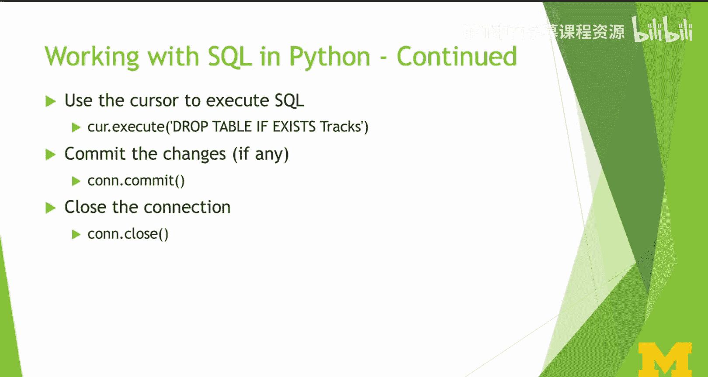

# 40：Python执行SQL语句教程 🐍


在本节课中，我们将学习如何在Python程序中执行SQL语句，与数据库进行交互。我们将介绍建立连接、创建游标、执行SQL命令以及提交更改和关闭连接的基本步骤。

## 建立连接与游标 🔗

上一节我们介绍了SQL的基本概念，本节中我们来看看如何在Python中实际操作数据库。首先，我们需要进行一些必要的设置。

要在Python中使用SQL，必须导入一个知道如何与数据库交互的模块。我们使用`import sqlite3`。

接着，需要创建一个到数据库的连接。通常，数据库可能位于另一台计算机上。本教程中，我们将在同一台计算机上操作，但连接机制同样适用于远程数据库。连接负责处理通信。

我们使用`sqlite3.connect()`函数，并传入数据库名称。该函数返回一个连接对象，我们将其保存起来。示例中我们将其命名为`conn`。

然后，我们创建一个游标对象。可以将游标理解为类似文件句柄的东西。文件句柄知道如何读取文件，而游标知道如何执行SQL命令并处理结果。

我们通过`connection.cursor()`来创建并返回游标对象。示例中我们将其命名为`cr`。

以下是建立连接和创建游标的代码示例：
```python
import sqlite3
conn = sqlite3.connect('my_database.db')
cr = conn.cursor()
```

## 执行SQL命令 ⚙️

在成功建立连接和游标后，就可以实际执行SQL语句了。

使用游标对象的`execute()`方法。你需要在一个字符串中指定要运行的SQL语句。例如，我们可以执行`DROP TABLE IF EXISTS`语句，这是SQL中的关键字，用于在表存在时删除它。后面跟上表名。

如果该表存在，它将被删除。当你已经有一个需要保留的数据库时，通常不希望这样做。但如果你是从文件开始创建一切，可能希望先删除旧表再重新创建。

以下是执行删除表语句的示例：
```python
cr.execute("DROP TABLE IF EXISTS my_table")
```

## 提交更改与关闭连接 💾

执行SQL命令后，如果对数据库进行了修改，就需要提交这些更改。

`SELECT`语句只是获取数据，不会改变数据库中的任何内容，因此不需要提交。但如果你执行了删除数据、更新数据或添加数据的操作，就需要使用连接对象进行提交。

提交使用`connection.commit()`方法。

最后，需要关闭连接。这会释放连接资源，以便其他人可以使用。因为通常许多不同的人会同时使用同一个数据库，所以可能存在多个到它的连接。

以下是提交更改和关闭连接的代码示例：
```python
conn.commit()
conn.close()
```



## 总结 📝


本节课中我们一起学习了使用Python执行SQL语句的基础知识。我们了解了从导入模块、建立数据库连接、创建游标，到执行SQL命令、提交更改，最后关闭连接的完整流程。记住，对于修改数据的操作，提交是关键步骤；操作完成后，及时关闭连接是良好的实践。