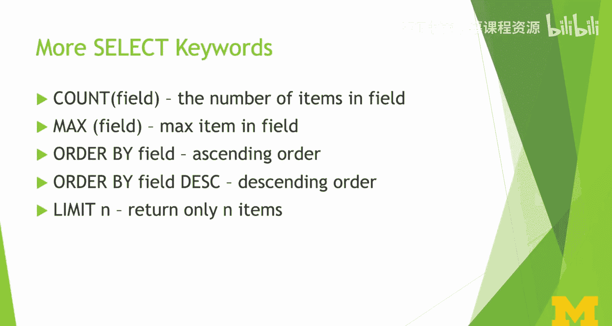

# 创造性编程：41：SELECT进阶关键字

在本节课中，我们将学习SQL `SELECT`语句中几个非常实用的进阶关键字。这些关键字能帮助我们进行数据统计、排序和限制结果数量，从而更高效地从数据库中获取所需信息。

## 聚合函数：COUNT与MAX

上一节我们介绍了基础的`SELECT`查询，本节中我们来看看如何对数据进行聚合计算。SQL提供了聚合函数，可以对一组值进行计算并返回单个值。

以下是两个常用的聚合函数及其用法：

*   **`COUNT`**：此函数用于统计某个字段中非空值的数量。其基本语法为 `COUNT(字段名)`。例如，`COUNT(user_id)` 会返回`user_id`字段中记录的总数。
*   **`MAX`**：此函数用于找出某个字段中的最大值。其基本语法为 `MAX(字段名)`。例如，`MAX(age)` 会返回`age`字段中最大的年龄数值。

## 结果排序：ORDER BY

获取数据后，我们经常需要对其进行排序。`ORDER BY`子句允许我们根据一个或多个字段对结果集进行排序。

以下是`ORDER BY`的两种排序方式：

*   **升序排序**：使用 `ORDER BY 字段名`。默认情况下，排序是升序的（从A到Z，从小到大）。
*   **降序排序**：使用 `ORDER BY 字段名 DESC`。关键字`DESC`表示降序排列（从Z到A，从大到小）。

## 限制结果数量：LIMIT

有时，我们可能只需要查看结果集中的前几条记录，而不是全部数据。这时可以使用`LIMIT`子句。

*   **限制返回条数**：使用 `LIMIT n`。其中`n`是一个数字，例如`5`。此语句将只返回查询结果中的前`n`条记录。

本节课中我们一起学习了SQL `SELECT`语句的几个进阶关键字：用于计数的`COUNT`、用于查找最大值的`MAX`、用于排序的`ORDER BY`（包括升序和降序`DESC`），以及用于限制返回记录数量的`LIMIT`。掌握这些关键字能让你更精准、更高效地查询和分析数据库中的数据。