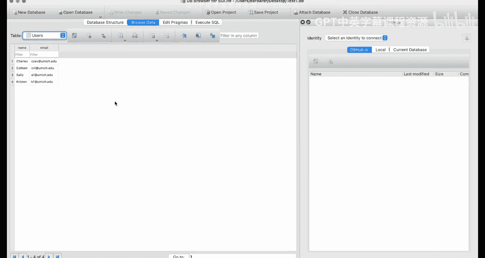
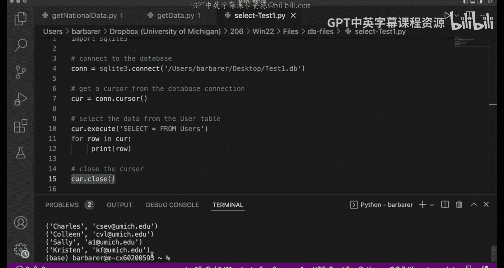

# 42：使用Python查询数据 📊


在本节课中，我们将学习如何使用Python编程语言来连接和查询SQLite数据库。我们将看到如何从数据库中获取数据，并在Python环境中处理和显示这些数据。

---

上一节我们介绍了如何使用SQL命令手动操作数据库。本节中我们来看看如何通过Python代码自动化这一过程。

首先，我们需要确保数据库已经按照讲义中的步骤创建好。具体来说，我们创建了一个名为 `users` 的表，它包含两个文本类型的字段：`name` 和 `email`。我们向表中插入了一些用户数据，随后删除了邮箱为“TEed”的用户，并将邮箱为指定值的用户姓名更新为“Charles”。

在开始编写Python代码之前，我们可以使用DB Browser这样的图形化工具来直观地查看数据库的当前状态。这有助于我们确认数据是否已按预期被修改。

以下是使用DB Browser查看数据的步骤：

*   打开数据库文件。
*   导航到“浏览数据”选项卡。
*   确认 `users` 表中已没有名为“Ted”的记录，并且“Ch”已被更新为“Charles”。

通过这种方式，我们可以清晰地看到数据库中实际存储的内容。

---

现在，让我们转向Python，看看如何通过代码实现同样的数据查询功能。

以下是通过Python连接数据库并查询数据的完整代码示例：



```python
import sqlite3

# 1. 创建到数据库的连接
connection = sqlite3.connect('/users/barbara/desktop/your_database_file.db')

# 2. 创建一个游标对象
cursor = connection.cursor()

# 3. 使用游标执行SQL查询语句
cursor.execute("SELECT * FROM users")

# 4. 遍历查询结果
for row in cursor:
    print(row)

# 5. 关闭游标和连接，释放资源
cursor.close()
connection.close()
```

让我们逐步解析这段代码：

1.  **导入模块**：首先，我们导入Python内置的 `sqlite3` 库，它提供了操作SQLite数据库的所有必要功能。
2.  **建立连接**：使用 `sqlite3.connect()` 函数创建与数据库文件的连接。你需要将路径替换为你自己的数据库文件位置。
3.  **创建游标**：从连接对象创建一个游标。游标是用于执行SQL命令和获取结果的主要工具。
4.  **执行查询**：使用游标的 `.execute()` 方法运行SQL语句。这里我们执行 `SELECT * FROM users` 来获取 `users` 表中的所有行。
5.  **处理结果**：游标对象本身可以被迭代。在 `for` 循环中，每次迭代会获取结果集中的下一行数据（以元组形式），然后我们将其打印出来。
6.  **关闭资源**：操作完成后，关闭游标和数据库连接是一个好习惯，这可以释放系统资源。

运行这段代码后，你将在Python控制台中看到与DB Browser中完全一致的数据列表。这验证了我们的Python代码成功地与数据库进行了交互并获取了数据。




---


本节课中我们一起学习了如何使用Python的 `sqlite3` 模块来连接SQLite数据库、执行SQL查询语句以及遍历和处理返回的结果。通过将数据库操作集成到Python脚本中，我们可以更灵活、自动化地管理和分析数据，这是将创意编程与数据持久化存储相结合的关键一步。