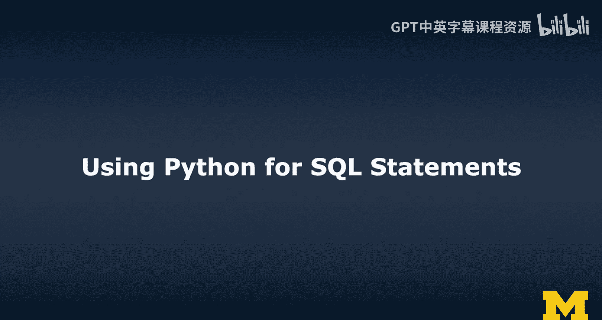
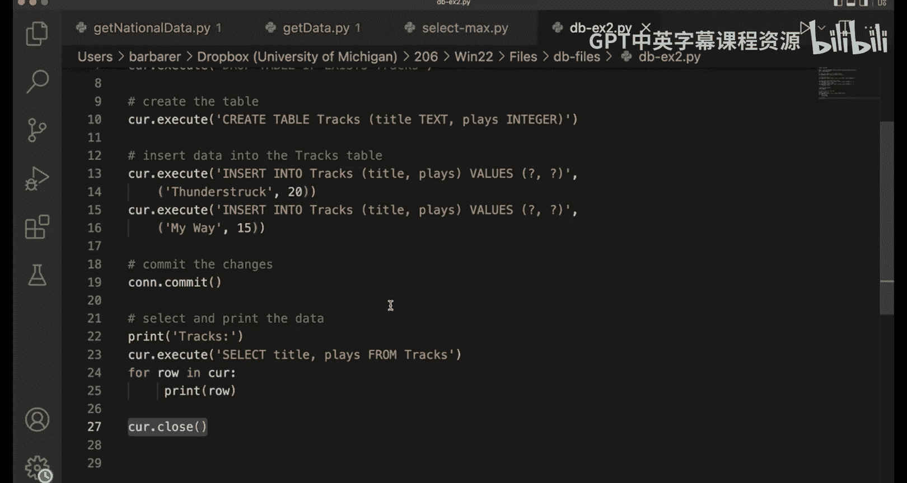

# 43：Python实现SQL操作 🐍💾




在本节课中，我们将学习如何使用Python来执行SQL数据库操作。我们将涵盖建立连接、创建表、插入数据以及查询数据等核心步骤，并介绍如何安全地执行这些操作。

---

上一节我们介绍了数据库的基本概念，本节中我们来看看如何在Python中具体执行SQL语句。我们将使用Python内置的`sqlite3`模块来操作一个SQLite数据库。

首先，我们需要导入必要的模块并建立与数据库的连接。如果指定的数据库文件不存在，系统会自动创建它。

```python
import sqlite3

# 建立数据库连接。如果‘mydatabase.db’文件不存在，它将被创建。
conn = sqlite3.connect('mydatabase.db')
```

连接建立后，我们需要创建一个游标对象。游标是执行SQL命令和获取结果的主要接口。

```python
# 从连接创建游标
cur = conn.cursor()
```

有了游标，我们就可以开始执行SQL语句了。以下是一个完整的操作示例，它展示了从创建表到查询数据的全过程。

以下是使用游标执行SQL语句的步骤：

1.  **删除已存在的表（可选）**：如果你想重新开始，可以先删除可能已存在的表。
    ```python
    cur.execute('DROP TABLE IF EXISTS tracks')
    ```

2.  **创建新表**：定义一个具有特定字段的新表。
    ```python
    cur.execute('''
        CREATE TABLE tracks (
            title TEXT,
            plays INTEGER
        )
    ''')
    ```

3.  **插入数据**：向表中插入数据。这里使用参数化查询（`?`占位符）来防止SQL注入攻击，这是一种安全的最佳实践。
    ```python
    cur.execute('INSERT INTO tracks (title, plays) VALUES (?, ?)', ('My Song', 100))
    ```

4.  **提交更改**：对数据库的修改（如插入、更新、删除）必须提交才会永久保存。
    ```python
    conn.commit()
    ```

5.  **查询数据**：执行SELECT语句来检索数据。游标本身可以作为一个迭代器来遍历结果。
    ```python
    cur.execute('SELECT title, plays FROM tracks')
    for row in cur:
        print(row)
    ```

6.  **关闭连接**：所有操作完成后，应关闭游标和数据库连接以释放资源。
    ```python
    cur.close()
    conn.close()
    ```




---


本节课中我们一起学习了如何使用Python的`sqlite3`模块执行基本的SQL操作。关键步骤包括：建立连接、创建游标、执行SQL语句（特别是使用参数化查询以确保安全）、提交事务以及最后关闭连接。通过将Python与SQL结合，你可以灵活地以编程方式管理和操作数据。